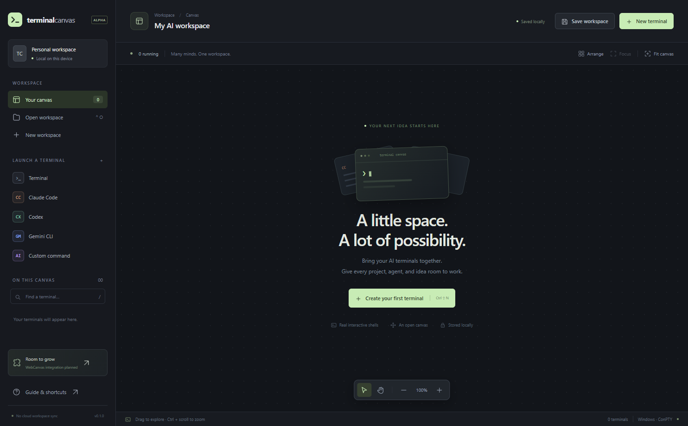
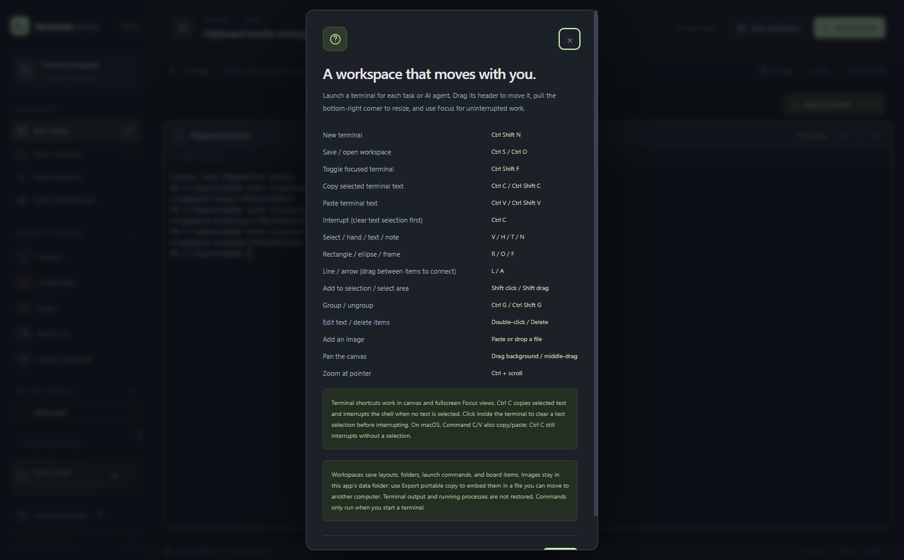

# Terminal Canvas

A desktop canvas for managing multiple AI terminals. Keep a shell, Claude Code, Codex, Gemini CLI, or your own command in separate movable cards, each with its own project folder.

This initial implementation shares Electron with the neighboring WebCanvas project. WebCanvas integration is planned; it is not included yet.



## Run locally

Use Node.js 22.12+ and npm. Windows 10 1809+ or Windows 11 is the primary target. The standard Windows setup uses the node-pty binary included in the dependency when it passes a real terminal check inside Electron.

```powershell
npm install
npm run rebuild
npm start
```

`npm install` needs access to the npm registry and Electron downloads. `npm run rebuild` verifies node-pty inside Electron on Windows and compiles it from source only if the existing binary fails. Other platforms compile from source. Rerun it after changing Electron or native dependencies. AI CLIs must already be installed, available on your `PATH`, and authenticated; Terminal Canvas does not install or sign in to them.

A dependency lockfile is included. Use `npm ci` instead of `npm install` for an exact install from that lockfile.

### Source-build troubleshooting

To force compilation, run `npm run rebuild -- --from-source`. Windows source builds require Python and Visual Studio Build Tools with Desktop development with C++, a Windows SDK, and MSVC Spectre-mitigated libraries matching the compiler toolset and target architecture. If you see `MSB8040: Spectre-mitigated libraries are required`, open **Visual Studio Installer → Modify → Individual components**, install those matching libraries, then retry the source build. The default Windows rebuild can use the verified bundled binary without these compiler components.

`npm run build` also invokes native compilation through electron-builder, so packaging currently requires the source-build prerequisites.

For a dependency-free **layout preview**, run `npm run dev` and visit [localhost:4174](http://127.0.0.1:4174). The preview supports card layout and browser-local recovery; it cannot launch shells, choose native folders, or open/save workspace files. It does not simulate AI output.

## Use the workspace

- Choose **New terminal** or a sidebar profile. Set a name, project folder, and optional shell command, then start it.
- Drag a card's header to move it; drag its lower-right corner to resize. Drag empty canvas or middle-drag to pan. Use Ctrl + scroll to zoom.
- Use **Arrange**, **Fit canvas**, and **Focus** to organize your terminals. Filter the sidebar to find a terminal by name, profile, or folder.
- Use the bottom-right **minimap** to locate terminals and see the current view. Click to recenter or drag the view rectangle to pan; with the minimap focused, use arrow keys (Shift for larger steps). Toggle it from the canvas toolbar. It hides when the canvas is empty or in Focus mode.
- Use the card's stop/start controls to end or relaunch its shell. Closing a running card asks before stopping it.
- Click a terminal hyperlink to open its HTTP/HTTPS destination directly in your default browser. Unsupported schemes and URLs containing credentials are blocked. Plain-text URL detection is not included.
- In a terminal, **Ctrl + C copies selected text**; with no text selected, it sends the shell interrupt. Click inside the terminal to clear a text selection before interrupting. **Ctrl + V pastes** clipboard text. Ctrl + Shift + C/V also copy/paste; explicit copy with no selection leaves the clipboard intact. These shortcuts work in both canvas and fullscreen **Focus** views and leave text fields and canvas shortcuts alone.

On macOS, Command + C/V also copy/paste; Ctrl + C still interrupts when no text is selected. Windows desktop behavior is tested with real native key events, clipboard IPC, and PowerShell. macOS aliases have automated handler coverage, but macOS and Linux desktop behavior has not been validated. Clipboard shortcuts require the desktop app; the browser layout preview does not provide clipboard IPC.

Paste accepts plain text up to 64,000 characters and uses xterm to normalize line endings and respect bracketed-paste mode. The shell or running program must enable bracketed paste; without it, pasted newlines can execute commands immediately. Oversized text and OS clipboard failures appear as a notification. Copying an empty selection does not erase existing clipboard text.



### Board items

The left canvas toolbar adds items around your terminals. Click to place an item at its default size, or drag to draw it; the tool then returns to Select.

- **Text label** and **sticky note** open for typing immediately. Double-click a label, note, or shape to edit its plain text; press Esc or Ctrl + Enter, or click elsewhere, to finish. An empty text label is removed.
- **Rectangle** and **ellipse** shapes can hold centered text.
- **Line** and **arrow** draw free-standing lines. Start or end a line on any terminal or item to attach it as a connector; attached ends follow the item when it moves. Select a line to drag its end handles and reattach them. Deleting an attached item leaves the line in place with a free end.
- **Frame** draws a titled section. Drag it by its title, which you can double-click to rename. Everything fully inside a frame, including terminals, moves with it. Its empty area still pans the canvas.
- **Image** opens a file picker. You can also paste an image or drop image files onto the canvas. PNG, JPEG, GIF, and WebP files up to 15 MB are supported.
- Shift + click adds or removes elements from the selection; Shift + drag on empty canvas selects every element fully inside the rectangle. Drag any selected element to move the whole selection. Click empty canvas to clear the selection.
- **Ctrl + G** groups the selection so it selects and moves as one unit; **Ctrl + Shift + G** ungroups. Groups can include terminals.
- **Delete** or **Backspace** removes selected board items. Terminals are only removed with their close button, which stops running shells safely.

Board items use one fixed visual style; colors, fonts, and stroke styles are not configurable yet. Undo, copy/paste of items, and nested groups are not implemented.

On Windows, cards open the built-in Windows PowerShell (`powershell.exe`) by default. Optional launch commands run inside PowerShell, except the plain shell launchers described below. Use `pwsh` as the launch command for PowerShell 7 if installed, or `cmd.exe` for Command Prompt. Other systems use the login shell selected by `SHELL`, falling back to Bash; those platforms have not been validated.

### Live terminal folders

A running card shows its shell's last reported current folder, including changes made with `cd`, `Set-Location`, or directory-stack commands. The full path is available on hover. Each terminal tracks its own folder. The configured project folder is still used for every restart and saved workspace; live directory reports are never persisted.

- **Windows PowerShell 5.1** (default) and **PowerShell 7**: a session-local prompt wrapper emits an encoded file URI after commands finish. Profiles and the existing prompt load normally; no profile file is edited. For PowerShell 7, set the launch command to exactly `pwsh` or `pwsh.exe`. Plain `powershell` / `powershell.exe` launchers also receive integration.
- **Command Prompt**: set the launch command to exactly `cmd` or `cmd.exe`. Its process-local `PROMPT` includes a directory report while preserving the existing visible prompt. These plain Windows shell launchers now start directly, so exiting them ends the terminal session.
- **Linux / macOS**: the managed login shell's process directory is queried about once per second, using `/proc/<pid>/cwd` on Linux and `/usr/sbin/lsof` on macOS. This works with native shells such as Bash and Zsh without modifying their startup files. Permission failures or a missing `lsof` report an unavailable directory. These platform adapters have automated coverage but have not been tested on a Linux or macOS desktop.

Before the first report, after a failed lookup, or in a PowerShell non-filesystem location (such as `HKCU:`), the running card shows **Current directory unavailable**. Stopped/restored cards initially show their configured launch folder. Windows updates occur when the prompt returns; a long-running command can leave the last reported folder visible until then. Replacing the PowerShell prompt or cmd `PROMPT` after startup can disable reporting. Nested/remote shells, WSL launched inside Windows, shell launch commands with extra arguments, and applications that maintain their own logical directory are not automatically integrated; Unix polling continues to describe the managed top-level shell. Reports are display metadata, never input or instructions to change a process directory.


| Shortcut | Action |
| --- | --- |
| Ctrl + Shift + N | New terminal |
| Ctrl + S / Ctrl + O | Save / open workspace |
| Ctrl + Shift + F | Toggle focus for the selected terminal |
| Ctrl + C in a terminal | Copy selected text, or interrupt with no selection |
| Ctrl + V / Ctrl + Shift + V in a terminal | Paste clipboard text |
| Ctrl + Shift + C in a terminal | Copy selected text; no selection leaves clipboard intact |
| / outside a terminal or input | Search terminals |
| V / H | Select / hand tool |
| T / N / R / O / L / A / F | Text, sticky note, rectangle, ellipse, line, arrow, frame tool |
| Esc | Return to the Select tool, then clear the selection |
| Ctrl + G / Ctrl + Shift + G | Group / ungroup the selection |
| Delete / Backspace | Delete selected board items |

Single-key and board shortcuts apply only when focus is outside a terminal or text field, so they never reach a running shell.

## Persistence and process lifecycle

Layouts autosave to Electron's user-data directory, normally `%APPDATA%/terminal-canvas/workspace.terminalcanvas` on Windows. **Save workspace** exports a portable `.terminalcanvas` JSON file. A workspace contains names, geometry, profile IDs, project paths, launch commands, and board items with their text, groups, and connectors. It does not save terminal output, credentials, or process IDs. Keep secrets out of launch commands because those commands are saved in plain text.

Images are copied into `%APPDATA%/terminal-canvas/assets/` under a SHA-256 content name; workspace files store only that name, so a regular saved workspace opened on another computer shows *Image unavailable*. Choose **Export portable copy** in the sidebar to write a separate file with every referenced image embedded. Opening that file copies the images back into the local assets folder, re-hashing each one; the file must be smaller than 64 MB. Image bytes are validated by signature, never by file name, and SVG is not accepted. Unused images are not deleted from the assets folder yet.

Workspace files from version 0.1 (format version 1) open unchanged and are saved as format version 2.

Restored cards are stopped until explicitly started. A saved command is never executed merely by importing a workspace. Closing the app stops its managed terminals; running processes cannot survive an app restart. A maximum of 24 cards, 1,000 board items, and 5,000 scrollback lines per terminal bounds the workspace.

## Development and validation

| Command | Purpose |
| --- | --- |
| `npm start` | Launch the Electron desktop app |
| `npm run dev` | Serve the layout preview on loopback port 4174 |
| `npm run rebuild` | Verify the Windows native binary in Electron, or rebuild when needed |
| `npm run icons` | Regenerate native PNG/ICO icons from `src/assets/logo.svg` using Electron |
| `npm run check` | Check JavaScript syntax and the package manifest |
| `npm test` | Run icon, workspace, board geometry, image asset, minimap, directory-tracking, external-link, terminal-manager, rebuild, renderer, clipboard IPC, and smoke-output/capture tests (no npm test framework; Windows prompt checks invoke built-in PowerShell and optionally PowerShell 7) |
| `npm run test:smoke` | Check native terminal copy/paste, multiline/bracketed paste, process interruption, outside text-field shortcuts, the desktop renderer, native hyperlink clicks without confirmation (with the OS launch intercepted), minimap navigation, live shell directory changes, first-click terminal typing, board items (image loading, connector hit testing, note typing, grouping), real PTY output, resize, and cleanup; save `.cache/smoke-links.png`, `.cache/smoke.png`, `.cache/smoke-first-click.png`, and `.cache/smoke-board.png`, `.cache/smoke-clipboard.png`, and `.cache/cwd smoke/*.png` |
| `npm run build` | Package an unsigned Windows portable executable in `release/` |

Terminal-manager tests use a controlled PTY substitute; the smoke test requires installed desktop dependencies and checks the real native integration. Screenshot capture retries transient `UnknownVizError` failures up to five times, requesting a repaint and waiting 100 ms between attempts. Persistent failures, unrelated errors, and empty captures still fail the test. Current Windows validation passed syntax checks and all 94 automated tests, including clipboard IPC, restart-race, and renderer regressions. The final combined desktop smoke command passed clipboard fixtures isolated from forced shell output, real process interruption in both views, native GitHub hyperlink clicks, unsafe-scheme rejection, and live shell directory changes. A separate native-click check previously launched the real default browser without confirmation. The board and hyperlink screenshots were visually inspected. In 14 desktop smoke runs on this machine, every run that reached the board checks passed them, but 5 runs failed earlier at the first-click terminal focus assertion. That assertion fails at the same rate on `main` without the board changes (4 of 8 runs), so it is a pre-existing intermittent failure. The native icon comparison against the SVG passed previously. The smoke test still emits a node-pty `AttachConsole failed` message during shutdown despite completing successfully. The default rebuild command passed previously; forced source compilation is blocked on this machine by missing MSVC Spectre-mitigated libraries. The working-directory hotfix also passed real Windows PowerShell 5.1, PowerShell 7, and cmd directory checks (spaces, Unicode and reserved characters, independent terminals, failed directory changes, unavailable provider locations, and normal output) plus the full desktop smoke test. Follow-up regression checks cover strict-mode prompts with an absent or existing native exit code in both PowerShell versions, and local-machine/localhost UNC URI decoding. Packaging was attempted and failed with `MSB8040: Spectre-mitigated libraries are required for this project`; the required MSVC libraries remain missing. Linux and macOS desktop validation remains unavailable.

The clipboard bridge awaits Electron 45 asynchronous reads/writes before returning IPC results and enforcing text limits. Pending paste is tied to the originating process generation, so a terminal restart discards stale clipboard responses. Clipboard smoke fixtures are isolated from live shell repaints; real process interruption is checked separately in each view. Native text-field checks use Command on macOS and Control elsewhere.

Source lives in `src/`, scripts in `scripts/`, tests in `tests/`, and design notes in [docs/architecture.md](docs/architecture.md). `AGENTS.md` is preserved as requested; this README records the tooling added since that guide was created.

The sidebar, browser favicon, desktop window, and Windows executable use the same logo. After editing `src/assets/logo.svg`, run `npm run icons` and include the updated `icon.png` and `icon.ico` assets. Run `npm run icons -- --check` to verify they match the SVG. Restart the desktop app to see a new window icon; rebuild the portable executable to update its file icon.
