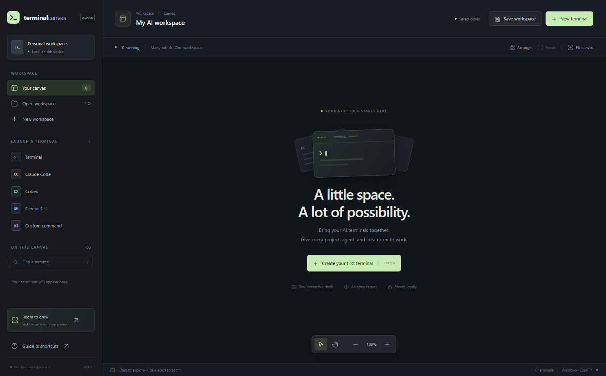
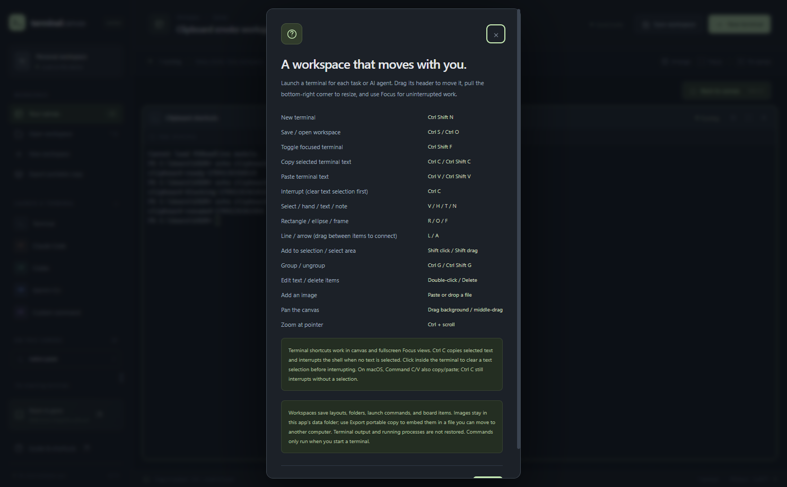

# Terminal Canvas

A desktop canvas for managing multiple AI terminals, hosted by Tauri 2 and Rust with xterm.js.
Keep independent shells, Claude Code, Codex, Gemini CLI, and custom commands in movable cards.
WebCanvas integration remains planned.



## Run locally

Use Rust 1.95 (pinned by `rust-toolchain.toml`) and Node.js 22.12+ for development tools.
Nothing in the shipped application requires Node, Electron, or node-pty.

Platform requirements:

- Windows 10 1809+ or Windows 11: MSVC Build Tools with a Windows SDK and C++20 support, plus the
  WebView2 Runtime. MSVC Spectre-mitigated libraries are not needed.
- macOS: Xcode Command Line Tools.
- Ubuntu/Debian: a C++20 compiler and `libwebkit2gtk-4.1-dev`, `libappindicator3-dev`,
  `librsvg2-dev`, and `patchelf`.

```sh
npm ci
cargo build -p tc-hook
cargo run -p terminal-canvas
```

`npm start` also launches the Rust application. Build the hook before the first launch so shell
integration can capture sessions. `build.rs` copies the pinned xterm files from `node_modules`
into ignored `src/vendor/`; if dependencies are missing, it asks you to run `npm ci`.
No Tauri CLI or browser preview server is needed for the development loop. AI tools must already
be installed on PATH and authenticated; Terminal Canvas does not install or sign in to them.

The browser-only layout preview has been retired. A normal launch uses the same `terminal-canvas`
configuration folder as the Electron build, preserving its autosave and content-addressed images.
For an isolated test workspace, build/run with `--features e2e`; it always uses a test profile,
even without command-line flags. Release builds reject the `e2e` feature.

## Use the workspace

- Choose **New terminal** or a sidebar profile. Set a name, project folder, and optional shell command, then start it.
- Right-click empty canvas space for **New terminal here** and choose a profile. The usual launch form opens; after you press Start, the card appears where you right-clicked, at any zoom. **Find terminal…** opens the searchable terminal switcher; choosing a result highlights and brings the terminal into view. With the canvas focused, the Menu key or Shift + F10 opens the menu at the last background pointer position (or the center of the view). Use Up/Down, Home/End, and Enter to choose; Escape closes it. Clicking elsewhere, scrolling, zooming, or leaving the window also closes it. Right-clicks on terminals, board items, and canvas controls keep their existing behavior.
- Drag a card's header to move it; drag its lower-right corner to resize. Drag empty canvas or middle-drag to pan.
- Scroll or two-finger scroll over empty space to zoom the canvas at the pointer. Plain scrolling over terminals, board items, the minimap, and controls keeps its usual behavior. Horizontal-only scrolling and plain scrolling in Focus view do not zoom. A gesture stays with its starting area until you pause, so crossing a terminal does not change zooming into terminal scrolling. Ctrl + scroll (Command on macOS) also zooms the canvas elsewhere; over the selected terminal, it changes that terminal's text size instead.
- Hold Ctrl (Command on macOS) and scroll over the selected terminal to make its text larger or smaller. In **Focus** view this works anywhere. Each wheel notch changes the size by one pixel, from 8 to 32 (the default is 12), and the running program gets the new number of rows and columns. **Ctrl + 0** (Command + 0) in a terminal resets it; Ctrl + − and Ctrl + = still reach the shell. Each terminal keeps its own size, saved with the workspace. **Duplicate** copies it; other new terminals start at the default. Over a terminal that is not selected or has not started, Ctrl + scroll still zooms the canvas.
- Use **Arrange**, **Fit canvas**, and **Focus** to organize your terminals. Filter the sidebar to find a terminal by name, profile, or folder.
- Select a terminal and use the canvas style bar to color its frame/title bar. The same seven colors work across terminals and board items; **Default color** restores the original look. Profile badges keep identifying the terminal's tool. Card colors also appear in the sidebar and minimap.
- Choose **Default theme** above the canvas for all terminals, or **Theme** in the selected terminal's style bar to override it. **Workspace default** clears an override; **Current** explicitly keeps the original theme. Current, Midnight (dark blue), and Paper (light) include complete ANSI palettes. Changes apply immediately, preserving running shells and scrollback. Themes and colors are saved in the workspace and support undo/redo. Duplicate copies the source card's color and theme override.
- Use the canvas icon in the top toolbar or **Ctrl/Cmd + Shift + B** to hide or show the sidebar, including while typing in a terminal. Click a sidebar section heading to collapse it; its terminal count stays visible. **/** outside text fields and terminals reveals the sidebar search. These choices are remembered on this device, separately from workspace files. Focus mode temporarily hides the sidebar and restores your choice when you return; the toggle or search can reveal it during Focus mode. Small windows keep your manual choice.
- Move between terminals from the keyboard with **Alt + arrow keys**. See [Keyboard navigation](#keyboard-navigation).
- Use the bottom-right **minimap** to locate terminals and see the current view. Click to recenter or drag the view rectangle to pan; with the minimap focused, use arrow keys (Shift for larger steps). Toggle it from the canvas toolbar. It hides when the canvas is empty or in Focus mode.
- Use **Duplicate** in a card header or **Ctrl + Shift + D** to start a fresh plain shell in that terminal's current directory. It gets a separate process and empty output; the source launch command and AI session are not copied. Ctrl + D keeps its normal terminal behavior.
- **Browse** opens at the valid folder displayed in the creation dialog. Invalid or unavailable paths fall back to home, then the app's working directory; canceling preserves the input.
- Use the card's stop/start controls to end or relaunch its shell. Closing a running card asks before stopping it.
- Click a terminal hyperlink to open its HTTP/HTTPS destination directly in your default browser. Unsupported schemes and URLs containing credentials are blocked. Plain-text URL detection is not included.
- Drag to select terminal text at any canvas zoom; dragging a terminal scrollbar thumb while zoomed away from 100% still moves at the wrong speed, so use the mouse wheel there.
- In a terminal, **Ctrl + C copies selected text**; with no text selected, it sends the shell interrupt. Click inside the terminal to clear a text selection before interrupting. **Ctrl + V pastes** clipboard text. Ctrl + Shift + C/V also copy/paste; explicit copy with no selection leaves the clipboard intact. These shortcuts work in both canvas and fullscreen **Focus** views and leave text fields and canvas shortcuts alone.

On macOS, Command + C/V also copy/paste; Ctrl + C still interrupts when no text is selected. Windows behavior is tested with real native key events, clipboard IPC, and PowerShell. On macOS, these shortcuts were checked by hand in the native app. Linux desktop behavior has not been validated.

### Browser access (first phase)

View the live canvas and type into its running terminals from a browser **on the same computer**:

1. Start Terminal Canvas, open **Browser access · Off** at the bottom of the sidebar, and choose a
   port. Leave it at `0` to select an available port, or choose a fixed port from 1 to 65535.
2. Click **Start**. The dialog shows `http://127.0.0.1:<port>` and separate controller/viewer tokens.
   Open that exact URL in a browser and enter the appropriate token. The sidebar keeps showing the
   connected-client count while access is running.
3. Use the controller token to type into running terminals, including paste and terminal interrupts.
   Only one remote controller can connect at once. The desktop can still type; simultaneous input
   reaches the shell in arrival order. Viewer tokens allow additional read-only windows, up to
   eight sessions in total. Use another browser or a private browser profile for a different token;
   tabs in one profile share their login cookie. Each client can switch canvases independently and
   keeps its own focus, selection, pan, and zoom on each canvas. Hidden terminals keep receiving output.
4. Keep workspace editing, terminal start/stop, folder/file dialogs, image import/cleanup, and
   updates in the desktop app. Browser output uses the desktop's PTY dimensions and scrolls when
   necessary. Browser clipboard shortcuts use that browser's permission-controlled clipboard.
5. **Revoke sessions** disconnects every browser without changing the tokens. **Rotate tokens**
   also invalidates both tokens. **Stop access** stops listening and disconnects everyone. Starting
   again generates fresh tokens. Reload a disconnected browser to reconnect or enter a new token.

Browser access is off by default on every launch, including debug, test, and E2E builds. It never
starts from an environment variable, saved setting, command-line argument, or remote request.
Tokens are generated from OS randomness and kept only in memory. Login uses a same-origin POST;
tokens never appear in URLs or browser storage. HttpOnly, SameSite=Strict cookies expire after
12 hours. At most five failed login attempts are allowed per rolling minute, across all browsers.
Stopping or revoking sessions invalidates queued shell input as well as active connections.

This phase binds only IPv4 loopback and checks the exact Host and Origin. It rejects direct
LAN/VPN access and arbitrary file paths, and keeps browser CSP separate from the unchanged desktop
CSP. Terminal output is replayed from a bounded, memory-only buffer collected while browser access
is running (2 MiB across terminals); older output and output before enabling access are unavailable.
Slow clients disconnect and can reload for a fresh snapshot; they never acknowledge or stall the
desktop's PTY output. Replay is a recent output stream, not an exact screen snapshot; full-screen
programs may need a redraw after attachment. Treat controller tokens like access to your shells, and viewer tokens like
access to terminal output and the workspace.

**iPhone/iPad and Tailscale:** direct access at a Tailscale `100.x` address or a LAN address is not
implemented in this phase. Installing Tailscale does not change that: `127.0.0.1` on an iPhone
refers to the phone. Do not publish this HTTP endpoint through a proxy, Tailscale Serve/Funnel,
or port forwarding; exact Host/Origin checks intentionally reject those URLs. A later phase must
add explicit interface selection and TLS (or an explicitly configured encrypted VPN), before
documenting the remote-device setup. QR pairing, touch gestures, a mobile extra-keys bar, and
iPhone/iPad Safari validation remain open under [issue #39](https://github.com/yutigi/TerminalCanvas/issues/39).
This PR does not provide background sessions (#35) or multiple canvases (#30); browsers attach
to the one running desktop canvas, and closing the desktop still stops its terminals.

Paste accepts plain text up to 1 MB (1,048,576 UTF-16 code units), the same limit as copying, and uses xterm to normalize line endings and respect bracketed-paste mode. Long pastes are sent in ordered pieces, and keys pressed afterward, Ctrl + C included, follow the whole paste. The limit keeps that wait bounded when a program reads its input slowly; the card's stop control ends a program that stops reading. The shell or running program must enable bracketed paste; without it, pasted newlines can execute commands immediately. Oversized text and OS clipboard failures appear as a notification. Copying an empty selection does not erase existing clipboard text.



### Multiple canvases

Use the **Canvas** selector in the sidebar to switch boards. The buttons beneath it create,
rename, reorder, or delete a canvas. There is no fixed canvas count limit. Each canvas keeps its
own terminals, items, groups, camera, selection, Focus view, and undo history. The last canvas
cannot be deleted; deleting another always asks for confirmation and stops only its terminals.

Terminals keep running on hidden canvases. Their output is still parsed and acknowledged, with
the same backpressure, directory tracking, and 5,000-line scrollback limit as visible terminals.
Hidden canvases do not fit terminals or paint their board; terminals refit when shown. **New output**,
**Bell**, and **Exited** indicators appear beside a hidden canvas's name and clear when it is shown.

| Shortcut | Canvas action |
| --- | --- |
| Ctrl + Shift + K | Create a canvas |
| Ctrl + Shift + R | Rename the current canvas |
| Ctrl + Shift + PageUp / PageDown | Switch to the previous / next canvas |
| Ctrl + Alt + Shift + PageUp / PageDown | Move the current canvas earlier / later |
| Ctrl + Shift + Delete | Delete the current canvas, after confirmation |

Use Command in place of Ctrl on macOS. These shortcuts also work inside terminals. Finish a
drag, image import, terminal creation, or open dialog before changing canvases. Sidebar search,
Arrange, Fit, and Alt + arrow navigation apply to the current canvas. A terminal jump by ID
switches to its canvas first; an agent requesting a terminal beside a hidden parent also switches
to that parent's canvas. Moving terminals between canvases is a follow-up; board items can be
copied and pasted using the existing clipboard controls.

Save, portable export, autosave, and recovery include all canvases and the last active canvas.
Restoring a workspace leaves every terminal stopped. Existing format 1/2/3 single-board files
open as one canvas. Canvas organization uses optional format-3 metadata; an unchanged legacy
workspace retains its original serialized defaults. Older format-3 apps can read the flat items
and terminals, but show them on a single board and discard canvas organization if they save.
The 1,000-item and 64 MB workspace limits still apply across all canvases.

### Board items

The left canvas toolbar adds items around your terminals. Click to place an item at its default size, or drag to draw it; the tool then returns to Select.

- **Text label** and **sticky note** open for typing immediately. Double-click a label, note, or shape to edit its plain text; press Esc or Ctrl + Enter, or click elsewhere, to finish. An empty text label is removed.
- **Rectangle** and **ellipse** shapes can hold centered text.
- **Line** and **arrow** draw free-standing lines. Start or end a line on any terminal or item to attach it as a connector; attached ends follow the item when it moves. Select a line to drag its end handles and reattach them. Deleting an attached item leaves the line in place with a free end.
- **Frame** draws a titled section. Drag it by its title, which you can double-click to rename. Everything fully inside a frame, including terminals, moves with it. Its empty area still pans the canvas.
- **Image** opens a file picker. You can also paste an image or drop image files onto the canvas. PNG, JPEG, GIF, and WebP files up to 15 MB are supported.
- Shift + click adds or removes elements from the selection; Shift + drag on empty canvas selects every element fully inside the rectangle. Drag any selected element to move the whole selection. Click empty canvas to clear the selection.
- **Ctrl + G** groups the selection so it selects and moves as one unit; **Ctrl + Shift + G** ungroups. Groups can include terminals and other groups, up to eight levels deep. Selecting any member selects the outermost group, and ungrouping removes one level at a time.
- The style bar at the top of the canvas appears when the selection includes terminals, text labels, notes, shapes, frames, or lines. Pick one of seven colors or the default look, and a small, medium, large, or extra-large text size for items that hold text. Terminals also offer a theme; their text size uses the terminal controls above. Images have no style options.
- **Ctrl + C**, **Ctrl + X**, **Ctrl + V**, and **Ctrl + D** copy, cut, paste, and duplicate the selected board items, including everything inside a selected frame. Each paste is offset from the last, or lands in the middle of the view if the original is out of sight. Connectors between copied items stay attached; other attached ends become free. Terminals are not copied. Copying also puts the items' text on the system clipboard; if you copy something else afterwards, Ctrl + V pastes that instead.
- **Ctrl + Z** undoes and **Ctrl + Shift + Z** or **Ctrl + Y** redoes board changes: creating, deleting, moving, resizing, and restyling items, editing text, connectors, grouping, and terminal moves, resizes, and Arrange. The canvas toolbar has matching buttons. Undo never creates or closes a terminal, because that would start or stop a process; a connector attached to a terminal you have since closed comes back with a free end. History keeps the last 100 changes and is cleared when you open or start a workspace.
- **Delete** or **Backspace** removes selected board items. Terminals are only removed with their close button, which stops running shells safely.

Line styles and fonts other than the size choices are not configurable.

On Windows, cards open the built-in Windows PowerShell (`powershell.exe`) by default. PowerShell cards start with a `RemoteSigned` execution policy for that shell only, so script shims such as `npm.ps1` run even when the system policy is `Restricted`. Policies set through Group Policy still take precedence, and no system setting is changed. Optional launch commands run inside PowerShell, except the plain shell launchers described below. Use `pwsh` as the launch command for PowerShell 7 if installed, or `cmd.exe` for Command Prompt. Other systems use the login shell selected by `SHELL`, falling back to Bash. macOS has been checked natively; Linux desktop behavior has not been validated.

### Terminals opened by agents

Any AI agent, harness, or script can open a terminal on the canvas, so an agent can hand its work
over to a fresh session or start a helper without you opening the New terminal dialog. Inside a
Terminal Canvas terminal, the new card opens beside that terminal, joined to it by an arrow, and
starts immediately. Programs outside the canvas can ask the running app too; their card opens beside
the card they name with `--parent`, or in view on its own. The caller gets the new card's ID, or why
nothing opened and what to do next, including the folder and command to open by hand, and with
`--log` can read the new terminal's output as it runs. If the app cannot find its `tc-hook` helper,
or cannot prepare a terminal's integration, a notification says so and the terminals still start
without it; a program whose new terminal started that way is told so.

```bash
# Inside a terminal: Bash, zsh, or Git Bash (Claude Code's Bash tool on Windows)
"$TC_HOOK" new-terminal --profile codex --title "Review" --command 'codex "Review this branch"'
```

```powershell
# Inside a terminal: PowerShell
& $env:TC_HOOK new-terminal --title "API tests" --cwd ..\api --command "npm test" --log --json
```

Every terminal, including Command Prompt, has `TC_HOOK`, `TC_LAUNCH_DIR`, and `TC_CARD_ID` set,
except that a terminal started without integration (see above) has only `TC_CARD_ID`. See
[Opening terminals from agents and scripts](docs/agent-launch.md) for options, results, output logs,
an instruction snippet for `AGENTS.md`/`CLAUDE.md`/`GEMINI.md`, sandbox notes, and the security
model. A new terminal does not inherit the requesting agent's sandbox.

### Terminal titles

New terminals use automatic names when you leave the suggested launch name untouched. The initial
name uses the project folder and profile. Once the shell integration captures a Claude or Codex
session, Terminal Canvas reuses that CLI's locally stored session name. It never types `/status`
into your terminal, starts a second agent, or makes an additional model request.

Click a card's title to **Rename terminal**; the title is a keyboard-accessible button too. **Save
name** makes your choice manual immediately. Automatic updates cannot replace it. **Use automatic
title** returns to the project/profile fallback and then follows available session names again.
The header, sidebar search, and minimap share the effective title. Names and modes survive autosave,
Save, portable export/import, and restart; restored terminals stay stopped.

Existing workspace titles remain manual, even when equal to a profile's default. A duplicate gets
a fresh automatic name for its new shell. Program requests with an explicit title remain manual;
requests without a title use automatic naming. Workspace format stays at 3; formats 1 and 2 still
load. Optional `titleMode` and `titleRevision` fields carry naming intent and protect newer host
decisions from stale saves.

Naming reads only dedicated name fields: Codex's `thread_name` in `session_index.jsonl`, matched
by the captured session ID, and Claude's `customTitle` (preferred) or `aiTitle` in that captured
project/session's JSONL metadata. It uses the terminal's launch-time `CODEX_HOME` or
`CLAUDE_CONFIG_DIR`, including a selected Claude account, or their usual home-directory defaults.
No prompts, raw scrollback, credential files, or other sessions' conversation histories are used
as naming context. Nothing is sent to an external service, and this feature adds no token or
subscription cost. Selecting a manual name disables further metadata reads for that card.

Local metadata is checked at most once every five seconds per eligible card, with one background
read at a time. A changed name settles for five seconds; subsequent visible changes are at least
60 seconds apart during that launch. Unchanged context does not churn titles. Reads are bounded
to 64 KiB for Codex and the first/last 64 KiB for Claude. Names are plain text, limited to 100
UTF-16 units without splitting emoji. Missing, malformed, unavailable, or unsupported metadata
keeps the last useful name or initial fallback. CLI versions without these fields, names outside
the bounded windows, Claude project paths longer than 200 encoded characters, and config-home
changes made inside an already running shell can use the fallback; restart a terminal after
changing its config home. No shared history scan or new AI summary is performed. Metadata formats
can change across CLI releases; real installed CLI versions still require manual verification.

The adapters follow the public [Codex session index](https://github.com/openai/codex/blob/main/codex-rs/rollout/src/session_index.rs)
and [Claude SDK metadata reader](https://github.com/anthropics/claude-agent-sdk-python/blob/main/src/claude_agent_sdk/_internal/sessions.py).

### Live terminal folders

A running card shows its shell's last reported current folder, including changes made with `cd`, `Set-Location`, or directory-stack commands. The full path is available on hover. Each terminal tracks its own folder. The last valid folder is saved for reopening and fresh shell starts; AI resumes use the captured session folder. An unavailable live directory leaves the last valid saved folder intact.

- **Windows PowerShell 5.1** (default) and **PowerShell 7**: a session-local prompt wrapper emits an encoded file URI after commands finish. Profiles and the existing prompt load normally; no profile file is edited. For PowerShell 7, set the launch command to exactly `pwsh` or `pwsh.exe`. Plain `powershell` / `powershell.exe` launchers also receive integration.
- **Command Prompt**: set the launch command to exactly `cmd` or `cmd.exe`. Its process-local `PROMPT` includes a directory report while preserving the existing visible prompt. These plain Windows shell launchers now start directly, so exiting them ends the terminal session.
- **Linux / macOS**: the managed login shell's process directory is queried about once per second, using `/proc/<pid>/cwd` on Linux and `/usr/sbin/lsof` on macOS. This works with native shells such as Bash and Zsh without modifying their startup files. Permission failures or a missing `lsof` report an unavailable directory. Polling has been checked natively on macOS with zsh and Bash; on Linux it has run only in the CI Bash drive, not on a desktop.

Before the first report, after a failed lookup, or in a PowerShell non-filesystem location (such as `HKCU:`), the running card shows **Current directory unavailable**. Stopped/restored cards initially show their last saved folder. Windows updates occur when the prompt returns; a long-running command can leave the last reported folder visible until then. Replacing the PowerShell prompt or cmd `PROMPT` after startup can disable reporting. Nested/remote shells, WSL launched inside Windows, shell launch commands with extra arguments, and applications that maintain their own logical directory are not automatically integrated; Unix polling continues to describe the managed top-level shell. Reports are display metadata, never input or instructions to change a process directory.


| Shortcut | Action |
| --- | --- |
| Ctrl + Shift + N | New terminal |
| Ctrl + Shift + D | Duplicate selected terminal into a fresh shell |
| Ctrl + S / Ctrl + O | Save / open workspace |
| Ctrl + Shift + F | Toggle focus for the selected terminal |
| Ctrl + Shift + P / Command + Shift + P | Open the terminal switcher, including while typing in a terminal |
| Ctrl/Cmd + Shift + B | Hide / show sidebar, including inside terminals |
| Alt + arrow keys, outside a terminal | Select the nearest terminal in that direction |
| Enter, outside a terminal | Type in the selected terminal (a stopped one gets its Start button) |
| Ctrl + Shift + E | Leave the terminal you are typing in, keeping it selected |
| Scroll / two-finger scroll over empty canvas | Zoom at the pointer |
| Ctrl + scroll (Command on macOS), outside the selected terminal | Zoom at the pointer outside Focus view |
| Ctrl + scroll over the selected terminal, or in Focus | Change that terminal's text size |
| Ctrl + 0 in a terminal | Reset its text size |
| Ctrl + C in a terminal | Copy selected text, or interrupt with no selection |
| Ctrl + V / Ctrl + Shift + V in a terminal | Paste clipboard text |
| Ctrl + Shift + C in a terminal | Copy selected text; no selection leaves clipboard intact |
| / outside a terminal or input | Reveal sidebar search and search terminals |
| V / H | Select / hand tool |
| T / N / R / O / L / A / F | Text, sticky note, rectangle, ellipse, line, arrow, frame tool |
| Esc | Return to the Select tool, then clear the selection |
| Ctrl + G / Ctrl + Shift + G | Group / ungroup the selection |
| Ctrl + Z / Ctrl + Shift + Z or Ctrl + Y | Undo / redo board changes |
| Ctrl + C / X / V / D | Copy, cut, paste, or duplicate board items |
| Delete / Backspace | Delete selected board items |

Single-key and board shortcuts apply only when focus is outside a terminal or text field, so they never reach a running shell.

### Keyboard navigation

The keyboard is either on the canvas or typing in one terminal. Selecting a terminal from the
keyboard never types in it, and a terminal you type in receives every key except the app's
Ctrl + Shift shortcuts, Alt + arrow keys included, so shells and full-screen programs keep them.

**Find terminal:** press **Ctrl + Shift + P** (**Command + Shift + P** on macOS), or use the search
button beside **ON THIS CANVAS**. The dialog focuses its query. Search by the displayed title,
folder, or profile; words match together without regard to case. An empty query shows all terminals
in sidebar order, initially highlighting the selected terminal. Folder/profile details and stable
card IDs distinguish duplicate titles. Title, folder, creation, and removal updates keep the query
and active terminal where possible; a removed result falls back to its next surviving row.

Use **↑/↓** to choose a result, then **Enter** to reveal and highlight it at the current zoom.
The keyboard stays on the canvas; press **Enter again** to type, or to focus a stopped terminal's
Start/Resume button. In Focus view, confirmation changes the focused terminal and reveals it on
the canvas when Focus ends. **Esc** or the dialog's close button cancels without changing selection
or camera, restoring the previous input/button (or the canvas if it is gone or hidden). Dialog
keystrokes stay out of shells. **Ctrl + P** remains available to terminal programs; **/** still
focuses sidebar search and **Ctrl + Shift + F** still toggles Focus. Search works locally without AI.

- **Alt + ←/→/↑/↓** on the canvas selects the nearest terminal that way. It works from the
  canvas itself, the sidebar, and the toolbars, but not inside a text field. With the minimap
  focused, arrow keys still pan the view.
- **Enter** types in the selected terminal. If the terminal is not running, Enter moves to its
  Start or Resume button instead, so a command never starts without a second Enter.
- **Ctrl + Shift + E** (Command + Shift + E on macOS) leaves the terminal you are typing in and
  selects it on the canvas. Clicking a terminal still types in it straight away.

Which terminal is nearest:

- A terminal is a candidate when its center lies past the current one's center in that direction
  and it either overlaps the current one's span across that direction or lies within 45 degrees of
  it. A terminal one column over but several rows down is reached with the arrow that points down.
- Candidates are ranked by the gap in that direction plus twice the sideways gap. Overlapping or
  oversized cards have no gap, so a card partly under another is still reachable. Ties go to the
  candidate whose center is closest to the line of travel, then the nearer one, then the one
  nearest the top left, then the lower terminal ID. The same layout always gives the same answer.
- Navigation starts from the selected element. A selected group starts from the element you
  selected in it, and a selected note, shape, or other item starts from that item. Reaching a
  grouped terminal selects its group, as clicking it does, and highlights that terminal.
- With nothing selected, any arrow selects the terminal nearest the middle of the view. With no
  terminals on the canvas, a notification says so. When no terminal lies that way, the selection
  stays and the selected terminal is brought back into view.

The selected terminal gets a bright outline while the canvas has the keyboard. The canvas pans as
little as needed to show it clear of the toolbars and keeps its zoom; a terminal larger than the
view is aligned by its top-left corner so its header shows. In **Focus** view, Alt + arrow keys
switch the focused terminal using the canvas layout, and the canvas is panned so the terminal is
in view when you return.

### Directory tracking and fallback

Windows PowerShell and PowerShell 7 report their FileSystem location at each prompt, including after `cd`, `Set-Location`, and `Push-Location`. Duplicate uses the same directory reports as the live folder display and requires an idle shell. The session wraps the existing `PSConsoleHostReadLine` function, preserving its reader and key bindings, to clear readiness before each accepted line executes. This also covers pasted commands buffered inside PSReadLine, which a console key-queue check cannot detect. The final idle prompt restores duplication. Missing or subsequently replaced readers require folder review. Custom prompt output, `$?`, strict mode, and native exit status are preserved.

While a command/AI CLI or nested shell is running, before the first prompt, in a non-filesystem provider such as `HKCU:`, or when the console cannot confirm idle input, Duplicate opens the New terminal dialog with an explanation and the first available folder: the source last saved directory, home, then the app's working directory. Review or browse before starting. Deleted/inaccessible directories and stopped cards follow the same flow. Command Prompt updates its live folder label but cannot confirm idle input, so Duplicate uses the review dialog there as well.

On Linux and macOS, Duplicate queries the managed shell's process directory afresh rather than reusing the display's polling cache (`/proc/<pid>/cwd` on Linux, `/usr/sbin/lsof` on macOS). A missing tool or failed lookup opens fallback review. Native macOS duplication/polling and the Linux controlled Bash drive passed; Linux desktop behavior remains unverified. Directories belonging to independently launched child shells are not tracked; native folder-picker behavior outside Windows remains unvalidated.

## Persistence and process lifecycle

Layouts autosave to `workspace.terminalcanvas` in the app's data folder: `%APPDATA%/terminal-canvas/` on Windows, `~/Library/Application Support/terminal-canvas/` on macOS, and `~/.config/terminal-canvas/` on Linux. It is the same folder the Electron build used. **Save workspace** exports a portable `.terminalcanvas` JSON file. A workspace contains names, geometry, profile IDs, project paths, launch commands, terminal text sizes, optional AI session metadata (provider, UUID, and session folder), and board items with their text, colors, text sizes, groups, and connectors. It does not save terminal output, credentials, or process IDs. Keep secrets out of launch commands because those commands are saved in plain text. Session IDs identify local conversation history; they do not transfer that history or authentication to another computer.

Images are copied into `%APPDATA%/terminal-canvas/assets/` under a SHA-256 content name; workspace files store only that name, so a regular saved workspace opened on another computer shows *Image unavailable*. Choose **Export portable copy** in the sidebar to write a separate file with every referenced image embedded. Opening that file copies the images back into the local assets folder, re-hashing each one; the file must be smaller than 64 MB. Image bytes are validated by signature, never by file name, and SVG is not accepted.

Images stay in the assets folder after you remove them from the board. Choose **Clean up images** in the sidebar to delete the ones that the current workspace, its undo history, and copied items no longer use; it shows how many and how much space first, and asks before deleting. Workspace files you saved earlier that are not portable copies show deleted images as *Image unavailable*, so export portable copies of layouts you want to keep before cleaning up.

Workspace format version 3 stores nested groups, item colors, and text sizes. Files in format 1 (version 0.1) and format 2 open unchanged and are saved as format 3. Earlier versions of Terminal Canvas cannot open format 3 files.

Restored cards are stopped until explicitly started, both on reopening the app and when importing a workspace. Cards with a captured AI session ID offer **Resume session**, which starts a new shell in the session folder and runs `codex resume <UUID>` or `claude --resume <UUID>`. **Start fresh shell** opens a plain shell without running the saved command, retaining the last captured AI ID for a later retry. For a new AI conversation, launch the tool in that shell. Without an ID, **Start terminal** runs the configured launch command. The header also offers a fresh-shell button after a process exits; stop a running shell before using it.

### Keep terminals running

Turn on **Keep running** in the footer, next to the Settings gear (or **Settings → Keep terminals running**), to keep terminals running after you quit. Quitting the app, opening another workspace, or reloading then leaves the terminals you start afterwards running, programs and output included. When their workspace opens again, the cards attach to them automatically; **Start** on such a card attaches too, and **Start fresh shell** replaces the terminal. **Stop** and closing a card end it. Terminals that were already running when you turned the setting on are unchanged until you restart them.

A kept terminal is not told when you switch to another app, so programs that dim while unfocused, such as Claude Code, stay active while you work elsewhere. Moving to another card or control inside Terminal Canvas still reports the focus change.

On Windows, Terminal Canvas's own helper keeps the terminals: `tc-hook` runs in the background from a copy in the app's data folder (`terminal-helper`), outside the app, and exits on its own once no kept terminals remain. Kept terminals type, redraw, and report folders and AI sessions exactly like other terminals. Reattaching replays up to 1 MB of recent output as scrollback and redraws the screen. Ending the helper process ends its terminals.

On macOS and Linux, each kept terminal runs in its own tmux session, named `tc-<card ID>`, on a separate tmux server (`tmux -L terminal-canvas ls` lists them). tmux is found on `PATH` or in the usual install folders (`/opt/homebrew/bin`, `/usr/local/bin`, `/usr/bin`); to use another copy, add `"tmuxProgram": "<path>"` to `settings.json` in the app's data folder. Your own tmux configuration applies, including the prefix key and status bar. tmux does not pass escape sequences through, so in a tmux terminal the folder and AI launches are read from tmux once a second instead: folder changes appear up to a second late, and a Codex session is recorded from Codex's own hook rather than its printed header.

### What can be recovered

- **Shell folders:** the integrated Windows PowerShell prompt reports the latest filesystem directory after each command. Bash also has a prompt integration, installed after its normal login profiles finish so their environment and prompt setup remain available. Command Prompt uses its process-local PROMPT reports. Linux and macOS also poll the managed shell directory, including shells without prompt integration; OSC 7 reports are supported on Windows. Starting a fresh shell falls back to Home if the saved folder has disappeared. An AI resume with a missing session folder reports the problem and retains its ID.
- **Claude Code:** ordinary `claude` launches, including those typed manually in a terminal, are wrapped with a per-terminal `SessionStart` hook. An argument-free launch also receives an explicit `--session-id`. The hook reports UUID changes on startup, resume, and clear, without reading transcripts. If you supply your own `--settings`, Terminal Canvas leaves that launch's settings alone and cannot install its hook. Disabled hooks, overridden shell functions, nested shells, and absolute executable paths can prevent automatic capture.
- **Codex:** ordinary `codex` launches through the integrated shell receive a per-launch `SessionStart` hook. On Codex versions with lifecycle hooks enabled, it reports the exact ID on startup, resume, and clear, before an exit hint is printed. If Codex asks you to review the hook, open `/hooks`, trust the Terminal Canvas command, then restart Codex so its startup hook runs. Terminal Canvas preserves Codex's hook trust checks. Other configuration layers' hooks remain in place, and no global CLI configuration is edited. Explicit CLI overrides of `hooks.SessionStart`, disabled hooks, older Codex versions without lifecycle hooks, nested shells, and absolute executable paths can prevent automatic capture. Explicit UUIDs passed to `codex resume` and active-launch output beginning with `session id:` or `To continue this session, run codex resume <UUID>` remain fallbacks. Without a hook or explicit ID, closing the app before an exit hint is printed cannot recover that new conversation. Ordinary shell output is ignored, and Terminal Canvas never guesses the latest conversation from a shared history folder.
- **Failed resumes:** missing tools and nonzero tool exits leave a usable shell and the saved metadata available. The tool displays authentication, expired/deleted-session, and other provider errors in the terminal. There is no automatic retry or substitution with a different conversation. Install/authenticate the tool, stop the shell, then retry Resume, or choose Start fresh shell. A syntactically valid UUID cannot prove the provider still has the conversation.
- **Unexpected shutdowns:** host-observed folder and ID changes queue an immediate atomic recovery write, independently of the renderer's 500 ms layout debounce. Hook files are polled every 500 ms and read again on tool exit, terminal stop, save/export, and app close. A normal close flushes the final snapshot before exiting; a renderer crash preserves the last host-known layout. A forced process kill or power loss can still lose changes not yet observed or written. Orphaned integration files may remain in the app's data folder after a crash; they contain no terminal output or credentials.

Shell variables, activated environments, terminal scrollback, running commands, and process memory are not recovered. Closing the app stops its managed terminals. Gemini and arbitrary custom tools retain their shell folder and configured command but have no provider-specific resume integration. Terminal cards have no fixed count limit; capacity depends on available system resources. Workspaces remain limited to 1,000 board items, 64 MB per workspace file, and 5,000 scrollback lines per terminal.

The supported resume commands and Claude hook input are described in the [Codex CLI reference](https://developers.openai.com/codex/cli/reference), [Claude CLI reference](https://code.claude.com/docs/en/cli-reference), and [Claude hooks reference](https://code.claude.com/docs/en/hooks). Only per-launch settings and files under the app's user-data directory are created; global CLI configuration is not edited.

## tmux protocol spike (issue #35, phase 1)

`crates/tc-tmux` is a protocol spike; terminals do not run in tmux yet. Closing Terminal Canvas
still stops its terminals; no background-running toggle or session attachment UI is shipped in this
phase. The app uses the crate only to detect and install tmux, and it never contacts the default server.

| Platform | Phase 1 |
| --- | --- |
| macOS / Linux | Native tmux protocol probes on an explicit private socket |
| Windows (MSYS2 tmux) | Experimental; probes pass locally against MSYS2 tmux 3.8, not in CI |
| Windows via WSL / SSH hosts | Deferred; no transport or path translation implemented |

The minimum is **tmux 3.3+**, because 3.2 lacks per-window control-client sizing. Discovery checks
`PATH`, then `/opt/homebrew/bin`, `/usr/local/bin`, and `/usr/bin`, or `C:\msys64\usr\bin` on
Windows; library callers may supply `Options.binary`. The native test override is `TC_TMUX_BINARY`.
CI probes both the runner's current tmux and a checksum-pinned 3.3a build.

**Installing tmux from the app.** On launch, if tmux 3.3+ is missing and a supported package
manager is found, Terminal Canvas offers to install it (after the agent setup, if that is offered).
Declining is remembered in `tmux-setup.json`; **Settings → Install tmux…** checks again and offers the
install at any time. The install runs in a new terminal on the canvas, so you follow its progress and
answer any UAC, `sudo`, or package-manager prompt there:

| Platform | Command |
| --- | --- |
| Windows | `winget install MSYS2.MSYS2` (skipped when MSYS2's `pacman` is found), then `pacman -Sy --needed tmux util-linux` in MSYS2 |
| macOS | `brew install tmux` (Homebrew is required) |
| Linux | `sudo` with the first of `apt-get`, `dnf`, `pacman`, `zypper`, `apk` |

Test (`e2e`) builds never detect, offer, or run the install.

Windows tmux comes from MSYS2, a POSIX layer. Its control clients cannot hand their stdin/stdout to
the server over MSYS2's emulated Unix socket, so the client runs `tmux -C` on an MSYS2 pty created by
`script`, in raw mode, and sets `MSYS=noglob` so `#{...}` arguments are not brace-expanded.

```sh
cargo test -p tc-tmux
# Creates and cleans up disposable private servers, never the default:
cargo test -p tc-tmux --test native -- --ignored --nocapture --test-threads=1
# Windows, against MSYS2 tmux (PowerShell):
$env:TC_TMUX_BINARY = 'C:\msys64\usr\bin\tmux.exe'; cargo test -p tc-tmux --test native -- --ignored --nocapture --test-threads=1
```

The probes check raw OSC 7/777 and UTF-8 output, literal hex input, subscriptions, independent
window sizes, reply correlation, pause/continue, and shell PID/history survival after detaching
and reattaching the library client. They do not establish desktop recovery or lossless flood
handling. tmux's pause discards protocol output; continuing starts at the current offset, so a
future backend must resynchronize from pane history. See [the process-layer findings](docs/architecture.md#tmux-control-mode-spike).

## Development and validation

| Command | Purpose |
| --- | --- |
| `npm ci` | Install the three pinned development dependencies; no native Node install scripts run |
| `cargo run -p terminal-canvas` / `npm start` | Run the Rust desktop host; build `tc-hook` first |
| `cargo xtask check` | rustfmt, clippy, Rust and JavaScript tests, syntax, native icons, and golden parity |
| `cargo test --workspace` | Host/process tests and every golden fixture; the style parity test needs Node on PATH |
| `npm test` | Renderer, geometry, pointer, minimap, bridge, and E2E-helper unit tests |
| `cargo xtask syntax` / `npm run check` | Parse JavaScript and the package manifest without executing scripts |
| `node scripts/capture-golden.cjs --check` | Reproduce frozen Electron-era behavior fixtures from the test-only oracle |
| `cargo xtask icons [--check]` | Generate/verify native icons with pinned resvg, without Electron or a display |
| `npm run test:e2e` | Windows WebView2 desktop/restoration suite after building the E2E app and hook |
| `cargo xtask package-windows` / `npm run build` | Windows NSIS installer and portable zip preparation |
| `npm run test:layout` | macOS rendered-layout comparison with the pre-migration UI; run `npm ci --prefix tests/visual` first (see [tests/visual](tests/visual/README.md)) |

For Windows E2E, install PowerShell 7 as well as the built-in Windows shells, build with
`cargo build -p tc-hook` and `cargo build -p terminal-canvas --features e2e`, then run
`node tests/e2e/preflight.cjs` and `npm run test:e2e`. Playwright connects to WebView2 over a debugging port set only in the child test
process; the test build supplies it through the native API on elevated Windows. Test workspace/webview files stay under `.cache/tauri-smoke-profile` or
`.cache/tauri-restoration-profile`. Controlled local CLI substitutes do not contact providers.
Clipboard tests preserve native formats, and test-only PowerShell shells skip user profiles and disable file history/predictions to keep the fixtures isolated. Native screenshots are saved as `.cache/tauri-*.png`.

The browser-access E2E test also requires Microsoft Edge. After building the isolated app and hook,
run `node --test tests/e2e/remote-browser.test.cjs` for its focused controller/viewer check. It saves
`.cache/tauri-remote-browser-controller.png` and `.cache/tauri-remote-browser-desktop.png`; the Windows
CI screenshot artifact includes these. A local pass does not replace the ten complete native E2E runs.

`tests/reference/node-host/` contains frozen, standalone compatibility oracles, not an application
host. They use Node built-ins only, are invoked only by the golden capture, and are excluded from
Tauri's frontend and distribution. Rust tests replay all captured fixtures; UI tests read JSON
factory fixtures. Golden updates must be intentional and reviewed.

Windows cleanup uses the documented local `portable-pty` patch in `vendor/portable-pty/PATCH.md`.
A mandatory kill-on-close Job Object is attached in process creation before startup children can
escape. Unix Stop signals process groups. The PTY backend has a reader, writer, and exit waiter;
output pauses at 256,000 unacknowledged UTF-16 units and resumes below 32,000. Input is applied in
per-terminal sequence order, and the host actor owns all mutable terminal/recovery state.

## Windows distribution

Rust builds have not been published as a GitHub release yet. CI builds an NSIS installer and a
portable ZIP for each validated change and keeps them as workflow artifacts.

- **Installer:** installs the WebView2 Runtime if it is missing.
- **Portable ZIP:** keep `Terminal Canvas.exe` and `tc-hook.exe` in the same folder. It needs the
  WebView2 Runtime, which Windows 11 already includes.

Neither package is code-signed, so Windows SmartScreen may warn on first launch.

To build the packages yourself, install the pinned CLI with
`cargo install tauri-cli --version 2.12.4 --locked`, then run `cargo xtask package-windows` on
Windows. It builds the release hook and runs `cargo tauri build` with `src-tauri/bundle.windows.json`,
writing both packages to `release/`. The manual release-artifact workflow validates the source and
ten consecutive Windows E2E runs before uploading; it does not publish a release.

## Releases and automatic updates

The Rust app updates itself from this repository's GitHub releases. A release build reads `latest.json` from the latest published release 20 seconds after it starts, and again every 6 hours until it finds a newer version. Then:

- **Installed copies download the update in the background and verify its signature**, then show **Restart to update** in the top bar. This covers the Windows NSIS install, the macOS app bundle, and the Linux AppImage or `.deb`. Restarting first saves the layout and stops the terminals; it asks before stopping any that are running. On Windows, the per-user installer runs without an administrator prompt and reopens the app. macOS and Linux replace the app before closing, so a failed install is reported while the app is still open; installing a `.deb` asks for an administrator password.
- **Copies that can't replace themselves** show **Update available**, which opens the release page. This covers the portable Windows zip, binaries run from `target/`, and a macOS app opened straight from its downloaded disk image without being moved to Applications.

Debug, test, and E2E builds never check for updates. To turn checks off in a release build, set `TERMINAL_CANVAS_DISABLE_UPDATES=1`. The sidebar shows the running version.

Every updater package is signed with the key whose public half is `plugins.updater.pubkey` in `src-tauri/tauri.conf.json`. The app rejects any package that this key didn't sign, or that was signed for a different version than `latest.json` announces (`requireSignedVersion`). The private key must never be committed. Store it as the `TAURI_SIGNING_PRIVATE_KEY` repository secret, and add `TAURI_SIGNING_PRIVATE_KEY_PASSWORD` if the key has a password. If the key is lost, installed copies can't update automatically: publish a new public key in a release that users install by hand.

To publish a release:

1. Set `version` under `[workspace.package]` in the root `Cargo.toml`. The app and its packages read their version from there. Merge to `main`, and wait for CI to pass.
2. Tag that commit `vX.Y.Z` and push the tag. `.github/workflows/publish.yml` then:
   - checks that the tag matches the version, CI passed for the commit, and the signing secret exists;
   - builds Windows x64, macOS Apple silicon and Intel, and Linux x64 packages with `cargo xtask package --updater`;
   - runs `cargo xtask release`, which requires every package, verifies each signature against the committed public key, and writes `latest.json` and `SHA256SUMS.txt`;
   - creates a **draft** release. Re-running the workflow refreshes the draft's files.
3. Review the draft, then publish it as the latest release. Apps look for updates at `releases/latest/download/latest.json`, so they only see releases that are published and marked latest; the `electron-final` rollback release has no manifest.

To build this platform's packages locally, run `cargo xtask package [--target <triple>] [--updater]`. Supported targets are `x86_64-pc-windows-msvc`, `aarch64-apple-darwin`, `x86_64-apple-darwin` (also built on Apple silicon), and `x86_64-unknown-linux-gnu`. Packages go to `release/`: the Windows installer and portable zip; a macOS `.dmg` (plus `.app.tar.gz` with `--updater`); or a Linux `.AppImage` and `.deb`. With `--updater`, each updatable package also gets a `.sig`. macOS packages are ad-hoc signed, not notarized. The first launch from a downloaded disk image needs Control-click → **Open**, or approval under System Settings → Privacy & Security; updates the app downloads itself are not quarantined. Windows packages are not Authenticode-signed, so SmartScreen may warn on the first install.

## Upgrading from the Electron build

Version 0.2.0 replaces the Electron host (0.1.0) with Rust and Tauri. The interface and features
are unchanged.

- **Your data carries over.** Both versions use the same data folder, so the autosave, images, and
  saved AI session IDs are picked up with no migration step. Workspace files open in either version.
- **Run one version at a time.** They share recovery data, so running both at once can overwrite
  each other's autosave.
- **Smaller download.** The installer is about 3 MB and the portable ZIP about 4.5 MB, compared with
  114 MB for the Electron portable app. The Rust app uses the system WebView2 instead of bundling
  Chromium; that runtime is not counted in these sizes.
- **Rolling back.** The last Electron app is attached to the
  [`electron-final` release](https://github.com/yutigi/TerminalCanvas/releases/tag/electron-final).
  Its tag marks the last source where Electron was the default.

## Validation status

The Rust-only code passed [CI run 42901548863](https://github.com/yutigi/TerminalCanvas/actions/runs/42901548863)
as candidate `27e8774`:

- Windows, macOS, and Ubuntu builds and tests, including 18 golden files that compare Rust output
  with the original JavaScript host
- ten consecutive 22-case Windows desktop suites (220 passes, zero skips) and the same suite from a
  relocated PowerShell 5.1 test kit
- Windows packaging, with import checks on both shipping executables

On macOS, the native app was checked by hand: shells, live folders, Duplicate, Stop and close, Save,
Export, and Open with images, Claude and Codex session capture and resume (using local stand-ins),
clipboard shortcuts, board tools, and file drop. Rendered layout is compared with the pre-migration
UI in the [visual parity check](tests/visual/README.md).

Still open before the cutover merges:

- the [Windows 11 checklist](tests/manual/windows11-checklist.md): installer and portable app on a
  clean machine, opening an Electron autosave with images, and the 22-case suite
- selecting and cancelling the native folder picker on macOS

Linux desktop behavior has not been validated. Details, measurements, and limits are in the
[migration plan](docs/rust-migration-plan.md#progress) and the
[Windows baseline](docs/windows-migration-baseline.md). Source lives in `src/`, `crates/`, and
`src-tauri/`; see [the architecture](docs/architecture.md) and `AGENTS.md` for layout and constraints.
