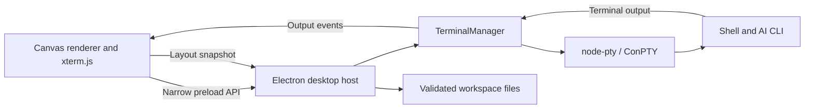

# Desktop architecture

## Scope and assumptions

Terminal Canvas is a single-user, local desktop workspace, initially targeting Windows. Each card owns an independent shell process and working directory. The first version prioritizes interactive AI CLIs, spatial organization, and predictable process cleanup. It does not coordinate agents, share credentials, synchronize workspaces, or infer whether an AI is thinking or waiting for input.

## Components and data flow

- `workspace.cjs` defines versioned, serializable workspace/card data, profile defaults, bounds, and validation. Runtime fields are excluded from imported and saved layouts.
- `terminal-manager.cjs` owns spawning, input, resizing, acknowledgments, exit handling, and disposal. Its injected spawn and event functions allow lifecycle tests without native dependencies.
- `main.cjs` owns the native window, file/folder dialogs, clipboard, persistence, and IPC authorization. It accepts calls only from the local main frame.
- `preload.cjs` exposes explicit methods while keeping Node.js unavailable to renderer code.
- `renderer.js` owns canvas navigation, card UI, selection, tools, and xterm emulators. A terminal's running state reflects its shell process, rather than an inferred AI activity state.
- `items.js` renders and edits board items (text labels, sticky notes, shapes, frames, images, and lines), their colors and text sizes, and image import and cleanup. It loads before `renderer.js` and uses the renderer's state when its functions run.
- `item-styles.js` defines the color and text-size palettes and the group nesting limit. The renderer and the host's workspace validation load the same file, so they cannot disagree.
- `history.js` holds undo and redo. `clipboard.js` copies, cuts, pastes, and duplicates board items. Both load after `items.js` in the same way.
- `canvas-geometry.js` holds pure geometry shared by the renderer and tests: connector clipping to rectangles and ellipses, frame containment, nested group expansion and grouping paths, marquee selection, and hit testing.
- `terminal-pointer.js` corrects mouse coordinates for terminals inside the zoomed canvas. The canvas zooms with a CSS `scale()` transform, while xterm.js converts `clientX`/`clientY` to cells using the unscaled cell size, so selection and mouse reports drift unless the event is first mapped into the `.xterm-screen` element's layout pixels. A capture-phase window listener rewrites the coordinates before xterm reads them, and keeps mapping into the terminal where a drag began. The scale is measured from the screen element, so Focus mode (no transform) and display scaling need no special case.
- `assets.cjs` validates image bytes by signature, stores them content-addressed in the user-data `assets` folder, embeds or extracts them for portable exports, and finds and deletes unused ones.

Output acknowledgments pause a producer above 256,000 unprocessed characters and resume it below 32,000. This propagates backpressure to the PTY instead of growing an unbounded renderer write queue. Layout writes are serialized and use a temporary file followed by rename. Save failures are surfaced to the user.

## Board items

Workspace format version 2 added an `items` array beside the terminal `cards`. Items are `text`, `note`, `shape` (`rect` or `ellipse`), `frame`, `image`, and `line`. Format 3 replaces each element's single `group` ID with `groups`, a path from the outermost group to the innermost, up to eight levels. Validation requires the paths to form a tree: every member of a group lists the same enclosing groups. Selecting one member selects its outermost group; grouping prefixes a new ID to the paths of whole selected groups, and ungrouping removes the first entry. Groups left with one member are pruned. Format 3 also adds optional `color` (one of seven palette names, on text, notes, shapes, frames, and lines) and `fontSize` (`small`, `large`, or `huge`, on text, notes, and shapes); the default look is stored as an absent field. Format 1 and 2 files migrate when opened. A line endpoint is either a free `{ x, y }` point or an attached `{ id }` that refers to a terminal or non-line item; validation rejects dangling or line-to-line attachments. Connector endpoints are computed when drawn, so the saved data never goes stale when items move. Frame membership is not stored: a frame moves whatever lies fully inside it when the drag starts. Larger frames receive lower `z-index` values so a frame drawn around existing items never hides them. Lines render in one SVG layer above cards.

Undo history lives in the renderer. Each step is a snapshot of every board item plus each terminal's geometry and groups, and restoring one updates items in place so their views keep their event handlers. Terminals are never created or closed by undo, since that would start or stop processes; connector ends attached to a terminal closed since the snapshot become free points at the terminal's remembered bounds. Copy and paste keep their items in the renderer as well. The system clipboard receives only a text summary, and a paste uses the copied items only while that summary is still on the clipboard.

Images load through a read-only `tc-asset://images/<sha256>.<ext>` protocol that serves only names matching that pattern from the assets folder, and the page CSP allows only that scheme besides `self` and `data:`. Image bytes cross IPC once, at import. Portable exports add an `assets` map of data URLs; on open, the host re-hashes every embedded image, rewrites references to the computed names, and drops the map before validation. Image cleanup is manual. The renderer sends the names it still needs (the workspace, undo and redo steps, and copied items), and the host deletes only content-addressed image files outside that list, recomputing the list when the user confirms.

## Desktop contracts

The command channel supports initialization, card creation, start/stop, folder selection, image import/picking/cleanup, autosave, workspace open/save/export/new, clipboard access, and close. Electron's clipboard API is asynchronous, so clipboard commands await it. Input, resize, and output acknowledgments use separate one-way channels. Output and exit events identify their owning card. Main-process validation applies before spawning and saving; imported layouts do not spawn processes.

Renderers are sandboxed with context isolation, no Node integration, no webviews, no remote scripts, and denied navigation/popups/device permissions. Terminal programs still run with the current user's permissions; the Electron renderer sandbox does not sandbox shell commands.

## Future WebCanvas plugin

The shared integration surface should be the **workspace card lifecycle**, while the desktop host retains native capabilities. A future plugin API can register a stable card type, versioned state validator/migration, renderer controller, and explicitly granted host capabilities. Expected controller operations are mount, resize, focus, serialize, and dispose. Imported unknown types should fail explicitly until a migration or compatible plugin exists.

A WebCanvas adapter can map its browser cards and camera coordinates onto this model, hosting websites in isolated `WebContentsView` instances. Browser content must remain separate from the terminal preload and IPC capabilities. Remote pages must never receive terminal, clipboard, or filesystem access. Native browser views also require clipping, visibility management, and snapshots during zoom; WebCanvas already explores that approach.

No dynamic plugin loader is present in v0.1. Introducing browser cards will require a card-type registry, a workspace schema migration, and plugin lifecycle tests. Revisit this boundary before loading third-party plugins: capability review, fault isolation, and independent versioning matter more at that point than a general-purpose extension framework does now.

## Trade-offs and follow-up

Electron matches WebCanvas's stack and supports mature terminal rendering at the cost of a larger desktop runtime. Plain JavaScript keeps this initial app small; revisit TypeScript and a component framework as UI complexity grows. Native node-pty requires runtime-compatible binaries/build tools. macOS/Linux behavior, signed distribution, persistent processes, output search, multiple named workspaces, and AI-specific session resumption remain future work.

Implementation references: [Electron security guidance](https://www.electronjs.org/docs/latest/tutorial/security), [node-pty](https://github.com/microsoft/node-pty), and [xterm flow control](https://xtermjs.org/docs/guides/flowcontrol/).
