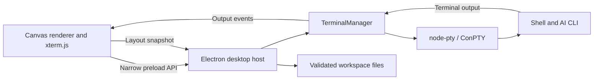

# Desktop architecture

## Scope and assumptions

Terminal Canvas is a single-user, local desktop workspace, initially targeting Windows. Each card owns an independent shell process and working directory. The first version prioritizes interactive AI CLIs, spatial organization, and predictable process cleanup. It does not coordinate agents, share credentials, synchronize workspaces, or infer whether an AI is thinking or waiting for input.

## Components and data flow

- `workspace.cjs` defines versioned, serializable workspace/card data, profile defaults, bounds, and validation. Runtime fields are excluded from imported and saved layouts.
- `terminal-manager.cjs` owns spawning, input, resizing, acknowledgments, exit handling, and disposal. Its injected spawn and event functions allow lifecycle tests without native dependencies.
- `terminal-cwd.cjs` decodes bounded OSC directory reports, preserves PowerShell prompt/status behavior, and polls native Unix shell directories. The host saves each valid report for recovery; unavailable reports clear only the live label. AI metadata and native shell tracking share this directory decoder to preserve UNC and local-host semantics.
- `shell-integration.cjs` prepares per-terminal PowerShell/Bash functions for directory reporting and ordinary Claude/Codex invocations. Bash starts as an interactive login shell; the host queues the integration source command before any saved command so normal profiles run first. Claude receives a per-launch settings file with a `SessionStart` hook; its Windows stdin bridge explicitly decodes UTF-8 before forwarding JSON. `session-hook.cjs` atomically records only a provider, UUID, directory, and invocation token; it never copies transcripts. Explicit custom Claude settings take precedence over hook injection.
- `session-metadata.cjs` validates optional session metadata and parses bounded OSC reports and Codex session-header/exit-hint lines only between a shell-reported Codex launch and its matching end token. Arbitrary shell text and output from another provider do not change the saved ID. Invocation tokens also keep hook updates from a previous launch out of the current one. Shared conversation history is never scanned to guess an association.
- `workspace-recovery.cjs` keeps host-observed metadata authoritative over delayed renderer snapshots, queues recovery writes when metadata changes, and supplies the final close snapshot. Optional malformed session metadata is discarded without discarding cards or board items.
- `main.cjs` owns the native window, file/folder dialogs, clipboard, persistence, and IPC authorization. It accepts calls only from the local main frame.
- `preload.cjs` exposes explicit methods while keeping Node.js unavailable to renderer code.
- `renderer.js` owns canvas navigation, card UI, selection, tools, and xterm emulators. A terminal's running state reflects its shell process, rather than an inferred AI activity state. Each session counts incoming metadata events so a delayed startup response cannot overwrite a newer directory or AI ID.
- `items.js` renders and edits board items (text labels, sticky notes, shapes, frames, images, and lines). It loads before `renderer.js` and uses the renderer's state when its functions run.
- `canvas-geometry.js` holds pure geometry shared by the renderer and tests: connector clipping to rectangles and ellipses, frame containment, group expansion, marquee selection, and hit testing.
- `terminal-pointer.js` corrects mouse coordinates for terminals inside the zoomed canvas. The canvas zooms with a CSS `scale()` transform, while xterm.js converts `clientX`/`clientY` to cells using the unscaled cell size, so selection and mouse reports drift unless the event is first mapped into the `.xterm-screen` element's layout pixels. A capture-phase window listener rewrites the coordinates before xterm reads them, and keeps mapping into the terminal where a drag began. The scale is measured from the screen element, so Focus mode (no transform) and display scaling need no special case.
- `assets.cjs` validates image bytes by signature, stores them content-addressed in the user-data `assets` folder, and embeds or extracts them for portable exports.

Output acknowledgments pause a producer above 256,000 unprocessed characters and resume it below 32,000. This propagates backpressure to the PTY instead of growing an unbounded renderer write queue. Layout writes are serialized and use a temporary file followed by rename. Save failures are surfaced to the user.

Terminal cards can carry `session: { provider: 'codex' | 'claude', sessionId: UUID, cwd: string }` as an additive field in workspace version 2. The card directory tracks the shell, while `session.cwd` tracks the captured AI conversation's folder. No running state is serialized. Starting in `resume` mode uses the allowlisted provider and validated UUID to build a fixed command, independent of the saved launch command; `fresh` mode launches only a shell. An invalid/missing folder prevents resume but permits a fresh shell in Home. IDs are candidates for provider-side resume, not proof that a conversation remains available.

Hook metadata is polled every 500 ms, plus before terminal stop/exit, save/export, and close. A normal close waits for the atomic recovery queue, stops processes, waits for native PTY exit cleanup, and flushes again. Previously stopped terminals remain tracked until cleanup finishes; each stop has a five-second fallback if no exit arrives. This keeps Electron alive while node-pty completes its asynchronous native callbacks. App-quit requests use the same renderer close flow as window close. On renderer failure, the host stops processes and saves its last known workspace. Process termination or power loss can still lose unobserved/unwritten changes. See the README's recovery limits for unsupported shell launches and Codex's exit-only resume hint on some versions.

## Board items

Workspace format version 2 adds an `items` array beside the terminal `cards`. Items are `text`, `note`, `shape` (`rect` or `ellipse`), `frame`, `image`, and `line`. Any element, terminals included, may carry a `group` ID; selecting one member selects the group. A line endpoint is either a free `{ x, y }` point or an attached `{ id }` that refers to a terminal or non-line item; validation rejects dangling or line-to-line attachments. Connector endpoints are computed when drawn, so the saved data never goes stale when items move. Frame membership is not stored: a frame moves whatever lies fully inside it when the drag starts. Larger frames receive lower `z-index` values so a frame drawn around existing items never hides them. Lines render in one SVG layer above cards.

Images load through a read-only `tc-asset://images/<sha256>.<ext>` protocol that serves only names matching that pattern from the assets folder, and the page CSP allows only that scheme besides `self` and `data:`. Image bytes cross IPC once, at import. Portable exports add an `assets` map of data URLs; on open, the host re-hashes every embedded image, rewrites references to the computed names, and drops the map before validation.

## Desktop contracts

The command channel supports initialization, card creation, start/stop, folder selection, image import/picking, autosave, workspace open/save/export/new, clipboard access, and close. Input, resize, and output acknowledgments use separate one-way channels. Output and exit events identify their owning card. Main-process validation applies before spawning and saving; imported layouts do not spawn processes.

Renderers are sandboxed with context isolation, no Node integration, no webviews, no remote scripts, and denied navigation/popups/device permissions. Terminal programs still run with the current user's permissions; the Electron renderer sandbox does not sandbox shell commands.

## Future WebCanvas plugin

The shared integration surface should be the **workspace card lifecycle**, while the desktop host retains native capabilities. A future plugin API can register a stable card type, versioned state validator/migration, renderer controller, and explicitly granted host capabilities. Expected controller operations are mount, resize, focus, serialize, and dispose. Imported unknown types should fail explicitly until a migration or compatible plugin exists.

A WebCanvas adapter can map its browser cards and camera coordinates onto this model, hosting websites in isolated `WebContentsView` instances. Browser content must remain separate from the terminal preload and IPC capabilities. Remote pages must never receive terminal, clipboard, or filesystem access. Native browser views also require clipping, visibility management, and snapshots during zoom; WebCanvas already explores that approach.

No dynamic plugin loader is present in v0.1. Introducing browser cards will require a card-type registry, a workspace schema migration, and plugin lifecycle tests. Revisit this boundary before loading third-party plugins: capability review, fault isolation, and independent versioning matter more at that point than a general-purpose extension framework does now.

## Trade-offs and follow-up

Electron matches WebCanvas's stack and supports mature terminal rendering at the cost of a larger desktop runtime. Plain JavaScript keeps this initial app small; revisit TypeScript and a component framework as UI complexity grows. Native node-pty requires runtime-compatible binaries/build tools. macOS/Linux behavior, signed distribution, persistent processes, output search, multiple named workspaces, and broader provider/session discovery remain future work.

Implementation references: [Electron security guidance](https://www.electronjs.org/docs/latest/tutorial/security), [node-pty](https://github.com/microsoft/node-pty), and [xterm flow control](https://xtermjs.org/docs/guides/flowcontrol/).
