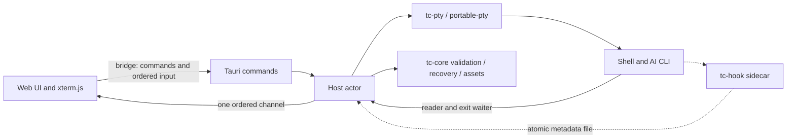

# Desktop architecture

Terminal Canvas is a local, single-user desktop workspace. Tauri 2 hosts the unchanged web UI and
xterm.js; Node is used only for development dependencies, UI/oracle tests, and Windows automation.
The app stores no credentials, transcripts, shell memory, or scrollback in its workspace file.

## Host state and persistence

One tokio actor owns the terminal manager, recovery state, current file, and input sequencing.
Commands use oneshot replies; PTY events carry a generation to discard late events after restart.
Blocking reads/writes/waits stay outside the actor. Native dialogs and directory lookups return
continuations through it. Workspace snapshots are enqueued for atomic writing in actor order, so
an older debounced layout cannot overwrite newer host-observed metadata. Image operations have
their own serial worker queue.

Format 3 retains `version, name, camera, cards, items`, omits default styles/empty groups, and migrates
formats 1/2. Cards restore stopped. The host-observed cwd and validated provider/UUID override stale
renderer metadata. Start, resume, and fresh-shell modes preserve the existing semantics and limits.
Normal close confirms in the renderer, flushes, waits for native exits, flushes again, then exits.
Renderer/native-window failure preserves the last host-known snapshot. Forced termination can lose
unobserved/unwritten changes.

## Process layer

Each PTY has a reader, non-blocking queued writer, and exit waiter. UTF-8 decoding carries split
sequences and replaces invalid bytes; backpressure and input limits count UTF-16 units. Readers
pause above 256,000 unacknowledged units and resume below 32,000. Stop has a five-second cleanup
fallback. Windows creates a mandatory kill-on-close Job Object before process creation via the
vendored job-list patch, so startup children belong to it. Unix Stop sends SIGHUP to shell and
foreground process groups. Failed worker startup ends the child before closing the master.

PowerShell/cmd/Bash integration supplies directories/readiness and validated AI launch metadata.
Unix directory polling supports other shells. Claude hook files are polled twice per second and
read again on exit/stop/save/close; Codex output is considered only during a recognized launch.
The native `tc-hook` sidecar sits beside the executable and atomically records bounded metadata.

## UI and security boundary

`bridge.js` exposes the five renderer methods, one ordered event channel, raw image bodies, and
per-terminal input sequence numbers. Host rejections become the existing `{ error }` results.
Pure renderer modules retain board geometry, nested groups, connectors, styles, history, clipboard,
minimap, and zoom-correct terminal pointers. No Electron preload or Node integration is present.

Capabilities grant only app commands to the local main webview. Every command checks the caller;
navigation and new windows are restricted, permissions denied, and CSP comes from `tauri.conf.json`
without unsafe-eval. Links are validated HTTP(S) URLs without credentials at the OS boundary.
Images use validated content-addressed names with nosniff/no-cache and an app-only allowed origin.
The protocol accepts direct macOS/Linux URLs and Wry's rewritten Windows form. WebView2 zoom and
browser accelerators are disabled; file drops reach the canvas. macOS keeps its native Edit menu.

## Validation and distribution

Rust tests exercise core/process/host logic; golden fixtures replay a frozen dev-only Node oracle.
UI unit tests read JSON defaults. Windows E2E uses Playwright over child-only CDP, isolated profiles,
controlled tools, focus/event-dispatch waits, clipboard preservation, and process-tree checks.
The `e2e` feature cannot compile in release builds. Packaging produces Windows NSIS/portable
artifacts with the app and hook together; CI artifacts do not imply clean-machine validation.

This is the Rust architecture after the cutover. The migration plan tracks the remaining Windows,
manual, baseline, packaging, and compatibility gates. WebCanvas integration, other-platform
packaging, zsh prompt integration, synchronization, and running-session recovery remain future work.
