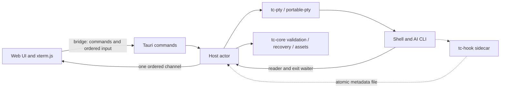

# Desktop architecture

Terminal Canvas is a local, single-user desktop workspace. Tauri 2 hosts the unchanged web UI and
xterm.js; Node is used only for development dependencies, UI/oracle tests, and Windows automation.
The app stores no credentials, transcripts, shell memory, or scrollback in its workspace file.

## Host state and persistence

One tokio actor owns the terminal manager, recovery state, current file, and input sequencing.
Commands use oneshot replies; PTY events carry a generation to discard late events after restart.
Blocking reads/writes/waits stay outside the actor. Native dialogs and directory lookups return
continuations through it. Workspace snapshots are enqueued for atomic writing in actor order, so
an older debounced layout cannot overwrite newer host-observed metadata. Image operations have
their own serial worker queue.

Format 3 retains `version, name, camera, cards, items`, omits default styles/empty groups, and migrates
formats 1/2. Cards restore stopped. The host-observed cwd and validated provider/UUID override stale
renderer metadata. Start, resume, and fresh-shell modes preserve the existing semantics and limits.
Normal close confirms in the renderer, flushes, waits for native exits, flushes again, then exits.
Renderer/native-window failure preserves the last host-known snapshot. Forced termination can lose
unobserved/unwritten changes.

## Process layer

Each PTY has a reader, non-blocking queued writer, and exit waiter. UTF-8 decoding carries split
sequences and replaces invalid bytes; backpressure and input limits count UTF-16 units. Readers
pause above 256,000 unacknowledged units and resume below 32,000. Stop has a five-second cleanup
fallback. Windows creates a mandatory kill-on-close Job Object before process creation via the
vendored job-list patch, so startup children belong to it. Unix Stop sends SIGHUP to shell and
foreground process groups. Failed worker startup ends the child before closing the master.

PowerShell/cmd/Bash integration supplies directories/readiness and validated AI launch metadata.
Unix directory polling supports other shells. Claude hook files are polled twice per second and
read again on exit/stop/save/close; Codex output is considered only during a recognized launch.
The native `tc-hook` sidecar sits beside the executable and atomically records bounded metadata.
`tc-hook new-terminal` writes validated launch requests into an owner-only inbox: the terminal's
own `TC_LAUNCH_DIR` (in the temporary folder) or, from outside the canvas, the app's
`launch-requests` folder, which is emptied at startup. The same poll takes at most four per inbox,
removes each file, validates it again, and sends a `launch` event; the renderer creates and starts
the card beside its parent with an arrow, or in view when there is no parent (`docs/agent-launch.md`).
The renderer reports each outcome with `launch-result`; the host answers the request in its inbox
and, for requests that ask, logs the new terminal's output there as plain text from its first byte.

## tmux control-mode spike

Issue #35 phase 1 adds `tc-tmux`, a workspace crate with no Tauri or process-layer dependencies.
It is not wired into `tc-pty` or the host. Plain PTYs, format 3 validation, capabilities and close
semantics are unchanged. The spike uses **pipes and `tmux -C`**; `-CC` adds terminal-emulator DCS
framing and terminal-mode changes that pipes do not need.

The incremental parser frames replies by `(time, command number, flags)`, keeps reply bodies
separate from notifications, and octal-unescapes output into bytes. It preserves unknown
notifications for forward compatibility. Split UTF-8 and OSC bytes reach consumers unchanged;
phase 2 must retain one existing UTF-8/metadata decoder per pane. Lines are limited to 1 MiB and
replies to 8 MiB / 16,384 lines; malformed or truncated streams disconnect rather than guessing.

Commands use fixed verbs and individually quoted arguments. Session/window names and numeric
targets are validated; input is only `send-keys -H` hex, bounded by the current 65,536 UTF-16-unit
limit. There are no runtime kill-window/session/server commands in the spike. The pipe client
has separate reader/writer threads, 16 queued commands, four queued events, and local request IDs
matched FIFO to replies with the control-command flag. Initial attach replies have no request ID.
Synchronous `%pause` / `%continue` lines can occur inside their command's reply; those remain
reply text, allowing command-aware handling without misclassifying captured pane text as events.
Submitting never blocks the host; a full queue returns `WouldBlock`. Consumers must drain events
and retry queued input in order. Dropping the client releases blocked workers, ends/reaps only the
attached tmux client, and leaves its server/windows alive.

Per-window control-client sizes (`refresh-client -C @window:WxH`) also cap manual
`resize-window` requests. Clear that client's cap with `refresh-client -C @window:` before
expecting a larger manual size. The native probe checks the clamp, removal of one window's cap,
and preservation of the other window's independent size.

All connections require an explicit absolute socket path. Native probes create owner-only
temporary profiles, pass `-S` to every subprocess, ignore user tmux configuration, and clean up
only their own server/profile. They are explicitly ignored in normal workspace tests and run
separately in macOS/Linux CI, against current tmux and checksum-pinned 3.3a. The API accepts a
configured binary path and otherwise searches PATH and common macOS installation directories.
Windows native attachment returns an unsupported-platform error; WSL and SSH are later work.

Two source findings change the issue's initial assumptions:

- **Minimum 3.3, pending native CI confirmation:** tmux 3.2a's `cmd-refresh-client.c` only parses
  `WxH`; 3.3a adds `@window:WxH`. The spike rejects versions below 3.3.
- **Pause is lossy:** `control_pause_pane` discards pending output; `control_continue_pane`
  copies the pane's current offset. This behavior exists in both inspected 3.2a and 3.3a sources.
  Bounded Rust queues do not prove lossless end-to-end backpressure under a flood. Phase 2 must
  design capture-and-resync ordering (including live output during capture), handle gaps in OSC /
  provider metadata, and either establish a lossless strategy or revise that acceptance criterion.
  The native probe checks pause/continue notifications and capture recovery of a finite backlog;
  it does not claim lossless replay of program bytes.

The Windows development machine passes pure tests but cannot establish real-tmux behavior.
PID/history survival in these library probes is not desktop crash/restart recovery. Phase 2 still
needs host-owned connection/generation routing, ownership tags, persistent integration folders,
bindings/validation/migration, history/live-stream coordination and the three-way close dialog.
External adoption and split-pane grouping are phase 3. Coordination with #30 (per-canvas bindings),
#33 (hook pointers only while open until a queue is designed), and #27 (switcher) remains future
integration work against the current single-board app.

## UI and security boundary

`bridge.js` exposes the five renderer methods, one ordered event channel, raw image bodies, and
per-terminal input sequence numbers. Host rejections become the existing `{ error }` results.
Pure renderer modules retain board geometry, nested groups, connectors, styles, history, clipboard,
minimap, and zoom-correct terminal pointers. No Electron preload or Node integration is present.

Capabilities grant only app commands to the local main webview. Every command checks the caller;
navigation and new windows are restricted, permissions denied, and CSP comes from `tauri.conf.json`
without unsafe-eval. Links are validated HTTP(S) URLs without credentials at the OS boundary.
Images use validated content-addressed names with nosniff/no-cache and an app-only allowed origin.
The protocol accepts direct macOS/Linux URLs and Wry's rewritten Windows form. WebView2 zoom and
browser accelerators are disabled; file drops reach the canvas. macOS keeps its native Edit menu.

## Validation and distribution

Rust tests exercise core/process/host logic; golden fixtures replay a frozen dev-only Node oracle.
UI unit tests read JSON defaults. Windows E2E uses Playwright over child-only CDP, isolated profiles,
controlled tools, focus/event-dispatch waits, clipboard preservation, and process-tree checks.
The `e2e` feature cannot compile in release builds. Packaging produces Windows NSIS/portable
artifacts with the app and hook together; CI artifacts do not imply clean-machine validation.

This is the Rust architecture after the cutover. The migration plan tracks the remaining Windows,
manual, baseline, packaging, and compatibility gates. WebCanvas integration, other-platform
packaging, zsh prompt integration, synchronization, and running-session recovery remain future work.
