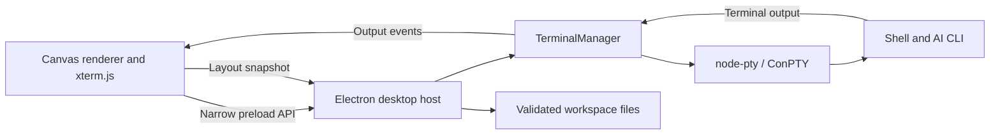

# Desktop architecture

## Scope and assumptions

Terminal Canvas is a single-user, local desktop workspace, initially targeting Windows. Each card owns an independent shell process and working directory. The first version prioritizes interactive AI CLIs, spatial organization, and predictable process cleanup. It does not coordinate agents, share credentials, synchronize workspaces, or infer whether an AI is thinking or waiting for input.

## Components and data flow

- `workspace.cjs` defines versioned, serializable workspace/card data, profile defaults, bounds, and validation. Runtime fields are excluded from imported and saved layouts.
- `terminal-manager.cjs` owns spawning, input, resizing, acknowledgments, exit handling, and disposal. Its injected spawn and event functions allow lifecycle tests without native dependencies.
- `main.cjs` owns the native window, file/folder dialogs, clipboard, persistence, and IPC authorization. It accepts calls only from the local main frame.
- `preload.cjs` exposes explicit methods while keeping Node.js unavailable to renderer code.
- `renderer.js` owns canvas navigation, card UI, and xterm emulators. A terminal's running state reflects its shell process, rather than an inferred AI activity state.

Output acknowledgments pause a producer above 256,000 unprocessed characters and resume it below 32,000. This propagates backpressure to the PTY instead of growing an unbounded renderer write queue. Layout writes are serialized and use a temporary file followed by rename. Save failures are surfaced to the user.

## Desktop contracts

The command channel supports initialization, card creation, start/stop, folder selection, autosave, workspace open/save/new, clipboard access, and close. Input, resize, and output acknowledgments use separate one-way channels. Output and exit events identify their owning card. Main-process validation applies before spawning and saving; imported layouts do not spawn processes.

Renderers are sandboxed with context isolation, no Node integration, no webviews, no remote scripts, and denied navigation/popups/device permissions. Terminal programs still run with the current user's permissions; the Electron renderer sandbox does not sandbox shell commands.

## Future WebCanvas plugin

The shared integration surface should be the **workspace card lifecycle**, while the desktop host retains native capabilities. A future plugin API can register a stable card type, versioned state validator/migration, renderer controller, and explicitly granted host capabilities. Expected controller operations are mount, resize, focus, serialize, and dispose. Imported unknown types should fail explicitly until a migration or compatible plugin exists.

A WebCanvas adapter can map its browser cards and camera coordinates onto this model, hosting websites in isolated `WebContentsView` instances. Browser content must remain separate from the terminal preload and IPC capabilities. Remote pages must never receive terminal, clipboard, or filesystem access. Native browser views also require clipping, visibility management, and snapshots during zoom; WebCanvas already explores that approach.

No dynamic plugin loader is present in v0.1. Introducing browser cards will require a card-type registry, a workspace schema migration, and plugin lifecycle tests. Revisit this boundary before loading third-party plugins: capability review, fault isolation, and independent versioning matter more at that point than a general-purpose extension framework does now.

## Trade-offs and follow-up

Electron matches WebCanvas's stack and supports mature terminal rendering at the cost of a larger desktop runtime. Plain JavaScript keeps this initial app small; revisit TypeScript and a component framework as UI complexity grows. Native node-pty requires runtime-compatible binaries/build tools. macOS/Linux behavior, signed distribution, persistent processes, output search, multiple named workspaces, and AI-specific session resumption remain future work.

Implementation references: [Electron security guidance](https://www.electronjs.org/docs/latest/tutorial/security), [node-pty](https://github.com/microsoft/node-pty), and [xterm flow control](https://xtermjs.org/docs/guides/flowcontrol/).
