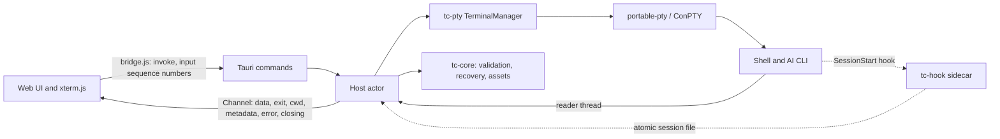

# Rust migration plan

Status: approved plan, 2026-11-09. Scope: replace the Electron/Node host with a Rust host on Tauri 2 and keep the web UI. Development happens on macOS. Windows stays the primary target and is validated in CI.

## Decision

Everything in Terminal Canvas that runs in Node moves to Rust, hosted by Tauri 2. That covers the Electron main process, PTY management, shell integration, persistence, image assets, and the Claude hook script. The renderer stays as it is: HTML, CSS, `renderer.js`, `items.js`, `history.js`, `clipboard.js`, `canvas-geometry.js`, `terminal-pointer.js`, `minimap.js`, and xterm.js. It changes only where the host boundary changes.

What this gets us:

- **No Electron or node-pty.** The native build that blocks `npm run build` today (`MSB8040: Spectre-mitigated libraries are required`) goes away, and so does the `postinstall` node-pty patch.
- **One compiled host.** Typed validation sits in front of every OS operation.
- **A much smaller app.** It uses the system webview (WebView2 on Windows) instead of bundling Chromium.

Non-goals:

- **No workspace format change.** Format 3 files written by the Electron build and by the Rust build must each open in the other.
- **No UI redesign and no new features** during the migration.
- **No Rust UI.** Moving the pure UI modules (`canvas-geometry.js`, `history.js`) to WASM can be reconsidered after cutover, if ever.
- **No new platform features.** Windows stays the primary target. CI builds and tests macOS and Linux from Phase 0. Packaging for those platforms and zsh prompt integration (zsh gets only directory polling today) remain future work.

## What moves and what stays

| Today | After |
| --- | --- |
| `src/main.cjs` (window, IPC, dialogs, clipboard, protocol, lifecycle) | `src-tauri/src/`: commands, protocol, lifecycle |
| `src/preload.cjs` | `src/bridge.js` (still JS): the same `window.terminalCanvas` API on top of Tauri IPC |
| `src/terminal-manager.cjs` | `crates/tc-pty`: manager |
| `src/terminal-cwd.cjs` | The OSC decoder goes to `tc-core::osc`, process cwd polling to `tc-pty::cwd`, and the PowerShell bootstrap to `crates/tc-pty/shell/bootstrap.ps1` |
| `src/shell-integration.cjs` | `tc-pty::integration` plus `shell/*.ps1` and `shell/*.bash` |
| `src/session-hook.cjs` | `crates/tc-hook`: a small console binary shipped as a sidecar |
| `src/session-metadata.cjs` | `tc-core::session` |
| `src/workspace.cjs` | `tc-core::workspace` |
| `src/workspace-recovery.cjs` | `tc-core::recovery` |
| `src/assets.cjs` | `tc-core::assets` |
| `src/directories.cjs` | `tc-core::dirs` |
| `src/item-styles.js` | Stays in the UI. Rust mirrors the constants, and a parity test compares the two |
| Renderer, items, history, clipboard, geometry, pointer, minimap, HTML, CSS | Stay, with the small edits listed in Phase 3 |
| `scripts/rebuild.cjs`, `scripts/patch-node-pty.cjs` | Deleted |
| `scripts/start.cjs`, `scripts/check.cjs` | Replaced by `cargo run` and `cargo xtask check` |
| `scripts/preview.cjs` (`npm run dev`) | Deleted; `cargo run` is the dev loop |
| `scripts/icons.cjs` | Replaced by `cargo tauri icon` or an xtask that uses resvg |
| `scripts/smoke*.cjs`, `scripts/restoration-smoke.cjs` | `tests/e2e/`: Playwright driving WebView2 over CDP |

Node remains a dev-only dependency. It runs the UI unit tests, supplies the pinned xterm.js files, and drives the Windows E2E tests. Nothing in the shipped app needs it.

## Target architecture



Tauri requires a `src-tauri/` folder, and `AGENTS.md` allows a layout that a framework requires:

```text
Cargo.toml              workspace, shared lints, pinned dependencies
rust-toolchain.toml     channel = "1.95"
.github/workflows/      CI on Windows, macOS, and Linux
crates/
    tc-core/            pure logic; no Tauri, no PTY; builds on every OS
    tc-pty/             processes, shell integration, cwd polling
        shell/          bootstrap.ps1, agent.ps1, integration.bash (loaded with include_str!)
    tc-hook/            sidecar binary: `record <provider>`, `emit launch|end`
src-tauri/              app: commands, protocol, lifecycle, build.rs, tauri.conf.json, capabilities/
xtask/                  check, icons, golden capture
src/                    web UI (existing files plus bridge.js); build.rs copies xterm.js into src/vendor/ (ignored)
tests/                  JS UI tests (stay), tests/golden/ fixtures, tests/e2e/
```

### Design decisions

1. **One host actor owns all state.** The JS host relies on Node's event loop to run everything in order: the `this.sessions.get(id) !== entry` checks, the write queue, and the `serialize()` asset tasks all depend on it. The Rust host keeps that model. One tokio task owns `TerminalManager` and `WorkspaceRecovery` and handles messages one at a time: commands (each answered through a oneshot reply), PTY output, exits, and poll ticks. The code can then be ported almost line by line, and the existing tests carry over directly. File writes and asset tasks each keep their own serial queue, as they do today.
2. **Each terminal has three threads, outside the actor.** A blocking reader, a writer (so a stalled shell cannot block IPC), and an exit waiter. At the 24-terminal limit that is 72 threads, which is fine.
3. **Backpressure works without `pause()`.** When unacknowledged output goes above 256,000, the reader thread stops reading until it drops below 32,000. The PTY's buffer then fills and the child process blocks, which is what node-pty's `pause()` achieved. Pending output is counted in UTF-16 units, so the renderer's `event.data.length` acknowledgments keep working unchanged.
4. **Output stays text.** The reader decodes UTF-8 and carries any sequence split across two reads over to the next one. Invalid bytes become U+FFFD, matching node-pty. A raw-bytes channel can come later as an optimization.
5. **Events go through one Tauri Channel**, registered by `initialize`. Channels deliver messages in order. `bridge.js` passes each message to the `onEvent` listeners, so `renderer.js` keeps its single handler.
6. **The data folder stays the same.** The host uses the folder Electron used: `terminal-canvas` inside `dirs::config_dir()`, which is `%APPDATA%` on Windows, `~/Library/Application Support` on macOS, and `~/.config` on Linux. Tauri's default would be named after the identifier, `local.terminalcanvas.desktop`. The existing autosave, `assets`, and `shell-integration` folders then carry over with no migration step.
7. **Host logic can be tested without Tauri.** Command handlers live in a `Host` type that takes a `Platform` trait for dialogs, clipboard, the link opener, and closing the window. Today's tests load `main.cjs` in a `vm` with a fake `electron` (clipboard, external links, recovery lifecycle). They become unit tests against a fake `Platform`.
8. **Stopping a terminal ends its whole process tree.**
    - **Windows:** node-pty kills every process attached to the console; that is the helper the `postinstall` patch fixes. portable-pty does not, so each shell runs in a Job Object that kills its processes when the job closes. This also covers a crash of the host itself, which today can leave AI CLIs running.
    - **macOS and Linux:** portable-pty starts each shell in its own session. Stop sends SIGHUP to that process group.

## Development and CI

Day-to-day development happens on a Mac. Windows is still the primary target, so the Windows CI job decides whether a change is ready.

The local loop on macOS needs Xcode Command Line Tools, Rust 1.95, and Node 22.12+:

```sh
npm ci                          # once, and again after package-lock.json changes
cargo run -p terminal-canvas    # the app
cargo test --workspace          # host tests
npm test                        # UI tests
```

`src-tauri/build.rs` copies the pinned xterm.js files from `node_modules` into `src/vendor/`. If they're missing it stops with "run npm ci first". `cargo run` is therefore the whole dev loop and needs no Tauri CLI. Packaging still uses `cargo tauri build`.

Some things only run on Windows: the PowerShell and cmd integration tests, Job Objects, WebView2-specific behavior, and the E2E suite, which drives WebView2 over CDP. macOS's WKWebView has no automation driver for Tauri apps. On the Mac, coverage comes from unit tests and manual checks.

CI runs on GitHub Actions, added in Phase 0, on `windows-latest`, `macos-latest`, and `ubuntu-latest`:

- rustfmt, clippy with `-D warnings`, and `cargo test --workspace`
- `npm ci`, `npm run check`, and `npm test`
- the golden capture in `--check` mode, which proves the fixtures do not depend on the machine that captured them
- from Phase 3, Tauri's WebKitGTK system packages installed in the Linux job
- from Phase 4, E2E on `windows-latest` only

All three jobs must pass before a merge.

## Phases

Sizes are relative (S < M < L). The Electron build remains the app we ship until Phase 5 ends, and each phase merges to `main` on its own.

### Phase 0: safety net and CI (S)

- Add the Cargo workspace, `rust-toolchain.toml`, rustfmt and clippy settings, and `target/` in `.gitignore`.
- Add the CI workflow described above. Until now the JS tests have only run on Windows. Any that fail on macOS or Linux get fixed, or skipped with a stated reason, in the same PR.
- Write `scripts/capture-golden.cjs`. It runs the current JS modules on fixture inputs and saves the results in `tests/golden/`. Platform, home folder, and hostname are passed in explicitly, so the fixtures come out the same on every machine. A `--check` mode compares against the committed files. The captures:
    - `validateWorkspace`, `validateCard`, `validateItem`: valid files, every rejection with its error message, migrations from format 1 and 2, `color: 'default'`, and group paths.
    - `directoryReports` and `MetadataParser`: the events produced for each byte stream, including the cases in `terminal-cwd.test.cjs` and `session-restoration.test.cjs`.
    - `extractAssets`, `embedAssets`, `detectImage`, and `keepList`.
    - The exact text of `powershellArgs()`, `powershellSource()`, `bashSource()`, and the Claude settings file.
- Record a baseline on Windows to compare against in Phase 5: test counts, smoke and restoration results, install size, memory with four idle terminals, and startup time.

Done when the golden fixtures are committed, CI passes on all three runners, and the app is unchanged.

### Phase 1: tc-core, the pure logic (M)

Port the workspace and session-metadata modules, the OSC decoder from `terminal-cwd.cjs`, assets, directories, recovery state, the item-style constants, and the profiles.

- Validate from `serde_json::Value` with hand-written checks that mirror the JS, then build typed structs. A plain `#[derive(Deserialize)]` would change the error messages and the migration behavior.
- Run every golden fixture. Add property tests that split each stream at every byte boundary and require the same events.
- Add a parity test for item styles: load `src/item-styles.js` with `node -e` and compare it with the Rust constants.

Done when `cargo test -p tc-core` passes on all three CI runners, golden fixtures included.

### Phase 2: tc-pty and tc-hook, the process layer (L)

- **Spawning with portable-pty.**
    - Windows: PowerShell 5.1 is the default. Detect the `pwsh`, `powershell`, and `cmd` launchers. Pass `-ExecutionPolicy RemoteSigned -EncodedCommand`. Prefix cmd's `PROMPT`.
    - Everywhere: set `TERM`, `COLORTERM`, and `TERMINAL_CANVAS`.
    - macOS and Linux: start `$SHELL` as a login shell. For Bash, queue its `source` command.
- **Lifecycle, ported exactly:**
    - the `start`, `resume`, and `fresh` modes and the 24-terminal limit
    - dimension checks, the 64 KB input limit, and resetting readiness on CR/LF
    - 500 ms hook polling and metadata merging
    - Stop with its 5 s fallback, and `shutdown` waiting for every exit
    - the Duplicate directory logic
- **Unix cwd polling.** Read `/proc/<pid>/cwd` on Linux. On macOS, either keep `/usr/sbin/lsof` or switch to `libproc`. Switching changes behavior, so the README must say so.
- **Shell scripts in files.** Move the scripts into `crates/tc-pty/shell/`. Golden tests prove that the generated text matches the JS output byte for byte.
- **tc-hook.**
    - `record claude` reads at most 64 KB from stdin, validates it, and writes the session file atomically with mode 0600.
    - `emit launch|end` writes the base64-encoded OSC 633 report.
    - Bash calls `"$TC_HOOK"` directly instead of `ELECTRON_RUN_AS_NODE=1 "$TC_NODE" "$TC_HOOK"`.
    - Keep the PowerShell UTF-8 stdin bridge in the Claude settings until a test shows that tc-hook decodes Unicode directories without it.
- **Cleanup.** On Windows each shell gets its own Job Object, and dropping the PTY master closes the pseudoconsole. On Unix, Stop signals the shell's process group.
- **A UI-free check.** Add `cargo run -p tc-pty --example drive`, which starts a shell, runs `cd`, and prints the events. It works on the Mac too.

Tests: port the terminal-manager tests to a fake PTY trait in place of the injected `spawn`, then port the terminal-cwd, session-restoration, and directories tests. PowerShell and cmd tests run on the Windows runner. Bash integration and cwd polling tests run on macOS and Linux, so they also run locally on the Mac.

Done when:

- On Windows, PowerShell 5.1, PowerShell 7, and cmd report directories and readiness through the example binary.
- On macOS, zsh and Bash report polled directories through the example binary.
- On Windows, the controlled CLI substitute from `restoration-smoke.cjs` captures Claude and Codex session IDs.

### Phase 3: Tauri app and bridge (L)

**Host**

- **Commands.** One per `command(action)` branch:
    - workspace: `initialize`, `create-card`, `autosave`, `save`, `save-as`, `export`, `open`, `new`, `close`
    - terminals: `duplicate-directory`, `start`, `stop`, `pick-folder`
    - images: `import-image`, `pick-image`, `unused-images`, `delete-unused-images`
    - OS: `open-link`, `clipboard-read`, `clipboard-write`
    - Plus `input`, `resize`, and `ack`.
- **Image import.** `import-image` receives the image as a raw IPC body, not as a JSON number array.
- **OS services.**
    - Dialogs use tauri-plugin-dialog.
    - Clipboard uses arboard or tauri-plugin-clipboard-manager, with the 64,000-character paste limit and the 1 MB copy limit kept.
    - Links open through tauri-plugin-opener after the existing validation.
- **Image protocol.** Serve `tc-asset` through `register_asynchronous_uri_scheme_protocol`, with the same name check and the `nosniff` and `no-cache` headers.
- **Lifecycle.**
    - `CloseRequested` and `ExitRequested` are prevented and become the `closing` event. The `close` command then flushes, shuts down, and exits.
    - On Windows, WebView2's `ProcessFailed` event, reached through `with_webview`, runs the renderer-crash path.

**Security, matching today's Electron settings**

- **Capabilities.** Only the `main` window, only local content, and only the app's own commands. No fs or shell plugin permissions are exposed to JavaScript.
- **CSP.** Move it from the `<meta>` tag into `tauri.conf.json`, because the meta tag's `connect-src 'none'` would block Tauri IPC. Keep `script-src 'self'` and do not allow `unsafe-eval`.
- **Navigation and permissions.** Block navigation away from the app's origin and deny new windows. On Windows, deny every WebView2 permission request through `PermissionRequested` in `with_webview`.
- **Caller check.** Every command still checks that the caller is the `main` webview.

**Window and webview defaults that would break current behavior**

These WebView2 items are Windows-specific. On the Mac, check what WKWebView does for each one.

- **File drop.** Set `dragDropEnabled: false`. Otherwise Tauri takes OS file drops and image drops never reach the canvas.
- **Zoom.** Turn off WebView2's zoom hotkeys and Ctrl+wheel zoom, so Ctrl+scroll reaches the canvas.
- **Accelerator keys.** Turn off the browser's own shortcuts (F5, Ctrl+R, Ctrl+F, Ctrl+P). Confirm that Ctrl+Shift+C reaches xterm; Chromium uses it to open DevTools when DevTools is enabled.
- **macOS Edit menu.** Keep the standard Edit menu on macOS so Cmd+C/V/X/A/Z work in text fields and dialogs; without an app menu, those shortcuts stop working in WKWebView text fields. Windows keeps no menu.
- **Window.** 1500×960, minimum 1000×680, background `#111318`, the same title and icon.

**Renderer edits (the only UI changes)**

- **`bridge.js`.** Defines `window.terminalCanvas` with the same five methods.
    - It turns rejected invokes into `{ error }` results, so `invoke()` in `renderer.js` stays the same.
    - It gives every `input` call a per-terminal sequence number. The host applies input in sequence order, because concurrent IPC requests are not guaranteed to arrive in order.
- **Image URLs.** On Windows, Tauri serves custom schemes as `http://tc-asset.localhost/…`. On macOS and Linux the scheme is registered directly, so `tc-asset://images/…` should keep working; verify this. `assetUrl()` in `items.js` takes its prefix from the bridge, the protocol handler accepts both forms, and `img-src` in the CSP lists both.
- **xterm.js files.** Load them from `src/vendor/`, which `src-tauri/build.rs` fills. Tauri cannot serve `../node_modules`.

Done when:

- `cargo run -p terminal-canvas` runs the full app on macOS and Windows.
- A manual pass through the README sections "Use the workspace", "Board items", and "What can be recovered" succeeds on both.
- The JS UI tests still pass on all three CI runners.

### Phase 4: end-to-end parity (L)

The E2E suite runs in the Windows CI job; it cannot run on the Mac.

- **Harness.** Rebuild the smoke and restoration suites in `tests/e2e/`, with Playwright connected to WebView2 over CDP. Test runs set `WEBVIEW2_ADDITIONAL_BROWSER_ARGUMENTS=--remote-debugging-port=…`; normal launches never do.
    - `executeJavaScript` becomes `page.evaluate`.
    - `sendInputEvent` becomes `page.mouse` and `page.keyboard`, which send trusted input through CDP.
    - `capturePage` becomes `page.screenshot`.
    - Keep two helpers that fixed real flakiness: waiting until the page has dispatched the last native event, and taking window focus back.
- **Test-only host features.** A cargo feature named `e2e`, never enabled in release builds, adds:
    - the profile-folder flags `--smoke-test` and `--restoration-smoke=<phase>`
    - a host-state query, so tests can check running sessions
    - interception of link opens, and window focus control
- **New checks** for risks the Electron build did not have:
    - input order during a 64,000-character paste followed by typing
    - backpressure under an output flood
    - child processes gone after Stop, after closing the app, and after killing the host
    - image file drop, Ctrl+wheel zoom, and Ctrl+Shift+C
    - display scaling at 1.25 and 1.5
    - the WebView2 renderer process killed mid-session

Done when smoke and restoration pass 10 consecutive runs in the Windows CI job and once on a Windows 11 machine.

### Phase 5: packaging and cutover (M)

- **Windows formats.** Build with `cargo tauri build` and ship both formats:
    - an NSIS installer, which can install the WebView2 Runtime if it's missing
    - a portable zip with `Terminal Canvas.exe` and `tc-hook.exe`, which needs the WebView2 Runtime already installed (Windows 11 has it)
- **tc-hook location.** The host finds tc-hook next to its own executable in both formats; the Bash and Claude hook paths point there. A release job on `windows-latest` builds both formats and uploads them as workflow artifacts.
- **Icons.** Generate them from `src/assets/logo.svg` with `cargo tauri icon` or a resvg xtask, and keep a `--check` mode.
- **Removal.** Switch `tests/renderer.test.cjs` off `workspace.cjs` (it uses `PROFILES`, `createWorkspace`, and `createCard`) and onto JSON fixtures. Then delete:
    - the Electron host files, the node-pty scripts, and their tests
    - `scripts/preview.cjs` and the `dev` script
    - the `postinstall` step
    - the `electron`, `electron-builder`, and `@electron/rebuild` dependencies
- **Docs.** Update:
    - `README.md`: requirements per platform (Windows: Rust 1.95, MSVC Build Tools without the Spectre libraries, the WebView2 Runtime; macOS: Xcode Command Line Tools; Linux: Tauri's WebKitGTK packages), commands, and validation results
    - `docs/architecture.md`
    - `AGENTS.md`: layout and commands
- **Baseline.** Compare against the Phase 0 baseline.

Done when the installer and the portable zip both run on a clean Windows 11 machine, and an autosaved workspace with images from the Electron build opens unchanged.

## Test migration

There are 182 `test()` call sites today; the README reports 189 tests run.

| Tests | Count | Destination |
| --- | --- | --- |
| renderer, canvas-geometry, terminal-pointer, minimap | 73 | Stay in JS (`node --test`) |
| workspace, assets, directories | 25 | tc-core unit tests and golden fixtures |
| terminal-manager, terminal-cwd, session-restoration | 54 | tc-pty and tc-hook tests; PowerShell and cmd cases run on Windows only |
| clipboard, external-links, recovery-lifecycle | 10 | `Host` unit tests with a fake `Platform` |
| smoke (harness helpers) | 10 | Tests for the new E2E harness helpers |
| icons | 2 | `cargo xtask icons --check` |
| rebuild, patch-node-pty, start | 8 | Deleted along with node-pty and Electron |

`npm test` keeps running the UI tests and `cargo test --workspace` runs the host tests. Both run on all three CI runners, and each test that needs Windows is skipped elsewhere. `cargo xtask check` runs rustfmt, clippy with `-D warnings`, `node --check` on the UI scripts, and both test suites.

## Parity details that are easy to get wrong

- **String lengths.** The JS limits count UTF-16 units: titles 100, text 10,000, paste 64,000, input 65,536. Use `encode_utf16().count()`, not `len()`.
- **Trimming.** JS `trim()` also removes U+FEFF; Rust's `trim()` does not.
- **Numbers.** serde_json writes `48.0` where JS writes `48`. Both parse to the same value, but golden tests should compare parsed values, or the serializer should write whole numbers without `.0`.
- **Field order and omitted defaults.** Keep the order `version, name, camera, cards, items`, and keep leaving out `color`, `fontSize`, and empty `groups`.
- **Error messages.** The UI shows host errors word for word, so keep the same strings.
- **File URLs.** `url::Url::to_file_path` follows the compile target, while the JS decoder takes the platform as an argument. Port the UNC `file://localhost/` handling and the `%5C` rejection as a separate function, and test it on every OS.
- **Hostnames.** OSC 7 accepts `localhost` and the machine's own hostname, compared without regard to case.
- **Atomic writes.** Use a temporary file and a rename everywhere: workspace, assets, and the session file. On Windows the rename must replace an existing file.

## Risks

| Risk | Impact | Mitigation |
| --- | --- | --- |
| Developing on macOS hides failures that only happen on Windows | High | The Windows CI job must pass before a merge; E2E runs there; a manual Windows pass ends Phases 3 to 5 |
| IPC calls arrive out of order and scramble typed or pasted input | High | Sequence numbers in `bridge.js`; E2E paste test |
| WebView2 defaults (file drop, zoom, accelerator keys, permission prompts) change behavior | High | Explicit settings in Phase 3; E2E checks in Phase 4 |
| portable-pty and node-pty differ in resize, kill, and exit codes | Medium | Job Objects and process-group signals; ported lifecycle tests; E2E with real shells |
| Validation drifts from the JS behavior and older files stop opening | Medium | Golden fixtures captured from the JS code before it is deleted |
| The rewritten smoke harness becomes flaky again | Medium | Keep the dispatch-wait and focus helpers; require 10 consecutive passes |
| Claude or Codex capture breaks when the hook moves from Node to a sidecar | Medium | Controlled CLI substitute in the restoration E2E; keep the UTF-8 bridge until a test shows it is unnecessary |
| Renderer-crash recovery needs WebView2 COM APIs | Low | `with_webview` with webview2-com; kill the renderer process in an E2E test |
| Building on Windows still needs Visual Studio Build Tools for the Rust MSVC toolchain | Low | The Spectre libraries are not needed; document this in the README |

## Decisions

Recorded 2026-11-09:

1. **Distribution.** Ship both an NSIS installer and a portable zip for Windows (Phase 5).
2. **Browser preview.** Retired. `cargo run` is the dev loop, and `scripts/preview.cjs` and `npm run dev` are deleted in Phase 5.
3. **Other platforms.** CI builds and tests Windows, macOS, and Linux from Phase 0.
4. **CI.** GitHub Actions, added in Phase 0.

## Progress

Updated 2026-11-11. This isolated branch prepares the Rust default; the transitional PR keeps Electron as its default until the manual gates pass. Draft PR [#16](https://github.com/yutigi/TerminalCanvas/pull/16) contains the transitional host and validation work; the final removal/default-command patch is prepared separately and has not been applied.

| Gate | Evidence and remaining work |
| --- | --- |
| Three-platform CI | [Run 42876975230](https://github.com/yutigi/TerminalCanvas/actions/runs/42876975230) passed Windows, macOS, and Ubuntu, followed by Windows packaging at the exact validated source revision. The final Rust-only candidate [run 42901548863](https://github.com/yutigi/TerminalCanvas/actions/runs/42901548863), at `27e8774`, passed all three platforms, ten Windows suites, the relocated PowerShell 5.1 kit, and corrected packaging. |
| Original Windows baseline | [Run 42873175044](https://github.com/yutigi/TerminalCanvas/actions/runs/42873175044) passed all 189 original tests, native smoke and two-launch restoration, and built the original portable EXE. See [measurements and method](windows-migration-baseline.md). |
| Ten consecutive Windows E2E suites | All 22 desktop cases passed in each of ten runs: 220 passes, zero skips, in run 42876975230. The runner was Windows Server 2025, not Windows 11. |
| macOS native checks | Shell/process, files/images, provider recovery, board clipboard, terminal copy/paste/interruption, drawing, grouping and minimap checks below passed. The user verified Finder-to-canvas file drop; saved asset bytes match the synthetic PNG fixture. Native folder-picker selection/cancellation remains unverified after Computer Use could not access the candidate window. |
| Windows 11 native/manual checks | The user has a clean machine and agreed to run the [checklist](../tests/manual/windows11-checklist.md). Results are pending. The read-only file checker passed positive and negative fixtures in native Windows PowerShell 5.1. The compiler-free [relocated desktop kit](https://github.com/yutigi/TerminalCanvas/actions/runs/42891652253) passed all 22 cases with zero skips. The corrected [PowerShell 5.1 kit run](https://github.com/yutigi/TerminalCanvas/actions/runs/42895186039) also passed all 22 cases, including a deliberately delayed startup reply. Windows 11 execution is still pending. The user reported a successful Windows `cargo run` launch, which does not establish clean-machine installation or workspace interoperability. |
| Windows distribution | NSIS/portable builds completed, but artifact inspection found `VCRUNTIME140.dll` in the release hook. Static linking and shipping-binary import checks in `f6e47ce` (candidate `27e8774`) passed native packaging, and downloaded output was inspected independently. Clean Windows 11 installation, portable execution, runtime bootstrap behavior and Electron autosave/image compatibility remain pending. |
| Final cutover | Prepared in an isolated copy only. It still needs final native CI/package validation and the outstanding manual gates before application. No release or merge is claimed. |

**Phase 0: safety net and baseline.** The Cargo workspace, pinned Rust 1.95 toolchain, lints, and three-platform CI are committed. `.gitattributes` keeps shell templates LF on Windows. Eighteen deterministic golden files capture validation/migrations/errors, Node decoding, directory/session parsing, assets, shell integration text, and renderer defaults. Node 22 and Node 26 generate identical captures. CI pins Node 22/npm 10 for the transitional Electron lockfile. Platform-specific JavaScript tests have explicit skip reasons.

The [baseline harness](../tests/baseline/README.md) exports the immutable original `f489d3b`, verifies 57 original file hashes, runs its original suites, samples its process tree, and builds the original portable app. A native clipboard guard preserves all original formats. Test-only PowerShell history/predictions are disabled; full non-BMP cwd arguments are constructed inside PowerShell to avoid its line editor dropping a character. Original assertions and source remain unchanged. Historical recapture is now manual: the immutable Electron version can hang in shutdown even after its smoke assertions finish (run 42895200792). Complete captures remain archived, and the current product's three-platform tests, goldens, rendered reference comparison and ten native suites continue automatically on every PR. The completed candidate [paired comparison](https://github.com/yutigi/TerminalCanvas/actions/runs/42888120659) uses one external CDP ready observer, an empty-workspace handshake before shell startup, matching viewports, and the same native memory sampler. It records slower debug Rust readiness, lower private commit, and slightly higher summed working sets; the slow first launch is retained. Raw runs and limitations are recorded in the baseline document; release performance is not inferred from debug measurements.

**Phase 1: core parity.** All 43 `tc-core` tests, including the golden suites, passed on all three CI runners. Modules cover workspace formats 1/2/3, validation order/messages, session metadata, OSC parsing, assets, directories, recovery, styles, atomic files, and Node/JavaScript semantics. Ada, Node's URL parser, preserves file-URL cases that `url` 2.5 changed. UTF-16 limits, coercion quirks, and chunk-sensitive parsing remain covered; streams are replayed at every byte boundary.

**Phase 2: processes and hook.** Native Windows Rust tests and the PowerShell 5.1/7/cmd drives passed; Bash drives passed on macOS/Linux and zsh polling passed on macOS. Controlled Claude/Codex stand-ins verify executable resolution before invocation and never contact a provider.

- `tc-pty` uses generation-tagged events, ordered lifecycle state, polled cwd, readiness, metadata merging, and reader-thread backpressure. PowerShell integration remains byte-identical to the captured JavaScript text. Bash and Claude invoke the Rust `tc-hook` sidecar directly.
- Windows supplies a mandatory kill-on-close Job Object to `CreateProcessW` through `PROC_THREAD_ATTRIBUTE_JOB_LIST`, before any child executes. The licensed, pinned `portable-pty` patch is limited to the documented three files. Immediate membership, invalid-job rejection, Stop/close/host-kill descendant cleanup all passed natively. Startup failure kills the child before closing the pseudoconsole.
- Unix Stop signals the shell process group and foreground job. Native macOS Stop and real Ctrl+C were observed to end the relevant processes.
- The hook accepts one PowerShell transport UTF-8 BOM while preserving size/allowlist/error behavior. Unicode, duplicate-BOM rejection, and boundary regressions pass. Shell-facing test paths use ordinary canonical Windows spelling; controlled PowerShell startup allowances remain bounded at 30 seconds.
- UI-free ConPTY fixtures answer split cursor-position queries; xterm provides the production response. The cmd drive checks the original renderer review fallback instead of expecting a PowerShell-only idle marker.

**Phase 3: desktop host and bridge.** The single host actor serializes terminal/recovery state, with generation tags, sequenced input, serial image work, immediate metadata persistence, final close flush, and crash recovery. Commands, native dialogs, bounded clipboard, validated links, raw image IPC, and read-only image serving are implemented. Only the local main webview receives app commands; origin/caller checks, CSP, blocked navigation/new windows, denied permissions, and WebView2 failure handling remain in place. Normal shells retain their login profiles.

The renderer keeps the same API through `bridge.js`. Stored images accept Wry's rewritten Windows URL and send origin-limited CORS headers; actual native image rendering verified the macOS fix. The HTML CSP remains during transition; the unapplied cutover moves it exclusively to Tauri configuration. Both hosts use the pinned vendored xterm files.

Native macOS observations, using isolated profiles and synthetic data:

- zsh input/output, a 10,000-character burst, cwd polling, fresh duplication, Stop, native field paste/undo, note style/zoom, image import, and stopped restoration passed. Cancel preserved a running shell; confirmed close saved the changed workspace, exited 0, and ended the shell.
- Native Save, repeated Save, portable Export, and Open into a fresh profile preserved the complete layout and image bytes; images rendered and cards stayed stopped. Both runs exited 0. The legacy validator/image extractor accepted the actual Rust outputs. Reports are under `.cache/native-file-check/`.
- The exact original Electron process reopened and rewrote the Rust autosave with the same hash; Rust reopened that output with its image rendered. This is macOS file/process evidence. Electron visual inspection was unavailable through Computer Use and does not establish the Windows interoperability gate.
- Two native controlled-Bash launches captured Claude/Codex IDs and Thai/Chinese/emoji cwd, reopened with zero running cards, resumed the exact IDs, and started fresh shells without provider calls. Both hosts exited 0 and all six observed shells ended. Reports are under `.cache/native-cli-check/`.
- Board Command+C/V, cut, undo/redo, and native PNG paste passed. Terminal Command+V executed exactly once on the canvas and in Focus; selected text copied exactly through Command+C and Control+Shift+C. Native Ctrl+C ended an observed `sleep 30` before its timeout and returned a prompt. Stop ended the shell; closing exited 0. The guard restored every original clipboard format byte for byte and exited 0; the previous test profile was restored. Evidence is `.cache/native-board-check/current-run.json` and its archived completed profile. Earlier `cgWindowNotFound` attempts are superseded by these observed checks.

An additional native macOS board run created text, a note, rectangle, ellipse, frame, plain line, and attached arrow through the actual tools. Shift selection, Command+G group movement, attached endpoints, undo/redo, ungrouping, minimap Right/Down navigation, and Fit passed. The seven-item workspace saved with zero cards and the app closed with exit 0; the prior test profile was restored. Computer Use could not complete the cross-window drag (`noWindowsAvailable` for Desktop input); the user then performed Finder-to-canvas drop successfully. The saved new image asset matches the fixture SHA-256 `4258699ba0181027db1c32e7d9360339ccf87658015a24cd1424a0a5bd1b329c`. The initial synthetic fixture's incorrect camera key was rejected; these checks used the valid empty default workspace instead. Evidence is `.cache/native-board-check/board-run-state.json` and `drop-run-state.json`. A final candidate build was prepared with an empty profile to check native folder selection, but Computer Use returned `cgWindowNotFound` for both bundle ID and path while inventory showed the process running. No dialog action was observed. Only that empty test process was terminated, its original bundle binaries were restored, and the prior user test workspace was untouched. Evidence is `.cache/final-mac-pickers/state.json`; this check remains open.

Linux's full CI job and controlled Bash drive passed. Local Docker was unavailable, and Linux native desktop behavior remains unverified. It is not a substitute for the required Windows/macOS manual checks.

**Phase 4: native end-to-end parity.** [Run 42876975230](https://github.com/yutigi/TerminalCanvas/actions/runs/42876975230) passed the full 22-case suite ten consecutive times. That iteration passed the repetition gate. The later startup-race correction is being rechecked in full CI; one Windows 11 suite and its manual desktop pass remain required.

- Coverage includes creation/folder dialogs, directory displays in all three Windows shells, two-launch provider capture/exact-ID resume/fresh recovery, stopped restoration, 64,000-character ordered input, direct full-Unicode input hashing, backpressure, process-tree cleanup, renderer failure, Cancel/Confirm close, selection/SGR/scrollback/zoom/Focus, clipboard shortcuts and interruption, safe links/browser accelerators, board grouping/undo/minimap/connectors, file drop/image cleanup/export, and arrow pixels under normal/forced colors.
- Test builds isolate workspace and webview data, default to a smoke profile even without flags, and reject release compilation with `e2e`. `TC_E2E_ROOT` permits relocating the test kit; the harness always sets it to the kit root. No normal-user profile fallback exists.
- WebView2 150+ can ignore environment debugging arguments for elevated hosts. The Windows test build passes child-only arguments through the native API while retaining Wry defaults; normal builds omit this forwarding. A preflight checks CDP, initialized renderer, isolation, and shutdown before the suites. CDP deadlines and native event/focus waits remain bounded.
- Native STA clipboard guards restore on normal completion or parent EOF. Provider tools are controlled local substitutes. Test PowerShell skips profiles/history/predictions. The interrupt fixture waits for the actual prompt after Ctrl+C before sending another command; all ten suites passed without retrying failed cases.

**Phase 5: packaging and cutover.** The release workflow built the NSIS installer and portable ZIP after all three jobs and ten E2E runs passed. It verifies/reuses the exact validated source SHA; manual dispatch performs its own checks. It uploads reviewable artifacts without publishing a release.

- `cargo xtask package-windows` uses pinned Tauri CLI 2.12.4, builds the normal release hook, stages the sidecar, and packages with the Windows-only overlay. Both installed/extracted executables are colocated. The NSIS bootstrapper can install WebView2; portable requires it present. The actual missing-runtime path still needs an eligible clean machine.
- Historical build 855dba4: the installer is 3,153,585 bytes; the portable ZIP is 4,490,586 bytes and contains exactly `Terminal Canvas.exe` (13,457,920 bytes) and `tc-hook.exe` (329,216 bytes), both x64. Release binaries contain no test profile/debug-argument markers. These historical normal packages are superseded for clean-machine testing: the sidecar had a direct MSVC redistributable import. The corrected task applies `+crt-static` to the release hook and verifies the actual app/hook PE import tables before staging distribution files; the existing check rejects the old hook. Corrected candidate sizes are installer 3,167,146 bytes, portable ZIP 4,519,175 bytes, app 13,436,928 bytes and static hook 427,008 bytes. The ZIP contains exactly the two x64 executables, neither has test-only markers or MSVC redistributable/debug-runtime imports, and its hook imports only Windows system libraries. See the updated baseline document for hashes and direct downloads. [Distribution and comparison details](windows-migration-baseline.md) distinguish shipping size from debug performance.
- Deterministic native icons use pinned resvg 0.49.0. PNG/ICO format, sizes, and regeneration checks pass; generated images were visually compared with the shared logo.
- The isolated cutover removes Electron/CommonJS runtime modules, node-pty/build/preview/smoke scripts and replaced tests, dependencies/postinstall, and switches commands/docs to Rust. Renderer tests already use captured JSON. A frozen built-ins-only Node oracle under `tests/reference/node-host/`, outside the frontend, preserves golden generation without retaining a runnable Electron host.
- The candidate installs only three pinned dev packages (xterm, addon-fit, Playwright Core), with no runtime dependencies/install scripts. Clean npm 10/Node 22 and npm 11/Node 26 installs passed. Its config-only CSP, native renderer/stored-image behavior, and golden checks passed locally. Candidate `cargo xtask check` passed locally in its own workspace before the startup correction: 126 normal Rust tests, 25 test-host checks, 93 JavaScript passes plus one Windows-only skip, and 18 golden captures, with formatting, clippy, syntax, and icons. The candidate is on the separate `validation/rust-cutover` branch. [Run 42887278202](https://github.com/yutigi/TerminalCanvas/actions/runs/42887278202) at `0d692b5` passed macOS/Ubuntu and ten consecutive 22-case Windows suites (220 passes, zero skips), then failed only the extra relocated kit's old provider batch wrapper. The wrapper now keeps its source ASCII and obtains full Unicode executable/script paths through environment/parameter expansion. The corrected relocated kit passed all 22 cases in run 42891652253. The PowerShell 5.1 entry-point run then exposed an intermittent lost startup cursor reply, described below. The corrected `aed16b0` candidate passed all 22 relocated cases with the documented PowerShell 5.1 launcher, then its [full CI](https://github.com/yutigi/TerminalCanvas/actions/runs/42895771308) passed all three platforms, ten consecutive Windows suites, relocation and packaging. The transitional `646ef70` [full CI](https://github.com/yutigi/TerminalCanvas/actions/runs/42895201034) also passed all those stages. Subsequent PE inspection found a release-hook dependency on `VCRUNTIME140.dll`; the packaging correction `27e8774` passed [fresh CI](https://github.com/yutigi/TerminalCanvas/actions/runs/42901548863), including all three platforms, 220 repeated Windows passes, 22 relocated-kit passes, and packaging with actual import checks for both shipping binaries. After the correction, local JavaScript checks pass 94 tests with one Windows-only skip; normal Rust code is unchanged. The transitional `f6e47ce` [full CI](https://github.com/yutigi/TerminalCanvas/actions/runs/42902535935) also passed all three platforms, repeated Windows suites, relocation and corrected packaging. No cutover has been applied to this transitional branch. Failure diagnostics showed that cmd had reported the correct Unicode directory, while the second PowerShell was waiting at `ESC[6n`. The renderer had discarded xterm's cursor reply because the start invoke had not resolved. `646ef70` permits only replies to observed cursor queries during startup, including split queries; ordinary early typing remains blocked. The new unit regression fails before the fix and passes afterward (61 renderer tests; 192 total JavaScript passes/15 platform skips). Native E2E now deliberately delays the start response by 500 ms and passed all 22 cases in run 42895186039. No native timeouts or directory expectations were relaxed. Base-file hashes and patch application checks reject a stale candidate. Separate build directories and runtime workspace-path checks prevent cached task binaries validating the wrong copy.

**Rendered layout and PR review.** Host goldens do not validate layout. The [rendered comparison](../tests/visual/README.md) extracts the actual `f489d3b` UI and compares fifteen scenes (empty board, launch dialog, stopped terminal, connector/arrow board, selected-note style controls at three viewports). All fifteen passed locally and on hosted macOS. Legacy bounds retain the 1.5 CSS-pixel tolerance; current Chromium/WebKit controls/icons agree within 0.5 pixels and colors match. Presence checks require all eight creation buttons, eight palette colors, and four text-size buttons. Negative controls detect the original shift and missing arrow fill.

The macOS compatibility sheet preserves 1×/Retina line boxes and icon centering. Native outer/minimum sizes account for decorations and clamp to the monitor work area as Electron does. The rebuilt native app was observed and closed normally. Windows retains its original typography; native Windows E2E checks emulated densities 1/1.25/1.5, but these do not prove every physical display configuration.

The [review of `e58390c`](https://github.com/yutigi/TerminalCanvas/pull/16#issuecomment-6770963623) is addressed with actual five-arrowhead pixel assertions, normal/forced-color tests, and deliberate missing-fill failures (30 per engine). Plain heads are explicitly hidden and skip rotation, geometry derivation is documented, and selected color follows palette rules without a duplicate selector. Native WebView2 repeats the normal/forced-color/negative coverage in the passing suites. PNGs/reports are retained in CI artifacts and `.cache/layout-check/`.

Still required before cutover: native macOS folder-picker selection/cancellation; Windows 11 full suite, normal-user installer/portable and automatic Electron-autosave/image compatibility results; then applying/reviewing the focused removal/default-command/documentation change. The final candidate's three-platform automation and Windows artifacts have already passed at `27e8774`. The existing Electron default remains in place until those gates pass.
