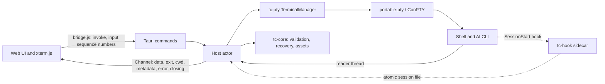

# Rust migration plan

Status: approved plan, 2026-11-09. Scope: replace the Electron/Node host with a Rust host on Tauri 2 and keep the web UI. Development happens on macOS. Windows stays the primary target and is validated in CI.

## Decision

Everything in Terminal Canvas that runs in Node moves to Rust, hosted by Tauri 2. That covers the Electron main process, PTY management, shell integration, persistence, image assets, and the Claude hook script. The renderer stays as it is: HTML, CSS, `renderer.js`, `items.js`, `history.js`, `clipboard.js`, `canvas-geometry.js`, `terminal-pointer.js`, `minimap.js`, and xterm.js. It changes only where the host boundary changes.

What this gets us:

- **No Electron or node-pty.** The native build that blocks `npm run build` today (`MSB8040: Spectre-mitigated libraries are required`) goes away, and so does the `postinstall` node-pty patch.
- **One compiled host.** Typed validation sits in front of every OS operation.
- **A much smaller app.** It uses the system webview (WebView2 on Windows) instead of bundling Chromium.

Non-goals:

- **No workspace format change.** Format 3 files written by the Electron build and by the Rust build must each open in the other.
- **No UI redesign and no new features** during the migration.
- **No Rust UI.** Moving the pure UI modules (`canvas-geometry.js`, `history.js`) to WASM can be reconsidered after cutover, if ever.
- **No new platform features.** Windows stays the primary target. CI builds and tests macOS and Linux from Phase 0. Packaging for those platforms and zsh prompt integration (zsh gets only directory polling today) remain future work.

## What moves and what stays

| Today | After |
| --- | --- |
| `src/main.cjs` (window, IPC, dialogs, clipboard, protocol, lifecycle) | `src-tauri/src/`: commands, protocol, lifecycle |
| `src/preload.cjs` | `src/bridge.js` (still JS): the same `window.terminalCanvas` API on top of Tauri IPC |
| `src/terminal-manager.cjs` | `crates/tc-pty`: manager |
| `src/terminal-cwd.cjs` | The OSC decoder goes to `tc-core::osc`, process cwd polling to `tc-pty::cwd`, and the PowerShell bootstrap to `crates/tc-pty/shell/bootstrap.ps1` |
| `src/shell-integration.cjs` | `tc-pty::integration` plus `shell/*.ps1` and `shell/*.bash` |
| `src/session-hook.cjs` | `crates/tc-hook`: a small console binary shipped as a sidecar |
| `src/session-metadata.cjs` | `tc-core::session` |
| `src/workspace.cjs` | `tc-core::workspace` |
| `src/workspace-recovery.cjs` | `tc-core::recovery` |
| `src/assets.cjs` | `tc-core::assets` |
| `src/directories.cjs` | `tc-core::dirs` |
| `src/item-styles.js` | Stays in the UI. Rust mirrors the constants, and a parity test compares the two |
| Renderer, items, history, clipboard, geometry, pointer, minimap, HTML, CSS | Stay, with the small edits listed in Phase 3 |
| `scripts/rebuild.cjs`, `scripts/patch-node-pty.cjs` | Deleted |
| `scripts/start.cjs`, `scripts/check.cjs` | Replaced by `cargo run` and `cargo xtask check` |
| `scripts/preview.cjs` (`npm run dev`) | Deleted; `cargo run` is the dev loop |
| `scripts/icons.cjs` | Replaced by `cargo tauri icon` or an xtask that uses resvg |
| `scripts/smoke*.cjs`, `scripts/restoration-smoke.cjs` | `tests/e2e/`: Playwright driving WebView2 over CDP |

Node remains a dev-only dependency. It runs the UI unit tests, supplies the pinned xterm.js files, and drives the Windows E2E tests. Nothing in the shipped app needs it.

## Target architecture



Tauri requires a `src-tauri/` folder, and `AGENTS.md` allows a layout that a framework requires:

```text
Cargo.toml              workspace, shared lints, pinned dependencies
rust-toolchain.toml     channel = "1.95"
.github/workflows/      CI on Windows, macOS, and Linux
crates/
    tc-core/            pure logic; no Tauri, no PTY; builds on every OS
    tc-pty/             processes, shell integration, cwd polling
        shell/          bootstrap.ps1, agent.ps1, integration.bash (loaded with include_str!)
    tc-hook/            sidecar binary: `record <provider>`, `emit launch|end`
src-tauri/              app: commands, protocol, lifecycle, build.rs, tauri.conf.json, capabilities/
xtask/                  check, icons, golden capture
src/                    web UI (existing files plus bridge.js); build.rs copies xterm.js into src/vendor/ (ignored)
tests/                  JS UI tests (stay), tests/golden/ fixtures, tests/e2e/
```

### Design decisions

1. **One host actor owns all state.** The JS host relies on Node's event loop to run everything in order: the `this.sessions.get(id) !== entry` checks, the write queue, and the `serialize()` asset tasks all depend on it. The Rust host keeps that model. One tokio task owns `TerminalManager` and `WorkspaceRecovery` and handles messages one at a time: commands (each answered through a oneshot reply), PTY output, exits, and poll ticks. The code can then be ported almost line by line, and the existing tests carry over directly. File writes and asset tasks each keep their own serial queue, as they do today.
2. **Each terminal has three threads, outside the actor.** A blocking reader, a writer (so a stalled shell cannot block IPC), and an exit waiter. At the 24-terminal limit that is 72 threads, which is fine.
3. **Backpressure works without `pause()`.** When unacknowledged output goes above 256,000, the reader thread stops reading until it drops below 32,000. The PTY's buffer then fills and the child process blocks, which is what node-pty's `pause()` achieved. Pending output is counted in UTF-16 units, so the renderer's `event.data.length` acknowledgments keep working unchanged.
4. **Output stays text.** The reader decodes UTF-8 and carries any sequence split across two reads over to the next one. Invalid bytes become U+FFFD, matching node-pty. A raw-bytes channel can come later as an optimization.
5. **Events go through one Tauri Channel**, registered by `initialize`. Channels deliver messages in order. `bridge.js` passes each message to the `onEvent` listeners, so `renderer.js` keeps its single handler.
6. **The data folder stays the same.** The host uses the folder Electron used: `terminal-canvas` inside `dirs::config_dir()`, which is `%APPDATA%` on Windows, `~/Library/Application Support` on macOS, and `~/.config` on Linux. Tauri's default would be named after the identifier, `local.terminalcanvas.desktop`. The existing autosave, `assets`, and `shell-integration` folders then carry over with no migration step.
7. **Host logic can be tested without Tauri.** Command handlers live in a `Host` type that takes a `Platform` trait for dialogs, clipboard, the link opener, and closing the window. Today's tests load `main.cjs` in a `vm` with a fake `electron` (clipboard, external links, recovery lifecycle). They become unit tests against a fake `Platform`.
8. **Stopping a terminal ends its whole process tree.**
    - **Windows:** node-pty kills every process attached to the console; that is the helper the `postinstall` patch fixes. portable-pty does not, so each shell runs in a Job Object that kills its processes when the job closes. This also covers a crash of the host itself, which today can leave AI CLIs running.
    - **macOS and Linux:** portable-pty starts each shell in its own session. Stop sends SIGHUP to that process group.

## Development and CI

Day-to-day development happens on a Mac. Windows is still the primary target, so the Windows CI job decides whether a change is ready.

The local loop on macOS needs Xcode Command Line Tools, Rust 1.95, and Node 22.12+:

```sh
npm ci                          # once, and again after package-lock.json changes
cargo run -p terminal-canvas    # the app
cargo test --workspace          # host tests
npm test                        # UI tests
```

`src-tauri/build.rs` copies the pinned xterm.js files from `node_modules` into `src/vendor/`. If they're missing it stops with "run npm ci first". `cargo run` is therefore the whole dev loop and needs no Tauri CLI. Packaging still uses `cargo tauri build`.

Some things only run on Windows: the PowerShell and cmd integration tests, Job Objects, WebView2-specific behavior, and the E2E suite, which drives WebView2 over CDP. macOS's WKWebView has no automation driver for Tauri apps. On the Mac, coverage comes from unit tests and manual checks.

CI runs on GitHub Actions, added in Phase 0, on `windows-latest`, `macos-latest`, and `ubuntu-latest`:

- rustfmt, clippy with `-D warnings`, and `cargo test --workspace`
- `npm ci`, `npm run check`, and `npm test`
- the golden capture in `--check` mode, which proves the fixtures do not depend on the machine that captured them
- from Phase 3, Tauri's WebKitGTK system packages installed in the Linux job
- from Phase 4, E2E on `windows-latest` only

All three jobs must pass before a merge.

## Phases

Sizes are relative (S < M < L). The Electron build remains the app we ship until Phase 5 ends, and each phase merges to `main` on its own.

### Phase 0: safety net and CI (S)

- Add the Cargo workspace, `rust-toolchain.toml`, rustfmt and clippy settings, and `target/` in `.gitignore`.
- Add the CI workflow described above. Until now the JS tests have only run on Windows. Any that fail on macOS or Linux get fixed, or skipped with a stated reason, in the same PR.
- Write `scripts/capture-golden.cjs`. It runs the current JS modules on fixture inputs and saves the results in `tests/golden/`. Platform, home folder, and hostname are passed in explicitly, so the fixtures come out the same on every machine. A `--check` mode compares against the committed files. The captures:
    - `validateWorkspace`, `validateCard`, `validateItem`: valid files, every rejection with its error message, migrations from format 1 and 2, `color: 'default'`, and group paths.
    - `directoryReports` and `MetadataParser`: the events produced for each byte stream, including the cases in `terminal-cwd.test.cjs` and `session-restoration.test.cjs`.
    - `extractAssets`, `embedAssets`, `detectImage`, and `keepList`.
    - The exact text of `powershellArgs()`, `powershellSource()`, `bashSource()`, and the Claude settings file.
- Record a baseline on Windows to compare against in Phase 5: test counts, smoke and restoration results, install size, memory with four idle terminals, and startup time.

Done when the golden fixtures are committed, CI passes on all three runners, and the app is unchanged.

### Phase 1: tc-core, the pure logic (M)

Port the workspace and session-metadata modules, the OSC decoder from `terminal-cwd.cjs`, assets, directories, recovery state, the item-style constants, and the profiles.

- Validate from `serde_json::Value` with hand-written checks that mirror the JS, then build typed structs. A plain `#[derive(Deserialize)]` would change the error messages and the migration behavior.
- Run every golden fixture. Add property tests that split each stream at every byte boundary and require the same events.
- Add a parity test for item styles: load `src/item-styles.js` with `node -e` and compare it with the Rust constants.

Done when `cargo test -p tc-core` passes on all three CI runners, golden fixtures included.

### Phase 2: tc-pty and tc-hook, the process layer (L)

- **Spawning with portable-pty.**
    - Windows: PowerShell 5.1 is the default. Detect the `pwsh`, `powershell`, and `cmd` launchers. Pass `-ExecutionPolicy RemoteSigned -EncodedCommand`. Prefix cmd's `PROMPT`.
    - Everywhere: set `TERM`, `COLORTERM`, and `TERMINAL_CANVAS`.
    - macOS and Linux: start `$SHELL` as a login shell. For Bash, queue its `source` command.
- **Lifecycle, ported exactly:**
    - the `start`, `resume`, and `fresh` modes and the 24-terminal limit
    - dimension checks, the 64 KB input limit, and resetting readiness on CR/LF
    - 500 ms hook polling and metadata merging
    - Stop with its 5 s fallback, and `shutdown` waiting for every exit
    - the Duplicate directory logic
- **Unix cwd polling.** Read `/proc/<pid>/cwd` on Linux. On macOS, either keep `/usr/sbin/lsof` or switch to `libproc`. Switching changes behavior, so the README must say so.
- **Shell scripts in files.** Move the scripts into `crates/tc-pty/shell/`. Golden tests prove that the generated text matches the JS output byte for byte.
- **tc-hook.**
    - `record claude` reads at most 64 KB from stdin, validates it, and writes the session file atomically with mode 0600.
    - `emit launch|end` writes the base64-encoded OSC 633 report.
    - Bash calls `"$TC_HOOK"` directly instead of `ELECTRON_RUN_AS_NODE=1 "$TC_NODE" "$TC_HOOK"`.
    - Keep the PowerShell UTF-8 stdin bridge in the Claude settings until a test shows that tc-hook decodes Unicode directories without it.
- **Cleanup.** On Windows each shell gets its own Job Object, and dropping the PTY master closes the pseudoconsole. On Unix, Stop signals the shell's process group.
- **A UI-free check.** Add `cargo run -p tc-pty --example drive`, which starts a shell, runs `cd`, and prints the events. It works on the Mac too.

Tests: port the terminal-manager tests to a fake PTY trait in place of the injected `spawn`, then port the terminal-cwd, session-restoration, and directories tests. PowerShell and cmd tests run on the Windows runner. Bash integration and cwd polling tests run on macOS and Linux, so they also run locally on the Mac.

Done when:

- On Windows, PowerShell 5.1, PowerShell 7, and cmd report directories and readiness through the example binary.
- On macOS, zsh and Bash report polled directories through the example binary.
- On Windows, the controlled CLI substitute from `restoration-smoke.cjs` captures Claude and Codex session IDs.

### Phase 3: Tauri app and bridge (L)

**Host**

- **Commands.** One per `command(action)` branch:
    - workspace: `initialize`, `create-card`, `autosave`, `save`, `save-as`, `export`, `open`, `new`, `close`
    - terminals: `duplicate-directory`, `start`, `stop`, `pick-folder`
    - images: `import-image`, `pick-image`, `unused-images`, `delete-unused-images`
    - OS: `open-link`, `clipboard-read`, `clipboard-write`
    - Plus `input`, `resize`, and `ack`.
- **Image import.** `import-image` receives the image as a raw IPC body, not as a JSON number array.
- **OS services.**
    - Dialogs use tauri-plugin-dialog.
    - Clipboard uses arboard or tauri-plugin-clipboard-manager, with the 64,000-character paste limit and the 1 MB copy limit kept.
    - Links open through tauri-plugin-opener after the existing validation.
- **Image protocol.** Serve `tc-asset` through `register_asynchronous_uri_scheme_protocol`, with the same name check and the `nosniff` and `no-cache` headers.
- **Lifecycle.**
    - `CloseRequested` and `ExitRequested` are prevented and become the `closing` event. The `close` command then flushes, shuts down, and exits.
    - On Windows, WebView2's `ProcessFailed` event, reached through `with_webview`, runs the renderer-crash path.

**Security, matching today's Electron settings**

- **Capabilities.** Only the `main` window, only local content, and only the app's own commands. No fs or shell plugin permissions are exposed to JavaScript.
- **CSP.** Move it from the `<meta>` tag into `tauri.conf.json`, because the meta tag's `connect-src 'none'` would block Tauri IPC. Keep `script-src 'self'` and do not allow `unsafe-eval`.
- **Navigation and permissions.** Block navigation away from the app's origin and deny new windows. On Windows, deny every WebView2 permission request through `PermissionRequested` in `with_webview`.
- **Caller check.** Every command still checks that the caller is the `main` webview.

**Window and webview defaults that would break current behavior**

These WebView2 items are Windows-specific. On the Mac, check what WKWebView does for each one.

- **File drop.** Set `dragDropEnabled: false`. Otherwise Tauri takes OS file drops and image drops never reach the canvas.
- **Zoom.** Turn off WebView2's zoom hotkeys and Ctrl+wheel zoom, so Ctrl+scroll reaches the canvas.
- **Accelerator keys.** Turn off the browser's own shortcuts (F5, Ctrl+R, Ctrl+F, Ctrl+P). Confirm that Ctrl+Shift+C reaches xterm; Chromium uses it to open DevTools when DevTools is enabled.
- **macOS Edit menu.** Keep the standard Edit menu on macOS so Cmd+C/V/X/A/Z work in text fields and dialogs; without an app menu, those shortcuts stop working in WKWebView text fields. Windows keeps no menu.
- **Window.** 1500×960, minimum 1000×680, background `#111318`, the same title and icon.

**Renderer edits (the only UI changes)**

- **`bridge.js`.** Defines `window.terminalCanvas` with the same five methods.
    - It turns rejected invokes into `{ error }` results, so `invoke()` in `renderer.js` stays the same.
    - It gives every `input` call a per-terminal sequence number. The host applies input in sequence order, because concurrent IPC requests are not guaranteed to arrive in order.
- **Image URLs.** On Windows, Tauri serves custom schemes as `http://tc-asset.localhost/…`. On macOS and Linux the scheme is registered directly, so `tc-asset://images/…` should keep working; verify this. `assetUrl()` in `items.js` takes its prefix from the bridge, the protocol handler accepts both forms, and `img-src` in the CSP lists both.
- **xterm.js files.** Load them from `src/vendor/`, which `src-tauri/build.rs` fills. Tauri cannot serve `../node_modules`.

Done when:

- `cargo run -p terminal-canvas` runs the full app on macOS and Windows.
- A manual pass through the README sections "Use the workspace", "Board items", and "What can be recovered" succeeds on both.
- The JS UI tests still pass on all three CI runners.

### Phase 4: end-to-end parity (L)

The E2E suite runs in the Windows CI job; it cannot run on the Mac.

- **Harness.** Rebuild the smoke and restoration suites in `tests/e2e/`, with Playwright connected to WebView2 over CDP. Test runs set `WEBVIEW2_ADDITIONAL_BROWSER_ARGUMENTS=--remote-debugging-port=…`; normal launches never do.
    - `executeJavaScript` becomes `page.evaluate`.
    - `sendInputEvent` becomes `page.mouse` and `page.keyboard`, which send trusted input through CDP.
    - `capturePage` becomes `page.screenshot`.
    - Keep two helpers that fixed real flakiness: waiting until the page has dispatched the last native event, and taking window focus back.
- **Test-only host features.** A cargo feature named `e2e`, never enabled in release builds, adds:
    - the profile-folder flags `--smoke-test` and `--restoration-smoke=<phase>`
    - a host-state query, so tests can check running sessions
    - interception of link opens, and window focus control
- **New checks** for risks the Electron build did not have:
    - input order during a 64,000-character paste followed by typing
    - backpressure under an output flood
    - child processes gone after Stop, after closing the app, and after killing the host
    - image file drop, Ctrl+wheel zoom, and Ctrl+Shift+C
    - display scaling at 1.25 and 1.5
    - the WebView2 renderer process killed mid-session

Done when smoke and restoration pass 10 consecutive runs in the Windows CI job and once on a Windows 11 machine.

### Phase 5: packaging and cutover (M)

- **Windows formats.** Build with `cargo tauri build` and ship both formats:
    - an NSIS installer, which can install the WebView2 Runtime if it's missing
    - a portable zip with `Terminal Canvas.exe` and `tc-hook.exe`, which needs the WebView2 Runtime already installed (Windows 11 has it)
- **tc-hook location.** The host finds tc-hook next to its own executable in both formats; the Bash and Claude hook paths point there. A release job on `windows-latest` builds both formats and uploads them as workflow artifacts.
- **Icons.** Generate them from `src/assets/logo.svg` with `cargo tauri icon` or a resvg xtask, and keep a `--check` mode.
- **Removal.** Switch `tests/renderer.test.cjs` off `workspace.cjs` (it uses `PROFILES`, `createWorkspace`, and `createCard`) and onto JSON fixtures. Then delete:
    - the Electron host files, the node-pty scripts, and their tests
    - `scripts/preview.cjs` and the `dev` script
    - the `postinstall` step
    - the `electron`, `electron-builder`, and `@electron/rebuild` dependencies
- **Docs.** Update:
    - `README.md`: requirements per platform (Windows: Rust 1.95, MSVC Build Tools without the Spectre libraries, the WebView2 Runtime; macOS: Xcode Command Line Tools; Linux: Tauri's WebKitGTK packages), commands, and validation results
    - `docs/architecture.md`
    - `AGENTS.md`: layout and commands
- **Baseline.** Compare against the Phase 0 baseline.

Done when the installer and the portable zip both run on a clean Windows 11 machine, and an autosaved workspace with images from the Electron build opens unchanged.

## Test migration

There are 182 `test()` call sites today; the README reports 189 tests run.

| Tests | Count | Destination |
| --- | --- | --- |
| renderer, canvas-geometry, terminal-pointer, minimap | 73 | Stay in JS (`node --test`) |
| workspace, assets, directories | 25 | tc-core unit tests and golden fixtures |
| terminal-manager, terminal-cwd, session-restoration | 54 | tc-pty and tc-hook tests; PowerShell and cmd cases run on Windows only |
| clipboard, external-links, recovery-lifecycle | 10 | `Host` unit tests with a fake `Platform` |
| smoke (harness helpers) | 10 | Tests for the new E2E harness helpers |
| icons | 2 | `cargo xtask icons --check` |
| rebuild, patch-node-pty, start | 8 | Deleted along with node-pty and Electron |

`npm test` keeps running the UI tests and `cargo test --workspace` runs the host tests. Both run on all three CI runners, and each test that needs Windows is skipped elsewhere. `cargo xtask check` runs rustfmt, clippy with `-D warnings`, `node --check` on the UI scripts, and both test suites.

## Parity details that are easy to get wrong

- **String lengths.** The JS limits count UTF-16 units: titles 100, text 10,000, paste 64,000, input 65,536. Use `encode_utf16().count()`, not `len()`.
- **Trimming.** JS `trim()` also removes U+FEFF; Rust's `trim()` does not.
- **Numbers.** serde_json writes `48.0` where JS writes `48`. Both parse to the same value, but golden tests should compare parsed values, or the serializer should write whole numbers without `.0`.
- **Field order and omitted defaults.** Keep the order `version, name, camera, cards, items`, and keep leaving out `color`, `fontSize`, and empty `groups`.
- **Error messages.** The UI shows host errors word for word, so keep the same strings.
- **File URLs.** `url::Url::to_file_path` follows the compile target, while the JS decoder takes the platform as an argument. Port the UNC `file://localhost/` handling and the `%5C` rejection as a separate function, and test it on every OS.
- **Hostnames.** OSC 7 accepts `localhost` and the machine's own hostname, compared without regard to case.
- **Atomic writes.** Use a temporary file and a rename everywhere: workspace, assets, and the session file. On Windows the rename must replace an existing file.

## Risks

| Risk | Impact | Mitigation |
| --- | --- | --- |
| Developing on macOS hides failures that only happen on Windows | High | The Windows CI job must pass before a merge; E2E runs there; a manual Windows pass ends Phases 3 to 5 |
| IPC calls arrive out of order and scramble typed or pasted input | High | Sequence numbers in `bridge.js`; E2E paste test |
| WebView2 defaults (file drop, zoom, accelerator keys, permission prompts) change behavior | High | Explicit settings in Phase 3; E2E checks in Phase 4 |
| portable-pty and node-pty differ in resize, kill, and exit codes | Medium | Job Objects and process-group signals; ported lifecycle tests; E2E with real shells |
| Validation drifts from the JS behavior and older files stop opening | Medium | Golden fixtures captured from the JS code before it is deleted |
| The rewritten smoke harness becomes flaky again | Medium | Keep the dispatch-wait and focus helpers; require 10 consecutive passes |
| Claude or Codex capture breaks when the hook moves from Node to a sidecar | Medium | Controlled CLI substitute in the restoration E2E; keep the UTF-8 bridge until a test shows it is unnecessary |
| Renderer-crash recovery needs WebView2 COM APIs | Low | `with_webview` with webview2-com; kill the renderer process in an E2E test |
| Building on Windows still needs Visual Studio Build Tools for the Rust MSVC toolchain | Low | The Spectre libraries are not needed; document this in the README |

## Decisions

Recorded 2026-11-09:

1. **Distribution.** Ship both an NSIS installer and a portable zip for Windows (Phase 5).
2. **Browser preview.** Retired. `cargo run` is the dev loop, and `scripts/preview.cjs` and `npm run dev` are deleted in Phase 5.
3. **Other platforms.** CI builds and tests Windows, macOS, and Linux from Phase 0.
4. **CI.** GitHub Actions, added in Phase 0.
