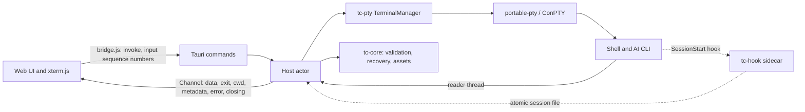

# Rust migration plan

Status: approved plan, 2026-11-09. Scope: replace the Electron/Node host with a Rust host on Tauri 2 and keep the web UI. Development happens on macOS. Windows stays the primary target and is validated in CI.

## Decision

Everything in Terminal Canvas that runs in Node moves to Rust, hosted by Tauri 2. That covers the Electron main process, PTY management, shell integration, persistence, image assets, and the Claude hook script. The renderer stays as it is: HTML, CSS, `renderer.js`, `items.js`, `history.js`, `clipboard.js`, `canvas-geometry.js`, `terminal-pointer.js`, `minimap.js`, and xterm.js. It changes only where the host boundary changes.

What this gets us:

- **No Electron or node-pty.** The native build that blocks `npm run build` today (`MSB8040: Spectre-mitigated libraries are required`) goes away, and so does the `postinstall` node-pty patch.
- **One compiled host.** Typed validation sits in front of every OS operation.
- **A much smaller app.** It uses the system webview (WebView2 on Windows) instead of bundling Chromium.

Non-goals:

- **No workspace format change.** Format 3 files written by the Electron build and by the Rust build must each open in the other.
- **No UI redesign and no new features** during the migration.
- **No Rust UI.** Moving the pure UI modules (`canvas-geometry.js`, `history.js`) to WASM can be reconsidered after cutover, if ever.
- **No new platform features.** Windows stays the primary target. CI builds and tests macOS and Linux from Phase 0. Packaging for those platforms and zsh prompt integration (zsh gets only directory polling today) remain future work.

## What moves and what stays

| Today | After |
| --- | --- |
| `src/main.cjs` (window, IPC, dialogs, clipboard, protocol, lifecycle) | `src-tauri/src/`: commands, protocol, lifecycle |
| `src/preload.cjs` | `src/bridge.js` (still JS): the same `window.terminalCanvas` API on top of Tauri IPC |
| `src/terminal-manager.cjs` | `crates/tc-pty`: manager |
| `src/terminal-cwd.cjs` | The OSC decoder goes to `tc-core::osc`, process cwd polling to `tc-pty::cwd`, and the PowerShell bootstrap to `crates/tc-pty/shell/bootstrap.ps1` |
| `src/shell-integration.cjs` | `tc-pty::integration` plus `shell/*.ps1` and `shell/*.bash` |
| `src/session-hook.cjs` | `crates/tc-hook`: a small console binary shipped as a sidecar |
| `src/session-metadata.cjs` | `tc-core::session` |
| `src/workspace.cjs` | `tc-core::workspace` |
| `src/workspace-recovery.cjs` | `tc-core::recovery` |
| `src/assets.cjs` | `tc-core::assets` |
| `src/directories.cjs` | `tc-core::dirs` |
| `src/item-styles.js` | Stays in the UI. Rust mirrors the constants, and a parity test compares the two |
| Renderer, items, history, clipboard, geometry, pointer, minimap, HTML, CSS | Stay, with the small edits listed in Phase 3 |
| `scripts/rebuild.cjs`, `scripts/patch-node-pty.cjs` | Deleted |
| `scripts/start.cjs`, `scripts/check.cjs` | Replaced by `cargo run` and `cargo xtask check` |
| `scripts/preview.cjs` (`npm run dev`) | Deleted; `cargo run` is the dev loop |
| `scripts/icons.cjs` | Replaced by `cargo tauri icon` or an xtask that uses resvg |
| `scripts/smoke*.cjs`, `scripts/restoration-smoke.cjs` | `tests/e2e/`: Playwright driving WebView2 over CDP |

Node remains a dev-only dependency. It runs the UI unit tests, supplies the pinned xterm.js files, and drives the Windows E2E tests. Nothing in the shipped app needs it.

## Target architecture



Tauri requires a `src-tauri/` folder, and `AGENTS.md` allows a layout that a framework requires:

```text
Cargo.toml              workspace, shared lints, pinned dependencies
rust-toolchain.toml     channel = "1.95"
.github/workflows/      CI on Windows, macOS, and Linux
crates/
    tc-core/            pure logic; no Tauri, no PTY; builds on every OS
    tc-pty/             processes, shell integration, cwd polling
        shell/          bootstrap.ps1, agent.ps1, integration.bash (loaded with include_str!)
    tc-hook/            sidecar binary: `record <provider>`, `emit launch|end`
src-tauri/              app: commands, protocol, lifecycle, build.rs, tauri.conf.json, capabilities/
xtask/                  check, icons, golden capture
src/                    web UI (existing files plus bridge.js); build.rs copies xterm.js into src/vendor/ (ignored)
tests/                  JS UI tests (stay), tests/golden/ fixtures, tests/e2e/
```

### Design decisions

1. **One host actor owns all state.** The JS host relies on Node's event loop to run everything in order: the `this.sessions.get(id) !== entry` checks, the write queue, and the `serialize()` asset tasks all depend on it. The Rust host keeps that model. One tokio task owns `TerminalManager` and `WorkspaceRecovery` and handles messages one at a time: commands (each answered through a oneshot reply), PTY output, exits, and poll ticks. The code can then be ported almost line by line, and the existing tests carry over directly. File writes and asset tasks each keep their own serial queue, as they do today.
2. **Each terminal has three threads, outside the actor.** A blocking reader, a writer (so a stalled shell cannot block IPC), and an exit waiter. At the 24-terminal limit that is 72 threads, which is fine.
3. **Backpressure works without `pause()`.** When unacknowledged output goes above 256,000, the reader thread stops reading until it drops below 32,000. The PTY's buffer then fills and the child process blocks, which is what node-pty's `pause()` achieved. Pending output is counted in UTF-16 units, so the renderer's `event.data.length` acknowledgments keep working unchanged.
4. **Output stays text.** The reader decodes UTF-8 and carries any sequence split across two reads over to the next one. Invalid bytes become U+FFFD, matching node-pty. A raw-bytes channel can come later as an optimization.
5. **Events go through one Tauri Channel**, registered by `initialize`. Channels deliver messages in order. `bridge.js` passes each message to the `onEvent` listeners, so `renderer.js` keeps its single handler.
6. **The data folder stays the same.** The host uses the folder Electron used: `terminal-canvas` inside `dirs::config_dir()`, which is `%APPDATA%` on Windows, `~/Library/Application Support` on macOS, and `~/.config` on Linux. Tauri's default would be named after the identifier, `local.terminalcanvas.desktop`. The existing autosave, `assets`, and `shell-integration` folders then carry over with no migration step.
7. **Host logic can be tested without Tauri.** Command handlers live in a `Host` type that takes a `Platform` trait for dialogs, clipboard, the link opener, and closing the window. Today's tests load `main.cjs` in a `vm` with a fake `electron` (clipboard, external links, recovery lifecycle). They become unit tests against a fake `Platform`.
8. **Stopping a terminal ends its whole process tree.**
    - **Windows:** node-pty kills every process attached to the console; that is the helper the `postinstall` patch fixes. portable-pty does not, so each shell runs in a Job Object that kills its processes when the job closes. This also covers a crash of the host itself, which today can leave AI CLIs running.
    - **macOS and Linux:** portable-pty starts each shell in its own session. Stop sends SIGHUP to that process group.

## Development and CI

Day-to-day development happens on a Mac. Windows is still the primary target, so the Windows CI job decides whether a change is ready.

The local loop on macOS needs Xcode Command Line Tools, Rust 1.95, and Node 22.12+:

```sh
npm ci                          # once, and again after package-lock.json changes
cargo run -p terminal-canvas    # the app
cargo test --workspace          # host tests
npm test                        # UI tests
```

`src-tauri/build.rs` copies the pinned xterm.js files from `node_modules` into `src/vendor/`. If they're missing it stops with "run npm ci first". `cargo run` is therefore the whole dev loop and needs no Tauri CLI. Packaging still uses `cargo tauri build`.

Some things only run on Windows: the PowerShell and cmd integration tests, Job Objects, WebView2-specific behavior, and the E2E suite, which drives WebView2 over CDP. macOS's WKWebView has no automation driver for Tauri apps. On the Mac, coverage comes from unit tests and manual checks.

CI runs on GitHub Actions, added in Phase 0, on `windows-latest`, `macos-latest`, and `ubuntu-latest`:

- rustfmt, clippy with `-D warnings`, and `cargo test --workspace`
- `npm ci`, `npm run check`, and `npm test`
- the golden capture in `--check` mode, which proves the fixtures do not depend on the machine that captured them
- from Phase 3, Tauri's WebKitGTK system packages installed in the Linux job
- from Phase 4, E2E on `windows-latest` only

All three jobs must pass before a merge.

## Phases

Sizes are relative (S < M < L). The Electron build remains the app we ship until Phase 5 ends, and each phase merges to `main` on its own.

### Phase 0: safety net and CI (S)

- Add the Cargo workspace, `rust-toolchain.toml`, rustfmt and clippy settings, and `target/` in `.gitignore`.
- Add the CI workflow described above. Until now the JS tests have only run on Windows. Any that fail on macOS or Linux get fixed, or skipped with a stated reason, in the same PR.
- Write `scripts/capture-golden.cjs`. It runs the current JS modules on fixture inputs and saves the results in `tests/golden/`. Platform, home folder, and hostname are passed in explicitly, so the fixtures come out the same on every machine. A `--check` mode compares against the committed files. The captures:
    - `validateWorkspace`, `validateCard`, `validateItem`: valid files, every rejection with its error message, migrations from format 1 and 2, `color: 'default'`, and group paths.
    - `directoryReports` and `MetadataParser`: the events produced for each byte stream, including the cases in `terminal-cwd.test.cjs` and `session-restoration.test.cjs`.
    - `extractAssets`, `embedAssets`, `detectImage`, and `keepList`.
    - The exact text of `powershellArgs()`, `powershellSource()`, `bashSource()`, and the Claude settings file.
- Record a baseline on Windows to compare against in Phase 5: test counts, smoke and restoration results, install size, memory with four idle terminals, and startup time.

Done when the golden fixtures are committed, CI passes on all three runners, and the app is unchanged.

### Phase 1: tc-core, the pure logic (M)

Port the workspace and session-metadata modules, the OSC decoder from `terminal-cwd.cjs`, assets, directories, recovery state, the item-style constants, and the profiles.

- Validate from `serde_json::Value` with hand-written checks that mirror the JS, then build typed structs. A plain `#[derive(Deserialize)]` would change the error messages and the migration behavior.
- Run every golden fixture. Add property tests that split each stream at every byte boundary and require the same events.
- Add a parity test for item styles: load `src/item-styles.js` with `node -e` and compare it with the Rust constants.

Done when `cargo test -p tc-core` passes on all three CI runners, golden fixtures included.

### Phase 2: tc-pty and tc-hook, the process layer (L)

- **Spawning with portable-pty.**
    - Windows: PowerShell 5.1 is the default. Detect the `pwsh`, `powershell`, and `cmd` launchers. Pass `-ExecutionPolicy RemoteSigned -EncodedCommand`. Prefix cmd's `PROMPT`.
    - Everywhere: set `TERM`, `COLORTERM`, and `TERMINAL_CANVAS`.
    - macOS and Linux: start `$SHELL` as a login shell. For Bash, queue its `source` command.
- **Lifecycle, ported exactly:**
    - the `start`, `resume`, and `fresh` modes and the 24-terminal limit
    - dimension checks, the 64 KB input limit, and resetting readiness on CR/LF
    - 500 ms hook polling and metadata merging
    - Stop with its 5 s fallback, and `shutdown` waiting for every exit
    - the Duplicate directory logic
- **Unix cwd polling.** Read `/proc/<pid>/cwd` on Linux. On macOS, either keep `/usr/sbin/lsof` or switch to `libproc`. Switching changes behavior, so the README must say so.
- **Shell scripts in files.** Move the scripts into `crates/tc-pty/shell/`. Golden tests prove that the generated text matches the JS output byte for byte.
- **tc-hook.**
    - `record claude` reads at most 64 KB from stdin, validates it, and writes the session file atomically with mode 0600.
    - `emit launch|end` writes the base64-encoded OSC 633 report.
    - Bash calls `"$TC_HOOK"` directly instead of `ELECTRON_RUN_AS_NODE=1 "$TC_NODE" "$TC_HOOK"`.
    - Keep the PowerShell UTF-8 stdin bridge in the Claude settings until a test shows that tc-hook decodes Unicode directories without it.
- **Cleanup.** On Windows each shell gets its own Job Object, and dropping the PTY master closes the pseudoconsole. On Unix, Stop signals the shell's process group.
- **A UI-free check.** Add `cargo run -p tc-pty --example drive`, which starts a shell, runs `cd`, and prints the events. It works on the Mac too.

Tests: port the terminal-manager tests to a fake PTY trait in place of the injected `spawn`, then port the terminal-cwd, session-restoration, and directories tests. PowerShell and cmd tests run on the Windows runner. Bash integration and cwd polling tests run on macOS and Linux, so they also run locally on the Mac.

Done when:

- On Windows, PowerShell 5.1, PowerShell 7, and cmd report directories and readiness through the example binary.
- On macOS, zsh and Bash report polled directories through the example binary.
- On Windows, the controlled CLI substitute from `restoration-smoke.cjs` captures Claude and Codex session IDs.

### Phase 3: Tauri app and bridge (L)

**Host**

- **Commands.** One per `command(action)` branch:
    - workspace: `initialize`, `create-card`, `autosave`, `save`, `save-as`, `export`, `open`, `new`, `close`
    - terminals: `duplicate-directory`, `start`, `stop`, `pick-folder`
    - images: `import-image`, `pick-image`, `unused-images`, `delete-unused-images`
    - OS: `open-link`, `clipboard-read`, `clipboard-write`
    - Plus `input`, `resize`, and `ack`.
- **Image import.** `import-image` receives the image as a raw IPC body, not as a JSON number array.
- **OS services.**
    - Dialogs use tauri-plugin-dialog.
    - Clipboard uses arboard or tauri-plugin-clipboard-manager, with the 64,000-character paste limit and the 1 MB copy limit kept.
    - Links open through tauri-plugin-opener after the existing validation.
- **Image protocol.** Serve `tc-asset` through `register_asynchronous_uri_scheme_protocol`, with the same name check and the `nosniff` and `no-cache` headers.
- **Lifecycle.**
    - `CloseRequested` and `ExitRequested` are prevented and become the `closing` event. The `close` command then flushes, shuts down, and exits.
    - On Windows, WebView2's `ProcessFailed` event, reached through `with_webview`, runs the renderer-crash path.

**Security, matching today's Electron settings**

- **Capabilities.** Only the `main` window, only local content, and only the app's own commands. No fs or shell plugin permissions are exposed to JavaScript.
- **CSP.** Move it from the `<meta>` tag into `tauri.conf.json`, because the meta tag's `connect-src 'none'` would block Tauri IPC. Keep `script-src 'self'` and do not allow `unsafe-eval`.
- **Navigation and permissions.** Block navigation away from the app's origin and deny new windows. On Windows, deny every WebView2 permission request through `PermissionRequested` in `with_webview`.
- **Caller check.** Every command still checks that the caller is the `main` webview.

**Window and webview defaults that would break current behavior**

These WebView2 items are Windows-specific. On the Mac, check what WKWebView does for each one.

- **File drop.** Set `dragDropEnabled: false`. Otherwise Tauri takes OS file drops and image drops never reach the canvas.
- **Zoom.** Turn off WebView2's zoom hotkeys and Ctrl+wheel zoom, so Ctrl+scroll reaches the canvas.
- **Accelerator keys.** Turn off the browser's own shortcuts (F5, Ctrl+R, Ctrl+F, Ctrl+P). Confirm that Ctrl+Shift+C reaches xterm; Chromium uses it to open DevTools when DevTools is enabled.
- **macOS Edit menu.** Keep the standard Edit menu on macOS so Cmd+C/V/X/A/Z work in text fields and dialogs; without an app menu, those shortcuts stop working in WKWebView text fields. Windows keeps no menu.
- **Window.** 1500×960, minimum 1000×680, background `#111318`, the same title and icon.

**Renderer edits (the only UI changes)**

- **`bridge.js`.** Defines `window.terminalCanvas` with the same five methods.
    - It turns rejected invokes into `{ error }` results, so `invoke()` in `renderer.js` stays the same.
    - It gives every `input` call a per-terminal sequence number. The host applies input in sequence order, because concurrent IPC requests are not guaranteed to arrive in order.
- **Image URLs.** On Windows, Tauri serves custom schemes as `http://tc-asset.localhost/…`. On macOS and Linux the scheme is registered directly, so `tc-asset://images/…` should keep working; verify this. `assetUrl()` in `items.js` takes its prefix from the bridge, the protocol handler accepts both forms, and `img-src` in the CSP lists both.
- **xterm.js files.** Load them from `src/vendor/`, which `src-tauri/build.rs` fills. Tauri cannot serve `../node_modules`.

Done when:

- `cargo run -p terminal-canvas` runs the full app on macOS and Windows.
- A manual pass through the README sections "Use the workspace", "Board items", and "What can be recovered" succeeds on both.
- The JS UI tests still pass on all three CI runners.

### Phase 4: end-to-end parity (L)

The E2E suite runs in the Windows CI job; it cannot run on the Mac.

- **Harness.** Rebuild the smoke and restoration suites in `tests/e2e/`, with Playwright connected to WebView2 over CDP. Test runs set `WEBVIEW2_ADDITIONAL_BROWSER_ARGUMENTS=--remote-debugging-port=…`; normal launches never do.
    - `executeJavaScript` becomes `page.evaluate`.
    - `sendInputEvent` becomes `page.mouse` and `page.keyboard`, which send trusted input through CDP.
    - `capturePage` becomes `page.screenshot`.
    - Keep two helpers that fixed real flakiness: waiting until the page has dispatched the last native event, and taking window focus back.
- **Test-only host features.** A cargo feature named `e2e`, never enabled in release builds, adds:
    - the profile-folder flags `--smoke-test` and `--restoration-smoke=<phase>`
    - a host-state query, so tests can check running sessions
    - interception of link opens, and window focus control
- **New checks** for risks the Electron build did not have:
    - input order during a 64,000-character paste followed by typing
    - backpressure under an output flood
    - child processes gone after Stop, after closing the app, and after killing the host
    - image file drop, Ctrl+wheel zoom, and Ctrl+Shift+C
    - display scaling at 1.25 and 1.5
    - the WebView2 renderer process killed mid-session

Done when smoke and restoration pass 10 consecutive runs in the Windows CI job and once on a Windows 11 machine.

### Phase 5: packaging and cutover (M)

- **Windows formats.** Build with `cargo tauri build` and ship both formats:
    - an NSIS installer, which can install the WebView2 Runtime if it's missing
    - a portable zip with `Terminal Canvas.exe` and `tc-hook.exe`, which needs the WebView2 Runtime already installed (Windows 11 has it)
- **tc-hook location.** The host finds tc-hook next to its own executable in both formats; the Bash and Claude hook paths point there. A release job on `windows-latest` builds both formats and uploads them as workflow artifacts.
- **Icons.** Generate them from `src/assets/logo.svg` with `cargo tauri icon` or a resvg xtask, and keep a `--check` mode.
- **Removal.** Switch `tests/renderer.test.cjs` off `workspace.cjs` (it uses `PROFILES`, `createWorkspace`, and `createCard`) and onto JSON fixtures. Then delete:
    - the Electron host files, the node-pty scripts, and their tests
    - `scripts/preview.cjs` and the `dev` script
    - the `postinstall` step
    - the `electron`, `electron-builder`, and `@electron/rebuild` dependencies
- **Docs.** Update:
    - `README.md`: requirements per platform (Windows: Rust 1.95, MSVC Build Tools without the Spectre libraries, the WebView2 Runtime; macOS: Xcode Command Line Tools; Linux: Tauri's WebKitGTK packages), commands, and validation results
    - `docs/architecture.md`
    - `AGENTS.md`: layout and commands
- **Baseline.** Compare against the Phase 0 baseline.

Done when the installer and the portable zip both run on a clean Windows 11 machine, and an autosaved workspace with images from the Electron build opens unchanged.

## Test migration

There are 182 `test()` call sites today; the README reports 189 tests run.

| Tests | Count | Destination |
| --- | --- | --- |
| renderer, canvas-geometry, terminal-pointer, minimap | 73 | Stay in JS (`node --test`) |
| workspace, assets, directories | 25 | tc-core unit tests and golden fixtures |
| terminal-manager, terminal-cwd, session-restoration | 54 | tc-pty and tc-hook tests; PowerShell and cmd cases run on Windows only |
| clipboard, external-links, recovery-lifecycle | 10 | `Host` unit tests with a fake `Platform` |
| smoke (harness helpers) | 10 | Tests for the new E2E harness helpers |
| icons | 2 | `cargo xtask icons --check` |
| rebuild, patch-node-pty, start | 8 | Deleted along with node-pty and Electron |

`npm test` keeps running the UI tests and `cargo test --workspace` runs the host tests. Both run on all three CI runners, and each test that needs Windows is skipped elsewhere. `cargo xtask check` runs rustfmt, clippy with `-D warnings`, `node --check` on the UI scripts, and both test suites.

## Parity details that are easy to get wrong

- **String lengths.** The JS limits count UTF-16 units: titles 100, text 10,000, paste 64,000, input 65,536. Use `encode_utf16().count()`, not `len()`.
- **Trimming.** JS `trim()` also removes U+FEFF; Rust's `trim()` does not.
- **Numbers.** serde_json writes `48.0` where JS writes `48`. Both parse to the same value, but golden tests should compare parsed values, or the serializer should write whole numbers without `.0`.
- **Field order and omitted defaults.** Keep the order `version, name, camera, cards, items`, and keep leaving out `color`, `fontSize`, and empty `groups`.
- **Error messages.** The UI shows host errors word for word, so keep the same strings.
- **File URLs.** `url::Url::to_file_path` follows the compile target, while the JS decoder takes the platform as an argument. Port the UNC `file://localhost/` handling and the `%5C` rejection as a separate function, and test it on every OS.
- **Hostnames.** OSC 7 accepts `localhost` and the machine's own hostname, compared without regard to case.
- **Atomic writes.** Use a temporary file and a rename everywhere: workspace, assets, and the session file. On Windows the rename must replace an existing file.

## Risks

| Risk | Impact | Mitigation |
| --- | --- | --- |
| Developing on macOS hides failures that only happen on Windows | High | The Windows CI job must pass before a merge; E2E runs there; a manual Windows pass ends Phases 3 to 5 |
| IPC calls arrive out of order and scramble typed or pasted input | High | Sequence numbers in `bridge.js`; E2E paste test |
| WebView2 defaults (file drop, zoom, accelerator keys, permission prompts) change behavior | High | Explicit settings in Phase 3; E2E checks in Phase 4 |
| portable-pty and node-pty differ in resize, kill, and exit codes | Medium | Job Objects and process-group signals; ported lifecycle tests; E2E with real shells |
| Validation drifts from the JS behavior and older files stop opening | Medium | Golden fixtures captured from the JS code before it is deleted |
| The rewritten smoke harness becomes flaky again | Medium | Keep the dispatch-wait and focus helpers; require 10 consecutive passes |
| Claude or Codex capture breaks when the hook moves from Node to a sidecar | Medium | Controlled CLI substitute in the restoration E2E; keep the UTF-8 bridge until a test shows it is unnecessary |
| Renderer-crash recovery needs WebView2 COM APIs | Low | `with_webview` with webview2-com; kill the renderer process in an E2E test |
| Building on Windows still needs Visual Studio Build Tools for the Rust MSVC toolchain | Low | The Spectre libraries are not needed; document this in the README |

## Decisions

Recorded 2026-11-09:

1. **Distribution.** Ship both an NSIS installer and a portable zip for Windows (Phase 5).
2. **Browser preview.** Retired. `cargo run` is the dev loop, and `scripts/preview.cjs` and `npm run dev` are deleted in Phase 5.
3. **Other platforms.** CI builds and tests Windows, macOS, and Linux from Phase 0.
4. **CI.** GitHub Actions, added in Phase 0.

## Progress

Updated 2026-11-10.

**Phase 0** implementation and golden fixtures are committed in `735ac80`. Draft PR [#16](https://github.com/yutigi/TerminalCanvas/pull/16) now runs CI. macOS and Ubuntu jobs have passed; Windows has reached real native compilation/tests but is not green. The Windows baseline remains open, so the phase is not complete.

- The Cargo workspace, `rust-toolchain.toml`, `rustfmt.toml`, workspace lints, and `.github/workflows/ci.yml` are in place. CI is now running through PR #16; Windows failures and remaining runtime gates are recorded below.
- Tauri command permission descriptors are generated from `src-tauri/build.rs` and ignored; a candidate build regenerates them rather than requiring generated source files in the commit.
- `.gitattributes` checks out text with LF everywhere. Without it, Windows checkouts turn the template literals in `src/*.cjs` into CRLF text, and the golden check fails there.
- `scripts/capture-golden.cjs` writes 18 files to `tests/golden/` (including the renderer defaults added during packaging preparation). Node 22 and Node 26 write identical files. Long repetitive values are stored compactly (`$text` and `$array`), and the 400 generated workspace mutations sit one per line in `workspace-mutations.json`.
- On macOS, three terminal-manager tests that feed real folders through Windows file URL decoding failed; they are now skipped off Windows with that reason. The current `npm test` run passes there: 199 tests, 185 passed, 14 skipped.
- CI pins Node 22, because npm 11 rejects the current `package-lock.json` for missing optional Windows packages (`@electron/windows-sign` and others).

**Phase 1** core validation has passed on all three CI platforms: 43 `tc-core` tests, including every golden suite, passed in the Windows workspace run before a later hook test failed. macOS and Ubuntu completed their full jobs. This establishes core test coverage; overall migration CI and later phases remain incomplete.

- Modules: `workspace`, `session` (session metadata and `MetadataParser`), `osc` (directory and readiness reports), `assets`, `dirs` (folder checks and the Electron data folder), `recovery`, `styles`, `atomic`, and `node` and `js` for the Node and JavaScript semantics the checks depend on.
- URLs are parsed with `ada-url`, the parser inside Node, not with `url`. The golden OSC 7 corpus found three differences in `url` 2.5: it drops the host of `file://host/C:/x`, keeps the legacy `c|` drive form, and collapses `file:////path`. The first is realistic on Windows, where some prompt tools send `file://HOSTNAME/C:/...`. Ada needs a C++20 compiler, which every supported platform already has.
- Two JavaScript quirks are kept on purpose, and the fixtures cover both: IDs are trimmed before they are checked, so `" note "` becomes `note`, and a launch token wrapped in an array passes the ID check but never matches a later end event.
- Every terminal stream split at every byte boundary gives the same events wherever the JavaScript code did. Six parser streams depend on how output is chunked in JavaScript too (the Codex 4096-unit window and a `\b` at the end of a chunk); Rust replays those chunk by chunk.

**Phase 2** is implemented, and its macOS checks pass; Windows native checks are now running in CI, with failures under investigation.

- `crates/tc-pty` ports `terminal-manager.cjs`, `terminal-cwd.cjs`, and `shell-integration.cjs`. The manager is a synchronous state machine for the host task: processes report back through an event sink, tagged with the card ID and a generation number that replaces the JavaScript `sessions.get(id) !== entry` checks. Process lookups for Duplicate on macOS and Linux are split in two (`directory` and `finish_directory`) so the host can run `lsof` off its task.
- The shell scripts live in `crates/tc-pty/shell/`. The PowerShell text matches the JavaScript output byte for byte. Bash runs `"$TC_HOOK" emit` directly, Claude's hook runs `tc-hook record claude`, the PowerShell UTF-8 bridge stays, and `TC_NODE` is gone.
- `crates/tc-hook` replaces `session-hook.cjs`, including Node's `Number()` parsing of exit codes; `tests/golden/hook.json` pins both commands to the JavaScript output.
- Backpressure is counted in the reader thread, as decision 3 says. Counting where the host handled the output let a fast program get about 1 MB past the 256,000-unit limit before the pause landed; now it stays within one read of it.
- Stop on macOS and Linux sends SIGHUP to the shell's process group and to the terminal's foreground job, then closes the PTY. On Windows each shell runs in a Job Object that kills its processes when closed. Native Windows CI now passes the immediate-membership and invalid-job rejection tests; process-tree Stop validation remains pending behind the UI-free PTY fixture issue below.
- Audit follow-up: job assignment is now mandatory and supplied to `CreateProcessW` itself through `PROC_THREAD_ATTRIBUTE_JOB_LIST`. The previous optional assignment after spawn could miss startup children or silently leave a shell without process-tree cleanup. The pinned PTY release lacks this API, so `vendor/portable-pty` contains a documented, licensed three-file patch. A shared owned handle and stable attribute storage preserve the Windows API's lifetimes. Windows-only tests checking immediate membership and rejection of a non-job handle before executing a marker command passed in run [42858038500](https://github.com/yutigi/TerminalCanvas/actions/runs/42858038500).
- Startup failure cleanup now retains the PTY master until the child is ended and unblocks the reader. This prevents a worker-start failure from blocking inside Windows pseudoconsole close before its job can be terminated. A platform-independent regression test checks kill-before-master-close ordering.
- A shell ended by a signal reports exit code 0 and the signal number, as node-pty did.
- The terminal-manager, terminal-cwd, and session-restoration tests are ported (97 Rust tests in all). The three JavaScript tests that were skipped off Windows run everywhere in Rust, because they now report folders with OSC 9;9. PowerShell tests, Job Object tests, and the ConPTY tests run only on Windows.
- `cargo run -p tc-pty --example drive` passes on macOS with zsh (polled folders) and Bash (folders, Duplicate, and Claude and Codex session capture through stand-ins). CI runs it for every shell on its platform. It caught that login profiles rebuild PATH, which would have run the real `claude` instead of the stand-in; the example now puts the stand-ins first inside the shell and confirms that `claude` resolves to them before running it.
- For Phase 3: macOS delivers a flood of output in small reads, so sending each read to the webview as its own message may be costly. node-pty behaved the same way; batching can wait until measurements show a need.

**Phase 3** has its host and bridge implementation, with local tests passing and a native macOS check completed for the behaviors listed below. The full platform manual passes and Windows execution remain open.

- `src-tauri/` implements the commands, dialogs, clipboard, link validation, read-only image protocol, and lifecycle. A single tokio actor owns terminal and recovery state. Commands return through oneshot replies; PTY events and 500 ms hook polls share its queue. Workspace snapshots are enqueued for writing in the actor, so an older autosave cannot overtake newer metadata. Image tasks have a separate serial queue.
- The bridge preserves the existing renderer methods, passes raw image bytes, delivers one ordered event channel, and numbers input per terminal. Host tests cover a 64,000-character paste arriving after the following typing, duplicate sequence numbers, clipboard UTF-16 boundaries, safe links, image export/import, immediate metadata persistence, stale layout on close, renderer crashes, and failed recovery writes.
- The app restricts commands to the main local webview, restricts navigation to its origins, denies new windows and permission requests, disables OS file-drop interception and browser zoom, and configures WebView2 accelerator keys and process-failure handling. WebView2 configuration failure closes the app through the recovery path. macOS retains Tauri's default Edit menu.
- Wry reverses Windows image URLs before invoking the protocol handler: `http://tc-asset.localhost/images/name` arrives as `tc-asset://localhost/images/name`. The handler and regression tests cover this form as well as the direct macOS/Linux URL.
- Transitional adjustment from the Claude session: retain the HTML CSP while Electron remains available, adding only Tauri IPC/image addresses; also configure the CSP in `tauri.conf.json`. Both hosts load pinned xterm files from `src/vendor/`; npm installation/start and the Rust build refresh those files. Electron is still the default app.
- `cargo xtask check` passes locally: 124 Rust workspace tests, 20 tests in the `e2e` host configuration, 185 JavaScript tests passed and 14 skipped, and all 18 golden files match. Clippy passes for both host configurations. The Windows Rust source also type-checks and passes clippy with temporary C++ and resource-compiler stubs; this is not a Windows build or runtime result. Initial macOS launch/observation attempts failed, but a disposable native `.app` under `.cache/` made computer-use checks possible. Native checks verified real zsh typing/output (including a 10,000-character burst), polled directory changes, fresh duplication, Stop, native field paste/undo, note editing/style/zoom, and reopening with terminals stopped. Native image selection/import and restored-image loading were also verified. The remaining manual board/clipboard checks still need verification.

- The native macOS check found that WKWebView rejected stored images even when the handler returned 200. The protocol now sends `Access-Control-Allow-Origin` limited to the app origin, matching Tauri's built-in asset protocol; a header regression assertion and an actual rendered-image check verify the fix.
- It also found that closing the last macOS window left the host process running. The platform now exits explicitly after host shutdown; unexpected native window destruction uses the recovery/shutdown path. Closing the rebuilt native test window was verified to terminate the host with exit code 0. The normal renderer-confirmed close path was then verified on macOS with a running shell: Cancel kept the app and shell alive, a second confirmed close preserved the changed workspace name, the host exited with code 0, and the managed shell was gone.

- The transitional native macOS app completed real Save, repeated Save to the chosen file, portable Export, and native Open of that export into an initially empty test profile. The image rendered, both terminals remained stopped, the imported autosave matched the original layout, every image byte matched, and both native runs exited with status 0. No queued dialog choices were used. The legacy JavaScript validator and image extractor also read the actual native outputs unchanged. `tests/manual/verify-workspace-roundtrip.cjs` repeats the file-content checks; artifacts and JSON reports live under `.cache/native-file-check/`. These file checks do not substitute for native UI observations or Windows execution.
- An exact pre-migration Electron host at `f489d3b` was launched with the Rust autosave and assets in a disposable profile. It exited with status 0 and rewrote the autosave at a newer timestamp with the same SHA-256. Rust reopened that output in another fresh profile with the image rendered and terminals stopped. Native Electron visual inspection remains unverified: Computer Use refused access because Electron was not approved. This is macOS process/file and Rust-rendering evidence only; the Windows cross-host/clean-machine gate remains open.

- A native macOS controlled-Bash run now verifies session capture, stopped restoration, exact-ID Resume, and Start fresh shell across two launches. Local Claude/Codex stand-ins ran from the native cards, Claude used the native hook, and both saved a working directory containing Thai, Chinese, and emoji. Reopening showed zero running terminals and Resume buttons without starting a shell or provider. Resumes passed the exact stored canonical IDs; fresh shells kept metadata and added no provider calls. Both app runs exited 0, and all six observed Bash PIDs were gone. `tests/manual/prepare-cli-restoration.cjs` prepares a fresh fixture with executable-path guards and skipped login profiles; `verify-cli-restoration.cjs` checks files and observed PIDs separately from native UI/exit observations. Artifacts are in `.cache/native-cli-check/`. This macOS check does not satisfy the Windows E2E/manual gates.

- A macOS clipboard guard now materializes all native formats in memory for the remaining manual checks. Its private-pasteboard test passed for multiple items, text/HTML/binary formats, Unicode, and an empty clipboard. On the general clipboard, access was already allowed; temporary text and PNG writes followed by restoration verified the original snapshot byte for byte, and stdin EOF also restored successfully. The macOS CI job is configured to run only the private test. Native board copy/cut/paste and image-paste actions remain unverified: Computer Use repeatedly returned `cgWindowNotFound` for a confirmed live app, including after rebinding/reset. A process sample showed the normal AppKit event loop. The untouched test fixture was archived, the prior test profile and clipboard were restored, and the test process was terminated after the observation failure. Evidence is under `.cache/native-board-check/`.
- Local Linux validation could not start: Docker's engine socket was absent, `docker desktop start --timeout 45` timed out, the status command reported no running Desktop, and no alternate local container runtime/context was available. Ubuntu CI subsequently passed its full job, including Rust/host tests and the controlled Bash drive. Linux native desktop behavior remains unverified.

**Phase 4** is in progress. Native Windows Rust tests have started, but the desktop E2E stage has not yet been reached.

- The `e2e` Cargo feature adds isolated smoke/restoration profile flags, host diagnostics, window focus, intercepted links, and queued dialog responses. It always defaults to the isolated smoke profile even with no flags; its type no longer permits falling back to normal user data. The feature is rejected in release builds. Test webview storage is isolated with the workspace data.
- Test builds now use the production close-confirmation path; the previous smoke-only bypass is removed from `Host`. A feature-gated native close-request command lets Windows E2E exercise Cancel, then Confirm, with controlled descendants, a pending renderer layout, persisted snapshot checks, and process-tree cleanup. Cleanup also sends the latest workspace instead of relying only on the last host snapshot. This Windows case is implemented but unexecuted locally; the corresponding native macOS cancel/confirm flow was verified.
- CDP readiness requests now have an abort deadline and connection setup has its own timeout, so an unresponsive listening endpoint cannot bypass the overall startup deadline. A regression test verifies cancellation.
- `tests/e2e/` uses pinned Playwright Core connected to WebView2 over CDP. Only the child test process receives debugging arguments. The harness preserves focus and native-event dispatch waits, checks process exit, and captures screenshots. Its output matching, polling, and input dispatch helpers have platform-independent unit tests.
- The initial nine Windows test cases cover board/image loading at 1/1.25/1.5 scaling, native note editing and grouping/undo/redo, Ctrl+wheel canvas zoom, first-click terminal typing at multiple canvas zooms and in Focus mode, Unicode directories and fresh duplication, 64,000-character input ordering, output backpressure, process trees after Stop/close/host kill, renderer-process failure, and two-launch Claude/Codex capture/resume/fresh-shell restoration. This is partial coverage of the original smoke suite, not a Phase 4 completion claim.
- CI now installs Linux webview libraries, tests/lints both host configurations, and runs the Windows E2E suite ten consecutive times, stopping on the first failure and uploading screenshots. macOS and Ubuntu jobs have passed; Windows desktop execution remains pending behind the native Rust test failure.
- The remaining smoke coverage is now ported: native selection in both directions across cells/lines, copies and SGR mouse reports at 1/1.25/1.5 display scaling and multiple canvas zooms, scrollback/pointer-anchored canvas zoom, clipboard shortcuts and single bracketed/multiline paste, native text fields and real process interruption, safe hyperlink clicks, browser accelerators, the full creation/queued-command/folder-picker workflow, directory displays in all three Windows shells, minimap navigation, connector hit testing, native board clipboard, file drops, image cleanup, and portable export/import. There are now 22 Windows test cases, including rendered arrow pixels under forced colors; discovery on macOS skips every one, so this is implementation evidence only.
- Clipboard tests materialize native clipboard formats in a separate STA PowerShell guard and restore them on completion or parent-pipe EOF. Dialog choices are queued through a feature-gated command; absent queued choices use real native dialogs for manual checks, and normal builds always use native dialogs. Pure renderer fixtures avoid live shell repaints, while separate real-PTY checks verify interruption. PowerShell E2E shells use `-NoProfile` so local login profiles cannot replace the controlled tool PATH before an automatic resume; normal shells keep their profiles. The complete suite still must pass ten consecutive Windows CI runs and a Windows 11 manual pass.

**Phase 5** preparation is implemented; cutover and native packaging validation remain pending.

- `cargo xtask icons [--check]` uses pinned resvg 0.49.0 to generate the 512px PNG and nine-size Windows ICO. The files were regenerated, format/size/determinism tests pass, and the PNG was visually compared with the previous rendering. `npm run icons` now delegates to Rust; the Electron icon generator is removed.
- `cargo xtask package-windows` pins Tauri CLI 2.12.4, builds the release hook, stages the target-suffixed sidecar, uses the packaging-only `src-tauri/bundle.windows.json` overlay, and creates the NSIS installer and portable zip. The overlay names the executable `Terminal Canvas.exe`, installs the hook next to it, and enables downloading the WebView2 bootstrapper. Ordinary development/tests do not require a prebuilt release sidecar.
- `.github/workflows/release.yml` builds both artifacts after validation and ten consecutive native E2E passes. It is manually dispatched and uploads artifacts without publishing a release. Neither it nor the packaging task has run on Windows yet.
- The final cutover is prepared in an isolated temporary copy, with a reviewable patch and base-file manifest under `.cache/`. It removes the runtime CommonJS host, legacy native-build/preview/smoke scripts and their replaced tests; switches default commands to Rust; removes Electron/node-pty dependencies and the postinstall step; and moves CSP exclusively into Tauri configuration. It is not applied to the transitional workspace.
- The candidate installs exactly three pinned dev packages (xterm, addon-fit, Playwright Core), with no runtime dependencies or install scripts. Clean installs passed under npm 10/Node 22 and npm 11/Node 26. All 18 golden captures still match after keeping a frozen, built-ins-only Node oracle under `tests/reference/node-host/`, outside the runtime frontend. No Electron main/preload/PTY manager is archived as a runnable host.
- Candidate validation passed in a separate build directory: 121 Rust workspace tests, 20 test-host checks, 87 JavaScript tests after carrying the arrowhead fix into the candidate, and 18 golden captures, plus icon/syntax/clippy checks. Its macOS renderer and stored image were verified in a disposable native test bundle after removing the HTML CSP tag. Windows behavior and packaging remain unverified; this does not satisfy the release gates.
- Bidirectional host-boundary compatibility is tested with a new Electron-era image workspace fixture: Rust opens autosave/portable files without starting saved cards, serves their image bytes, saves/exports them, and the legacy validator/image extractor reads those Rust outputs with matching layout and image data. The test works with the live transition reference or the frozen cutover oracle. This is format/I/O evidence, not a native Windows desktop pass.
- Verification follow-up: shared build output initially caused the original check to invoke a cached candidate task binary. The task now resolves the runtime invocation's manifest path, records the checked workspace, and has an integration regression test. Both copies were rechecked with separate build directories and their correct workspace paths in the logs. The cutover artifact remains unapplied and its base hashes are checked; an intentional source change was correctly rejected as stale before refreshing it.
- JavaScript syntax/manifest validation is now `cargo xtask syntax`; the transitional `npm run check` delegates to it and `scripts/check.cjs` is removed. A regression test proves syntax checks do not execute scripts and reject malformed nested files.
- Renderer unit tests now use captured `tests/golden/renderer.json` defaults. A Rust parity test checks the profiles, default workspace, and card templates. `AGENTS.md`, the README, and architecture notes describe current commands and the transition.
- A rendered comparison now extracts the actual JavaScript UI at `f489d3b` and captures Electron/WKWebView scenes for the empty board, launch dialog, stopped terminal, and connector/arrow board at 1000×680, 1280×720, and 1440×840 content sizes. `npm run test:layout -- --verify-regression` passes all twelve scenes: current controls remain within 1.5 CSS pixels of the legacy UI; current Chromium/WebKit bounds agree within 0.5 pixels with matching colors. Its negative control detects the original WebKit shift. A macOS-only compatibility sheet makes control typography/icon boxes explicit while preserving Windows/Linux CSS, and Tauri measures native decorations to preserve Electron's outer window and minimum dimensions. A DPI regression test covers the conversion; the rebuilt macOS app was visually checked and exited with status 0. PNGs and reports remain under `.cache/layout-check/`. This renderer check does not establish Windows/Linux visual parity.
- The review of `e58390c` identified that fake-DOM path assertions could not detect missing arrow fill. The rendered board now checks five arrowhead interior pixels in each viewport, with plain, colored, attached, diagonal, and multiply selected lines. Both Chromium and WebKit pass normal paint checks and reject deliberate missing-fill controls (30 failures per engine). Chromium also passes three forced-colors captures; a corresponding native WebView2 case is implemented but unexecuted. CI installs a separately locked test-only Electron runtime outside the application's dependencies and uploads renderer PNGs/JSON. Arrow dimensions are documented, plain heads are explicitly hidden and skip rotation, and the selected-color rule follows palette rules without a duplicate selector.
- Actual Windows CI exposed two hook failures. `450fc66` removed verbatim path prefixes from shell-facing test paths and added a stand-in resolution guard; the manual-wrapper test now passes. Run [42855023939](https://github.com/yutigi/TerminalCanvas/actions/runs/42855023939) then identified a UTF-8 preamble from PowerShell's native pipeline before the Unicode JSON input. The hook now strips exactly one transport preamble while retaining the UTF-16 document limit, metadata allowlist, and silent/nonblocking failure behavior. A regression failed before the fix and passes afterward, including Unicode paths, duplicate-preamble rejection, and size boundaries. Temporary stage diagnostics have been removed. The subsequent native Windows run passed the Unicode bridge and all hook tests. The initial JavaScript run also hit a 10-second cold PowerShell timeout; bounded startup allowances are now 30 seconds with all semantic assertions retained. Runs [42841386877](https://github.com/yutigi/TerminalCanvas/actions/runs/42841386877) and [42849451886](https://github.com/yutigi/TerminalCanvas/actions/runs/42849451886) record the earlier failures, not passing E2E results.
- The new macOS visual CI step exposed fixture windows clamped differently by the hosted display (645 versus 642 content pixels instead of the requested 680). Both fixture drivers now allow windows beyond screen bounds, wait for the requested viewport, and reject every report whose dimensions differ. All twelve scenes and both negative controls pass locally with the original comparison tolerances; the new CI run must confirm this on the hosted display.
- The production window now explicitly requests focus after its hidden decoration-sizing pass and `show()`, restoring foreground activation skipped by hidden construction. It compiles and passes host checks. A subsequent native board observation still failed with `cgWindowNotFound`, so this is not a completed clipboard/manual desktop check.
- Run [42858038500](https://github.com/yutigi/TerminalCanvas/actions/runs/42858038500) passed all eight Windows hook tests, including the Unicode PowerShell bridge, and both Job Object creation checks. Its UI-free PTY tests then stalled on ConPTY's inherited-cursor request (`ESC[6n`). Those test drivers now answer with a cursor-position report, handling split requests, and wait for a real shell prompt before sending commands. The production renderer continues to answer through xterm. The controlled drive example also uses ordinary Windows paths and verifies the exact stand-in executable before invoking it. The new native Windows run must validate these fixture changes.
- The same run confirmed exact viewport sizes and Chromium/WebKit parity within 0.5px, but the legacy comparison exposed accumulated control-box rounding on its 1× display. The macOS compatibility sheet now preserves 1× navigation/form/label boxes and the legacy search-icon baseline separately from Retina boxes. Both local 1× Chromium and 2× Chromium/WebKit checks retain the original tolerances; hosted 1× WebKit confirmation is pending.
- Still required: native desktop passes, Windows CI results, the Phase 0 baseline comparison, clean Windows 11 installer/portable execution, cross-host autosave/image compatibility, and final deletion of the legacy host/scripts/tests/dependencies with the default-command/documentation switch. Electron remains the default app; no cutover or release is claimed.
